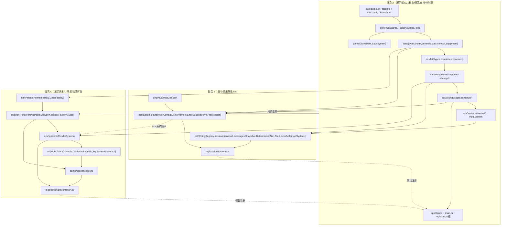
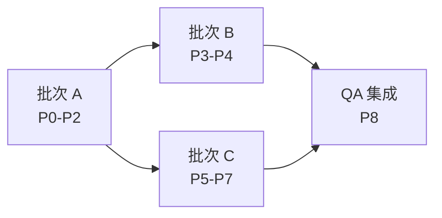
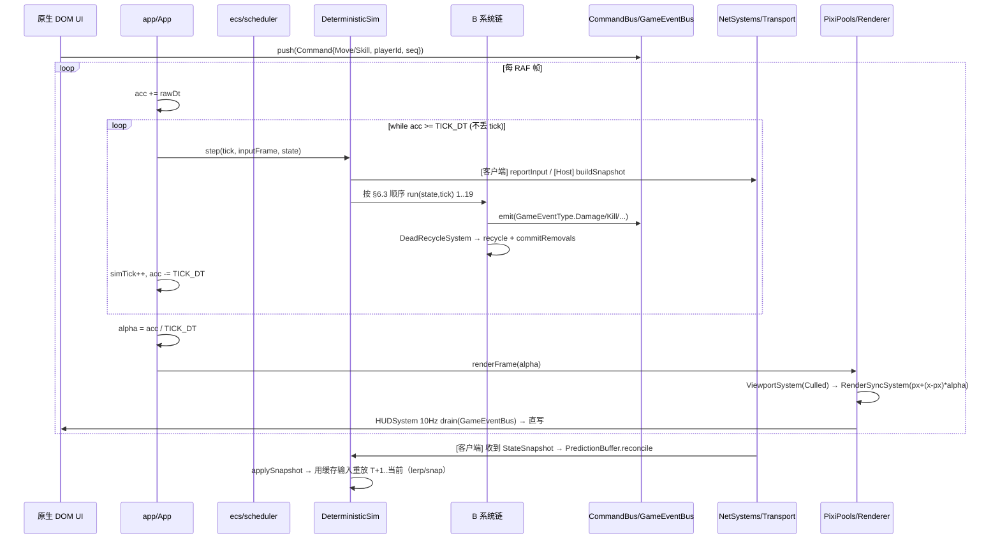

# 《无双》系统架构与接口契约（ARCHITECTURE）

> 本文是架构师对 `DESIGN.md`（设计事实来源）与 `docs/PRD.md`（需求优先级）的工程化落地定义。
> **接口契约为冻结版本**：工程师按此实现，不得自行改动签名；如需变更，必须先通知架构师并经 team-lead 回写本文。
> 注意区分：`PRD.md` 的 P0/P1/P2 是**需求优先级**；`DESIGN.md` §12 的 P0→P8 是**实施阶段**。本文按 team-lead 决策，将实施阶段归入三个工程批次 A/B/C，全部实现（含 P2「留接口」项仅定义接口边界）。
>
> 技术栈（team-lead 拍板）：**Vite 8.3.8 + TypeScript 5.9.3 + PixiJS 8.23.0 + bitECS 0.4.0（锁定版本）+ 原生 DOM UI**，不引入 React/MUI/Tailwind；音效 WebAudio 程序化生成，无外部素材；仓库本地提交、无远端。

---

## 1. 实现方案与关键取舍

### 1.1 四个核心难点

| 难点 | 方案 | 落地位置 |
| --- | --- | --- |
| **确定性**（同 seed + 同输入 → 逐 tick 一致） | 固定 60Hz tick + accumulator；禁用 `Math.random`，统一 `Rng`（按 `(seed, playerId, tick, salt)` 派生）；稳定排序；eid 不上线；关键三角函数用查表/多项式近似；逻辑层不读 `Date.now`/`performance.now` | `core/Rng.ts`、`ecs/scheduler.ts`、`net/DeterministicSim.ts` |
| **性能与游戏性解耦**（硬性） | 逻辑参数全配置化且只由 tick 驱动；CAP 固定（编译期常量 + 启动断言）；渲染裁剪只打 `Culled` 标签不参与逻辑；画质档位只改渲染层 | `core/Constants.ts`、`ecs/bit/adapter.ts`、`ecs/systems/RenderSystems.ts` |
| **bitECS 0.4.x API 兼容** | 全部 bitECS 调用集中在 `src/ecs/bit/adapter.ts`；组件用普通 SoA typed-array 对象工厂定义；把设计稿中的 0.3.x 概念映射为 0.4.0 真实 API（见 §1.2） | `ecs/bit/*` |
| **并行批次零冲突 + 每批可构建** | 批次之间文件集合互斥；A 提供应用外壳与注册槽，B/C 通过 `src/registration/*.ts` 侧载注册（`import.meta.glob`，无匹配文件时返回空对象，故 A 单独也能 build） | `src/main.ts`、`src/app/App.ts`、`src/registration/` |

### 1.2 bitECS 0.4.0 真实 API 核实结果（**已用 npm 包 `bitecs@0.4.0` 反编译 + 运行时探针验证**）

> ⚠️ **DESIGN.md §2.5 写的是 0.3.x 心智模型，与 0.4.0 实际 API 不符。以本节为准，adapter 是唯一调用点。**

| DESIGN.md / 0.3.x 写法 | 0.4.0 真实 API | 本架构对策 |
| --- | --- | --- |
| `defineComponent({x: Types.f32})` | **core 中不存在** `defineComponent`/`Types`。组件就是普通对象；SoA 需自己分配 `new Float32Array(CAP)`。旧 API 仅在 `bitecs/legacy` | `bit/components.ts` 的 `defineSoA(schema, CAP)` 工厂生成 `{x: new Float32Array(CAP), ...}`；`bit/types.ts` 定义字段类型常量 |
| `createWorld({components})` | `createWorld(...args: Array<EntityIndex \| object>)`；第一个参数为 `EntityIndex` 时共享 eid 空间，`object` 作为自定义 context。**必须在建世界后显式 `registerComponents(world, comps)`** | `adapter.createBitWorld()` 内 `createWorld(createEntityIndex(), {label})` + 收集组件并 `registerComponents` |
| `addComponent(world, Comp, eid)`（0.3.x 顺序） | `addComponent(world, eid, Comp)`（**参数顺序已改**） | adapter 统一封装 `add()`，业务代码永不直连 bitECS |
| `query(world, [Comps])` | `query(world, terms, asBuffer)` 返回 `Uint32Array`；`noCommit` 避免迭代中提交删除；`observe(world, onAdd(Comp), cb)` 替代 enter/exit query | adapter 的 `query()` 恒传 `asBuffer` |
| `createRelation()` | `createRelation<T>(...modifiers)` / `createRelation<T>({store, exclusive, autoRemoveSubject, onTargetRemoved})`；用法 `ChildOf(targetEid)` 生成 pair component，读取用 `getRelationTargets(world, eid, ChildOf)` | `defineRelation()` 工厂封装；`EffectOwner/ModifierOwner/ChildOf` 由它生成 |
| `enableManualEntityRecycling` + `flushRemovedEntities` | **0.4.0 均无此 API**（0.3.x 概念）。`removeEntity(world, eid)` 立即把 eid 归还 `EntityIndex`（versioning 关闭时下一次 `addEntity` 复用同一 eid）；`commitRemovals(world)` 只提交 query 的延迟移除 | adapter 提供 `recycle(world,eid)` = `removeEntity` + `commitRemovals`；`EntityPool` 维护空闲 eid 栈，Spawn 从池中 `acquire` |
| eid versioning 需禁用 | `createEntityIndex()` 默认 `versioning:false`（已验证）；`withVersioning(bits)` 才开启 | `createBitWorld()` 使用默认 `createEntityIndex()`，并启动断言 `index.versioning === false` |
| CAP 守卫 / warm-up 断言 | 0.4.0 不管理组件存储容量，需自己保证 | `defineSoA` 分配定长 typed array；`spawn()` 断言 `eid < CAP`；启动 warm-up 断言所有组件数组长度 == CAP |

**锁定策略**：`package.json` 固定 `"bitecs": "0.4.0"`（不用 `^`）；`src/ecs/bit/adapter.ts` 顶部注释记录本节结论；禁止业务层 `import 'bitecs'`（CI grep 校验）。

### 1.3 其他取舍

- **单 World + 标签分区**：`battleWorld` 承载逻辑/效果/属性实体；`PlayerTag`/`EnemyTag`/`EffectTag`/`Replicated`/`Culled` 空对象标签，query 零成本。
- **DOM UI 不进 ECS**：高频 HUD 直写 DOM（10Hz 节流读 `GameEventBus`）；菜单/场景用 DOM 覆盖层；只有战斗实体进 ECS。
- **零分配桥接**：`CommandBus`（`Int32Array` 环形，DOM→ECS）；`GameEventBus`（`Int32Array` 类型环 + `Float32Array` 数据环，ECS→DOM）；两者 `drain(out)` 写入调用方预分配数组。
- **多玩家统一**：三类玩家组件完全一致，差异只在 `IControlSource.poll()`；敌人多目标用 `EntityRegistry` 把 `targetNetId` 解析为 eid，避免 eid 漂移。
- **联机范围**：`NullTransport`/`LoopbackTransport` 可驱动完整 Host↔Client 闭环；WebRTC/WS 仅 `ITransport` 接口边界，不实现；严格确定性只在 Host 成立。

---

## 2. 完整文件清单（相对 `C:/Project/WS/`）

> 共 **80 个文件**（含 4 个测试、配置与入口）。批次之间写文件集合互斥；A 创建的 `core/data/bit/components/pools/bridge/world/scheduler/control/save` 等文件在 B/C 中**只读**。
> 设计稿 §11 的小模块合并说明见 §2.4。

### 2.1 批次 A — 脚手架 / ECS 核心 / 配置 / 存档 / 控制源（对应 P0–P2，45 个文件）

| # | 路径 | 职责 |
| --- | --- | --- |
| 1 | `package.json` | 固定版本依赖、scripts（dev/build/test/preview/typecheck） |
| 2 | `tsconfig.json` | strict、`moduleResolution: bundler`、types `vite/client`、路径别名 `@/*`→`src/*` |
| 3 | `vite.config.ts` | Vite + Vitest 配置（environment node/jsdom 分目录、`?debug=1` define） |
| 4 | `index.html` | 挂载点 `#app`、viewport `user-scalable=no`、`touch-action:none` |
| 5 | `.gitignore` | node_modules / dist / .tmp_* |
| 6 | `src/vite-env.d.ts` | `/// <reference types="vite/client" />`，`ImportMeta.glob` 类型 |
| 7 | `src/main.ts` | 入口：`bootstrapCore()` → `import.meta.glob('./registration/*.ts',{eager:true})` 执行 `register(app)` → `app.start()` |
| 8 | `src/style.css` | 全局重置、HUD 布局、命中区 ≥44px、安全区、`touch-action:none` |
| 9 | `src/app/App.ts` | 应用外壳：固定 tick 循环、accumulator、注册槽（`registerSimSystem` / `registerRenderSystem` / `setRenderer` / `registerScene`）、`start()` |
| 10 | `src/core/Constants.ts` | `TICK_RATE/TICK_DT/CAP/MAX_PLAYERS/POOL_SIZE/...` 常量 + `assert()/WushuangError` |
| 11 | `src/core/Registry.ts` | `Registry<T>`（get/all/validate/seal） |
| 12 | `src/core/Config.ts` | 汇总所有 content pack → `GameConfig`，`validateAll()` |
| 13 | `src/core/Rng.ts` | 确定性 `Rng`（sfc32/mulberry32）+ `derive(seed,playerId,tick,salt)` |
| 14 | `src/data/types.ts` | 所有配置类型：`GeneralDef/EnemyDef/SkillDef/WaveStage/EquipmentDef/.../EffectDef/ModifierDef/GameConfig` |
| 15 | `src/data/index.ts` | 注册全部内容为 `GameConfig`，导出 `buildGameConfig()` |
| 16 | `src/data/generals.ts` | 40 武将（阵营/配色/发型/胡须/武器/纹样/初始技能） |
| 17 | `src/data/stats.ts` | 属性定义、乘区分桶 `BUCKETS`、来源优先级链 `SOURCE_PRIORITY`、词缀池 |
| 18 | `src/data/combat.ts` | 技能、敌人、效果定义、BOSS（8）、波次表、模式、掉落表 |
| 19 | `src/data/equipment.ts` | 13 槽、稀有度、套装（4）、传奇特效（≥12）、普通宝石、传说宝石（6）、魔盒配方、材料 |
| 20 | `src/ecs/bit/types.ts` | `Eid` 别名、字段类型常量、`SoAComponent` 类型、组件名枚举 |
| 21 | `src/ecs/bit/adapter.ts` | **唯一 bitECS 调用点**：`createBitWorld/registerAll/spawn/recycle/add/remove/has/query/defineRelation/commit` |
| 22 | `src/ecs/bit/components.ts` | `defineSoA/defineTag` 工厂 + 全部 40+ 组件定义导出 |
| 23 | `src/ecs/components/core.ts` | Transform + Combat + Projectile/Pickup/Lifetime/Dead 组件再导出与常量 |
| 24 | `src/ecs/components/ai.ts` | `AIState/Behavior/Threat` 再导出与策略常量 |
| 25 | `src/ecs/components/effect.ts` | 效果组件 + `EffectOwner/EffectTarget/ChildOf` 关系 + `EffectContext` + `effectMask` |
| 26 | `src/ecs/components/stat.ts` | `Modifier/ModifierOwner/DirtyStat/StatBlock/StatSnapshotRef` 再导出 |
| 27 | `src/ecs/components/net.ts` | `PlayerId/NetId/Owner/SpawnTick/PlayerTag/Replicated/Predicted/NetControlled/NetSession` |
| 28 | `src/ecs/components/view.ts` | `RenderRef/Culled/InputCmd/ControlMode/ControlSource` 再导出 |
| 29 | `src/ecs/pools/EntityPool.ts` | `EntityPool`（空闲 eid 栈）+ `EffectEntityPool`（预留段） |
| 30 | `src/ecs/pools/ParamPool.ts` | `ParamPool`（`Float32Array`，`paramRef` 偏移） |
| 31 | `src/ecs/pools/SnapshotPool.ts` | `SnapshotPool`（最终值 + 每条贡献 + 来源分组 + 乘区 breakdown + version） |
| 32 | `src/ecs/bridge/enums.ts` | `CommandType` / `GameEventType` / 掩码常量（编号冻结见 §6.2） |
| 33 | `src/ecs/bridge/CommandBus.ts` | `Int32Array` 环形命令队列，带 `playerId` |
| 34 | `src/ecs/bridge/GameEventBus.ts` | 双环事件总线（类型环 + 数据环） |
| 35 | `src/ecs/world.ts` | `createBattleWorld()`：建世界、注册组件、warm-up 断言、eid<CAP 守卫 |
| 36 | `src/ecs/stages/statResolveStages.ts` | 8 阶段纯函数（stage0..stage7）+ scratch 类型 |
| 37 | `src/ecs/scheduler.ts` | `simulateTick()` / `renderFrame()` / `registerSimSystem()`，tick 顺序表见 §6.3 |
| 38 | `src/ecs/systems/control/IControlSource.ts` | `IControlSource` / `InputFrame` / `ControlSourceRegistry` / `LocalPlayerSpawner`（1+2–3 影子） |
| 39 | `src/ecs/systems/control/LocalHumanSource.ts` | drain `CommandBus` → `InputCmd` |
| 40 | `src/ecs/systems/control/AIShadowPlayerSystem.ts` | 确定性影子 AI（Rng key `(seed,playerId,tick)`），产出同形状 `InputCmd` |
| 41 | `src/ecs/systems/control/RemoteInputSource.ts` | 从 `NetInputBuffer` 读取远端输入 |
| 42 | `src/ecs/systems/InputSystem.ts` | 分发器：query `[PlayerId, ControlSource]` 按 kind 调 source |
| 43 | `src/game/SaveData.ts` | `SaveData` 完整类型 + 默认存档工厂 |
| 44 | `src/game/SaveSystem.ts` | localStorage 读写、节流、try/catch、`QuotaExceededError`、只存本地玩家 |
| 45 | `src/core/__tests__/adapter.test.ts` | 组件工厂/CAP 守卫/Rng 确定性 harness/注册完整性 |

### 2.2 批次 B — 战斗系统 / 效果属性 / net（对应 P3–P4，18 个文件）

| # | 路径 | 职责 |
| --- | --- | --- |
| 46 | `src/ecs/systems/LifecycleSystems.ts` | `TimeSystem`（accumulator/simTick/alpha，不丢 tick）、`LifetimeSystem`、`SpawnSystem`（波次/Host 分配 NetId）、`DeadRecycleSystem` |
| 47 | `src/ecs/systems/CombatSystems.ts` | `BulletSystem`、`CollisionSystem`（扫掠 `[px,py]→[x,y]`）、`DamageSystem`、`Invulnerable` 处理 |
| 48 | `src/ecs/systems/AISystem.ts` | 敌人多目标（最近/最弱/最高威胁）、`retargetTimer`、按 `targetNetId` 解析、Boss 加权 |
| 49 | `src/ecs/systems/MovementSystem.ts` | InputCmd/AI → Velocity → Position += v·tickDt，积分前存 px/py，`snapInterpolation` |
| 50 | `src/ecs/systems/EffectSystems.ts` | `EffectCompileSystem`（开局/换装/升级）、`EffectTriggerSystem`（掩码短路）、`ActionDispatchSystem`（O(1) 下标分派）、`EffectRegistry` |
| 51 | `src/ecs/systems/StatResolveSystem.ts` | 8 阶段调度器（脏宿主驱动）、scratch 复用、`SnapshotPool` 写入、清 DirtyStat |
| 52 | `src/ecs/systems/ProgressionSystems.ts` | `DropSystem`/`PickupSystem`/`ExpSystem`/`LevelUpSystem`（经验曲线 `expToNext`） |
| 53 | `src/engine/SweptCollision.ts` | 纯函数线段扫掠碰撞（圆-圆 / 圆-矩形），供 B 的碰撞系统与 C 的视口共用 |
| 54 | `src/net/EntityRegistry.ts` | `netId↔eid↔playerId` 映射 + Host 空闲 NetId 栈 |
| 55 | `src/net/session.ts` | `AuthorityRole` FSM（Standalone/Host/Client/Electing）、确定性 Host 选举、掉线降级影子 |
| 56 | `src/net/transport.ts` | `ITransport` / `NullTransport` / `LoopbackTransport`（注入延迟/抖动/丢包，种子 Rng） |
| 57 | `src/net/messages.ts` | `NetMsgType`、`NetInputBuffer`、消息结构、`Control` 消息 |
| 58 | `src/net/Snapshot.ts` | Full 快照 build/apply（ArrayBuffer：header + componentMask + 按 NetId 排序的 SoA 列块） |
| 59 | `src/net/DeterministicSim.ts` | `DeterministicSim.step(tick, inputFrame, state)` 纯入口 + 状态哈希（determinism harness 共用） |
| 60 | `src/net/PredictionBuffer.ts` | `InputHistory`/`SnapshotHistory` 环形缓冲 + 和解（小误差 lerp、大误差 snap） |
| 61 | `src/net/NetSystems.ts` | `InputReport`（客户端前置）、`BroadcastSnapshot`（Host）、快照应用/和解调度、`ISyncStrategy` 实现 |
| 62 | `src/registration/systems.ts` | `export function register(app)`：按 §6.3 顺序 `app.registerSimSystem(...)` 注册全部 B 系统 |
| 63 | `src/ecs/__tests__/determinism.test.ts` | 同 seed 不同帧抖动/画质 tick N 完全一致的 harness + NetId 往返回收 + 属性金标准 |
| 64 | `src/net/__tests__/loopback.test.ts` | Host↔Client 消息闭环、chaos（丢包/乱序/重复）、和解收敛 |

### 2.3 批次 C — 渲染美术 / UI 场景 / 玩法扩展（对应 P5–P7，17 个文件）

| # | 路径 | 职责 |
| --- | --- | --- |
| 65 | `src/engine/Renderer.ts` | Pixi v8 `Application`（`await app.init({preference:['webgpu','webgl']})`、`app.canvas`）、quality 只控渲染、无 GPU 降级 |
| 66 | `src/engine/PixiPools.ts` | `slot↔eid` 双向映射；敌人 Sprite 池按纹理分组、弹幕 `ParticleContainer`+`Particle` 池、掉落/特效 Sprite 池；低配普通 Sprite 池 |
| 67 | `src/engine/Viewport.ts` | 相机跟随、世界↔屏幕变换、视口矩形 |
| 68 | `src/engine/TextureFactory.ts` | `Graphics` v8 绘制 → `renderer.generateTexture({target,...})` 缓存纹理 |
| 69 | `src/engine/Audio.ts` | WebAudio 程序化音效（攻击/受击/升级/拾取/BOSS 预警），无外部素材 |
| 70 | `src/art/Palette.ts` | 40 将配色/阵营色/发型/胡须/武器/纹样参数表 |
| 71 | `src/art/PortraitFactory.ts` | 选将卡片矢量 Q 版头像（程序化生成，缓存） |
| 72 | `src/art/ChibiFactory.ts` | 战场小人纹理（复用 Palette 参数，缓存） |
| 73 | `src/ecs/systems/RenderSystems.ts` | `ViewportSystem`（打 `Culled`）、`RenderSyncSystem`（alpha 插值、dirty/位移同步、跳过 Culled）、`HUDSystem`（10Hz 读事件总线） |
| 74 | `src/ui/HUD.ts` | 血条/经验/计时/杀敌/BOSS 预警 DOM HUD |
| 75 | `src/ui/TouchControls.ts` | 虚拟摇杆 + 技能按钮，各自 `setPointerCapture`，拖动 >12px 瞄准 |
| 76 | `src/ui/CardsAndLevelUp.ts` | `LevelUpModal` + `SelectCards`（升级三选一，auto/manual 切换） |
| 77 | `src/ui/EquipmentUI.ts` | `InventoryUI` + `LoadoutUI` + `StatDetailUI`（13 槽网格、分类折叠、纸娃娃、来源明细、装备比较试算） |
| 78 | `src/ui/MetaUI.ts` | `KanaiCubeUI`（三功能）+ `LeaderboardUI`（Top10）+ 传说宝石面板 |
| 79 | `src/game/scenes/index.ts` | `BootScene`/`MenuScene`/`SelectScene`/`ResultScene`/`SettingsScene` + `SceneManager`（合并设计稿 5 个 scene 文件为 1 个场景模块） |
| 80 | `src/registration/presentation.ts` | `export function register(app)`：注册 Renderer、render 系统、UI 与场景、`?debug=1` 调试面板 |

> 附：QA 批次（team-lead 任务 #6）可新增 Playwright `tests/e2e/*.spec.ts` 与更多单测，不计入上述 80。

### 2.4 设计稿 §11 合并映射说明

| 设计稿文件 | 本文位置 | 原因 |
| --- | --- | --- |
| `components/{transform,combat,projectile,pickup,lifetime,render,input,effect,stat,net}.ts` | `bit/components.ts` 定义 + `components/{core,ai,effect,stat,net,view}.ts` 分区再导出 | 组件本体在 bit 工厂集中定义，避免 11 个薄文件；按系统关注点分 6 个逻辑模块 |
| `stages/`（8 阶段） | `ecs/stages/statResolveStages.ts` 单文件多纯函数 | 每个阶段只暴露一个纯函数，单文件便于金标准测试 |
| `systems/{Time,Lifetime,Spawn,DeadRecycle,...}.ts` | 按生命周期/战斗/AI/移动/效果/成长合并为 6 个 systems 文件 | 减少文件数；系统函数仍独立导出，调度顺序由 §6.3 冻结 |
| `ui/{hud,LevelUpModal,SelectCards,InventoryUI,LoadoutUI,KanaiCubeUI,LeaderboardUI,StatDetailUI}.ts` | `ui/{HUD,CardsAndLevelUp,EquipmentUI,MetaUI}.ts` | 同屏/同交互域合并；导出类名不变 |
| `game/scenes/{Boot,Menu,Select,Result,Settings}Scene.ts` | `game/scenes/index.ts` | 五个场景均为薄壳，合并为一个场景模块 + `SceneManager` |
| `pools/EffectEntityPool.ts` | `pools/EntityPool.ts` 内导出 `EffectEntityPool` | 与 `EntityPool` 共享空闲栈实现 |

**未丢失的设计稿 §11 关键模块**：`net/` 全部 8 个模块、`engine/` 全部 5 个、`art/` 全部 3 个、`core/` 全部 3 个、`pools/` 4 个、`bridge/` 3 个、`systems/control/` 4 个均保留（合并仅影响薄封装文件）。

---

## 3. 依赖图（Mermaid）



**关键依赖约束**：
- B/C **不得修改** A 的任何文件；只能 `import` A 的导出。
- B 与 C 之间唯一交点是 `engine/SweptCollision.ts`（B 创建，C 只读）与 `scene` 对战斗状态的只读访问。
- `src/registration/*.ts` 是 B/C 唯一写入 A 外壳的通道：`export function register(app: App): void`。

---

## 4. 三批工程实现任务列表

> 每批**结束必须 `npm run build` + `npm run typecheck` 通过**。批次 A 单独可构建（`import.meta.glob` 无匹配→空对象，应用以无渲染 headless 模式启动，满足 P0 harness 验收）。

### 批次 A（依赖：无；对应 P0–P2）

**精确文件**：见 §2.1 的 1–45 号。

**依赖**：`A0 → A1 → A2 → A3 → A4 → A5 → A6`；`A7` 仅依赖 `A1`；`A8` 依赖 `A5`。

**验收点**：
- `npm run build` / `npm run dev` 正常；`npm run test` 中组件工厂 + CAP 守卫通过。
- 确定性 harness：同 seed 跑 N tick 哈希一致（`Rng` + 空 world 骨架）。
- `Registry.validate()` 通过：40 将、13 槽、4 套、≥12 传奇特效、6 传说宝石、8 BOSS 全部注册。
- 1 真人 + 2–3 影子共享玩家组件/系统；控制源切换测试通过。
- `SaveData` 结构序列化 <80KB；只存 `localPlayerId` 数据。

### 批次 B（依赖：批次 A；对应 P3–P4）

**精确文件**：见 §2.2 的 46–64 号。

**依赖**：A 全部只读；`B2 → B1`；`B1,B3 → B4`。

**验收点**：
- 确定性 tick 测试：同 seed、不同帧抖动（30/60/144fps 帧序列）、不同 quality 下 tick N 的敌人数/状态/掉落完全一致。
- 属性金标准：ADD/MUL/MAX/OVERRIDE/MUTEX/CONDITIONAL 全通过；热路径零新增分配。
- 效果编译后运行期零 `addEntity`、零闭包、零字符串查找。
- Loopback host↔client 消息闭环；快照精确等于 `Replicated` 集合（不多不少）。
- `npm run build` 通过（B 系统通过 `registration/systems.ts` 注入，无渲染亦可构建）。

### 批次 C（依赖：批次 A；可与 B 并行但需在 QA 前完成；对应 P5–P7）

**精确文件**：见 §2.3 的 65–80 号。

**依赖**：A 全部只读；B 的 `SweptCollision` 只读；C 内部 `C2→C1→C3→C4→C5→C6`。

**验收点**：
- 300 敌 / 500 弹幕渲染 ≥50FPS；移动端 ≥45FPS；低配模式仅渲染降级，逻辑逐 tick 一致。
- Pixi v8 `await app.init()` + `app.canvas` 正确；`ParticleContainer`/`Particle` 池化；无 GPU 时 Sprite 池降级。
- 13 槽配装 → 属性详情面板与 `SnapshotPool` 一致；魔盒三功能 + 传说宝石保底单测通过。
- 双模式 + 8 BOSS + Top10 持久化；`?debug=1` 面板可用。
- `npm run build` 通过；合并 B 注册后全流程可跑。

### 批次依赖图（任务级）



---

## 5. 接口契约冻结（**精确签名，工程师照此实现**）

> 约定：所有类型从 `src/core/Constants.ts` / 对应模块具名导出；`Eid = number`。任何实现不得在这些签名上增加必填参数或改返回类型。

### 5.1 常量与错误

```ts
// src/core/Constants.ts
export const TICK_RATE = 60;
export const TICK_DT = 1 / 60;                    // 游戏规则常量，与设备/画质无关
export const MAX_PLAYERS = 4;                     // 席位 0..3
export const CAP = 4096;                          // 实体容量：300敌+500弹幕+特效/掉落+余量，所有设备统一
export const MAX_PROJECTILES = 512;
export const MAX_ENEMIES = 320;
export const EFFECT_ENTITY_BASE = 2048;           // EffectEntityPool 预留段起点
export const COMMAND_QUEUE_SIZE = 4096;
export const EVENT_QUEUE_SIZE = 8192;
export const PARAM_POOL_SIZE = 65536;             // Float32Array 长度
export const SNAPSHOT_POOL_SIZE = 256;
export const MAX_CONTRIB_PER_STAT = 64;           // SnapshotPool 每条属性贡献槽
export const INPUT_HISTORY_SIZE = 256;
export const SNAPSHOT_HISTORY_SIZE = 128;
export const SAVE_KEY = 'wushuang.profile.v1';
export const SAVE_MAX_BYTES = 80 * 1024;
export const SAVE_THROTTLE_MS = 2000;
export const HUD_THROTTLE_MS = 100;
export const SNAP_LERP_THRESHOLD = 1.5;           // px，小于此误差 lerp
export const SNAP_TELEPORT_THRESHOLD = 20;        // px，大于此误差 snap
export const INVALID_NET_ID = 0;
export const INVALID_EID = 0;
export const EXP_CURVE = (L: number): number => Math.round(10 + 8 * L + 0.8 * L * L);

export class WushuangError extends Error {
  constructor(public readonly code: number, message: string);
}
export function assert(cond: unknown, code: number, message: string): asserts cond; // 失败抛 WushuangError；CAP/eid/枚举非法必须断言
```

### 5.2 `Registry<T>`

```ts
// src/core/Registry.ts
export interface RegistryItem { readonly id: string }
export class Registry<T extends RegistryItem> {
  constructor(readonly namespace: string);
  register(item: T): this;                       // id 重复抛 WushuangError(1001)
  get(id: string): T;                            // 不存在抛 WushuangError(1002)
  tryGet(id: string): T | undefined;
  all(): readonly T[];                           // 返回只读数组，顺序 = 注册顺序（稳定）
  ids(): readonly string[];
  has(id: string): boolean;
  validate(): string[];                          // 返回问题列表，空数组表示通过
  seal(): this;                                  // 封存后 register 抛错
  readonly sealed: boolean;
}
```

### 5.3 `Rng`

```ts
// src/core/Rng.ts
export class Rng {
  constructor(seed: number);                     // seed 必须 >0，否则用 0x9e3779b9
  next(): number;                                // [0,1)
  int(maxExclusive: number): number;             // [0,maxExclusive)
  range(min: number, max: number): number;       // [min,max)
  pick<T>(items: readonly T[]): T;
  fork(salt: number): Rng;                       // 派生独立子流，不改父状态
  getState(): number;                            // 32-bit 状态
  setState(s: number): void;
  static derive(seed: number, playerId: number, tick: number, salt = 0): Rng;
}
export function hash32(...values: number[]): number; // 确定性混合（用于 seed 派生与状态哈希）
```

### 5.4 `CommandBus` / `GameEventBus`

```ts
// src/ecs/bridge/enums.ts
export enum CommandType { Move=1, Aim=2, Skill=3, AutoToggle=4, Pause=5, Ping=6 }
export enum GameEventType {
  Damage=1, Kill=2, Pickup=3, LevelUp=4, BossWarn=5, BossPhase=6,
  Equip=7, GemSocket=8, CubeResult=9, Death=10, Victory=11, Defeat=12, NetEvent=13
}
// 编号冻结：新增只在末尾追加，永不重排（存档/快照兼容）

// src/ecs/bridge/CommandBus.ts
export interface Command { type: CommandType; playerId: number; a: number; b: number; c: number; seq: number }
export class CommandBus {
  constructor(capacity?: number);                // 默认 COMMAND_QUEUE_SIZE
  push(cmd: Command): boolean;                   // 满返回 false，不阻塞
  drain(out: Command[]): number;                 // 写入调用方预分配数组，返回数量并清空
  get size(): number;
  clear(): void;
}

// src/ecs/bridge/GameEventBus.ts
export interface GameEvent { type: GameEventType; a: number; b: number; c: number }
export class GameEventBus {
  constructor(capacity?: number);                // 默认 EVENT_QUEUE_SIZE
  emit(type: GameEventType, a?: number, b?: number, c?: number): void; // 无分配
  drain(out: GameEvent[]): number;
  clear(): void;
}
```

### 5.5 bit adapter 与组件工厂（**B/C 唯一允许的 bitECS 入口**）

```ts
// src/ecs/bit/types.ts
export type Eid = number;
export type FieldKind = 'f32' | 'i32' | 'u32' | 'u8';
export type FieldArray = Float32Array | Int32Array | Uint32Array | Uint8Array;
export interface SoAComponent { readonly [field: string]: FieldArray }

// src/ecs/bit/adapter.ts  （import * as bit from 'bitecs' 仅此文件）
import type { World, EntityId, QueryTerm, Relation } from 'bitecs';

export interface BattleWorld extends World<{ label: string }> {
  readonly index: ReturnType<typeof bit.createEntityIndex>;
  readonly components: SoAComponent[];
}
export function createBitWorld(label: string): BattleWorld; // createWorld(createEntityIndex(),{label})+断言 versioning=false
export function registerAll(world: BattleWorld, components: SoAComponent[]): void; // bit.registerComponents
export function spawn(world: BattleWorld): Eid;             // bit.addEntity；断言 eid<CAP 且 index.versioning===false
export function recycle(world: BattleWorld, eid: Eid): void;// bit.removeEntity + bit.commitRemovals
export function add(world: BattleWorld, eid: Eid, comp: SoAComponent | Relation<unknown>): void;      // bit.addComponent(world,eid,comp)
export function remove(world: BattleWorld, eid: Eid, comp: SoAComponent): void;                        // bit.removeComponent
export function has(world: BattleWorld, eid: Eid, comp: SoAComponent): boolean;                        // bit.hasComponent
export function query(world: BattleWorld, terms: QueryTerm[]): Readonly<Uint32Array>;                  // bit.query(world,terms,bit.asBuffer)
export function queryNoCommit(world: BattleWorld, terms: QueryTerm[]): Readonly<Uint32Array>;          // + bit.noCommit
export function commit(world: BattleWorld): void;                                                      // bit.commitRemovals
export function exists(world: BattleWorld, eid: Eid): boolean;                                         // bit.entityExists
export function defineRelation<T>(opts?: { store?: () => T; exclusive?: boolean; autoRemoveSubject?: boolean }): Relation<T>;
export function targets(world: BattleWorld, eid: Eid, rel: Relation<unknown>): number[];               // bit.getRelationTargets

// src/ecs/bit/components.ts
export function defineSoA<S extends Record<string, FieldKind>>(schema: S, capacity?: number): { [K in keyof S]: FieldArray };
// 例：export const Position = defineSoA({ x:'f32', y:'f32', px:'f32', py:'f32' });
// 标签组件：export const PlayerTag = {} as const;  （空对象）
```

**组件字段（全部由 `defineSoA` 生成，字段名/类型冻结）**：

```
Position{x,y,px,py:f32}  Velocity{x,y:f32}  Heading{angle:f32}  Collider{r,type,w,h,layer:f32}
Speed{value:f32}  Health{cur,max,regen:f32}  Faction{value:u8}  Attack{damage,rate,cd,range:f32}
Damage{amount:f32, flags:u32}  Invulnerable{remaining:f32}  ExpValue{value:f32}
AIState{state,timer,target,policy,retargetTimer,targetNetId:f32/u32}  Behavior{type,p0,p1,p2:f32}  Threat{value:f32}
Projectile{dx,dy,speed,pierce,f32; hitMask:u32}  Pickup{kind,amount,cfgId:f32}  Magnet{radius:f32}
Lifetime{remaining:f32}  Dead{}  RenderRef{slot,kind,z,anim,animT,flipX,tint,scale,alpha,dirty:f32}
InputCmd{moveX,moveY,aimX,aimY,buttons,tick,seq:f32}  ControlMode{value:u8}  ControlSource{kind,ref:u8/u32}
EffectTag{}  TriggerReg{trigger,condMask,paramRef,effectCfgId:u32}  ActiveEffect{defId,state:f32; elapsed,cd:f32}
Condition{type,cmp,threshold,arg:u32/f32}  Action{op,paramRef,paramCount:u32}
EffectOwner/EffectTarget/ChildOf: Relation   EffectContext{source,target,hitValue,flags:u32/f32}  effectMask:u32
Modifier{stat:u8; op,bucket,priority,sourceKind,sourceId,group,condMask,duration,flags,value:u32/f32}
ModifierOwner: Relation  DirtyStat{mask:u32}  StatBlock（按 stats 配置动态生成字段:f32）  StatSnapshotRef{poolIndex:u32; version:u32}
PlayerId{value:u16→u32}  NetId{value:u32}  Owner{netId:u32; playerId:u16→u32}  SpawnTick{value:u32}
PlayerTag{}  Replicated{}  Predicted{}  NetControlled{}
NetSession{role:u8; localNetId,hostNetId,localPlayerId,roomSeed,simTick,lastAckedTick,playerCount:u32; tickRate:60}
```

### 5.6 对象池

```ts
// src/ecs/pools/EntityPool.ts
export class EntityPool {
  constructor(world: BattleWorld, base: number, capacity: number);
  acquire(): Eid;                        // 空闲栈 pop；空则按 base..base+capacity 线性分配；断言 < CAP
  release(eid: Eid): void;               // recycle(world,eid) 后压栈；调用方负责清组件
  get available(): number;
}
export class EffectEntityPool extends EntityPool {
  constructor(world: BattleWorld);       // base = EFFECT_ENTITY_BASE, capacity = CAP - EFFECT_ENTITY_BASE
  compile(effectCfgId: number, owner: Eid): Eid; // 从池取实体、填字段、建 ChildOf/EffectOwner、置 effectMask
}

// src/ecs/pools/ParamPool.ts
export class ParamPool {
  constructor(capacity?: number);        // 默认 PARAM_POOL_SIZE
  readonly data: Float32Array;
  alloc(count: number): number;          // 返回起始偏移；不足返回 -1；线性 bump
  write(offset: number, values: ArrayLike<number>): number; // 返回结束偏移
  reset(): void;                         // offset=0（仅 EffectCompile 阶段调用）
}

// src/ecs/pools/SnapshotPool.ts
export interface StatBreakdown { final: number; buckets: Float32Array; bySource: Float32Array }
export class SnapshotPool {
  constructor(slotCount: number, statCount: number, bucketCount: number);
  readonly final: Float32Array;          // slotCount * statCount
  readonly contribution: Float32Array;   // slotCount * statCount * MAX_CONTRIB_PER_STAT * 4 [value,sourceKind,sourceId,bucket]
  readonly versions: Uint32Array;        // slotCount
  acquire(): number;                     // 返回 poolIndex
  release(index: number): void;
  write(index: number, stat: number, value: number): void;
  getVersion(index: number): number;
  bumpVersion(index: number): void;
}
```

### 5.7 控制源

```ts
// src/ecs/systems/control/IControlSource.ts
export interface InputFrame {
  moveX: number; moveY: number; aimX: number; aimY: number;
  buttons: number; tick: number; seq: number;
}
export interface IControlSource {
  readonly kind: 0 | 1 | 2;             // 0 Local / 1 AI / 2 Remote
  poll(tick: number, out: InputFrame): void; // 直接写 out，零分配；不返回对象
}
export class ControlSourceRegistry {
  bind(eid: Eid, source: IControlSource): void;
  unbind(eid: Eid): void;
  get(eid: Eid): IControlSource | undefined;
  pollAll(tick: number, world: BattleWorld, bus: GameEventBus): void; // 遍历 [PlayerId,ControlSource] 写 InputCmd
}
export function spawnLocalPlayers(world: BattleWorld, registry: ControlSourceRegistry,
  cmdBus: CommandBus, shadowCount: number, seed: number): Eid[]; // 1 真人 + shadowCount 影子(1..3)，统一组件

// LocalHumanSource.ts
export class LocalHumanSource implements IControlSource {
  constructor(cmdBus: CommandBus, playerId: number);
  readonly kind = 0;
  poll(tick: number, out: InputFrame): void;    // drain CommandBus 中 playerId 匹配的命令
}
// AIShadowPlayerSystem.ts
export class AIShadowPlayerSystem implements IControlSource {
  constructor(deps: { world: BattleWorld; config: GameConfig; seed: number; playerId: number });
  readonly kind = 1;
  poll(tick: number, out: InputFrame): void;    // 寻敌/kiting/按 cd 放技能；Rng.derive(seed,playerId,tick)
}
// RemoteInputSource.ts
export class RemoteInputSource implements IControlSource {
  constructor(buffer: NetInputBuffer, netId: number);
  readonly kind = 2;
  poll(tick: number, out: InputFrame): void;
}
```

### 5.8 网络传输与同步

```ts
// src/net/transport.ts
export enum NetMsgType { InputReport=1, StateSnapshot=2, EventBatch=3, Delta=4, Control=5 }
export interface NetMessage {
  type: NetMsgType; from: number; to: number; tick: number; payload: ArrayBuffer;
}
export interface ITransport {
  readonly peerId: number;
  connect(peerId: number): void;
  send(msg: NetMessage): void;
  onMessage(handler: (msg: NetMessage) => void): () => void; // 返回取消订阅
  close(): void;
}
export class NullTransport implements ITransport { constructor(peerId?: number); /* 丢弃所有消息 */ }
export interface LoopbackOptions { latencyMs?: number; jitterMs?: number; dropRate?: number; duplicateRate?: number; seed?: number }
export class LoopbackTransport implements ITransport {
  constructor(peerId: number, opts?: LoopbackOptions);
  link(other: LoopbackTransport): void;        // 双向连接，可多 peer 组成本地房间
  tick(nowMs: number): void;                   // 按注入的网络条件投递；chaos 用种子 Rng 保证可复现
  setConditions(opts: LoopbackOptions): void;
}

// src/net/messages.ts
export class NetInputBuffer {
  push(tick: number, netId: number, frame: InputFrame): void;
  read(tick: number, netId: number, out: InputFrame): boolean; // 找到写 out 返回 true
  clearBefore(tick: number): void;
}
export interface ControlMessage { join?: number; leave?: number; promote?: number; roomSeed?: number }

// src/net/Snapshot.ts
export interface Snapshot {
  tick: number; mask: number; netIds: Uint32Array; data: ArrayBuffer; statVersion?: number;
}
export function buildSnapshot(world: BattleWorld, registry: EntityRegistry, tick: number): Snapshot;
export function applySnapshot(snap: Snapshot, world: BattleWorld, registry: EntityRegistry): void;

// src/net/EntityRegistry.ts
export class EntityRegistry {
  constructor(world: BattleWorld, capacity?: number);
  alloc(eid: Eid, playerId: number): number;    // Host only；nextNetId++；返回 0 表示失败
  bind(eid: Eid, netId: number, playerId: number): void; // 客户端从快照重建
  byNetId(netId: number): Eid;                  // 不存在返回 INVALID_EID
  byEid(eid: Eid): number;                      // 不存在返回 INVALID_NET_ID
  playerOf(netId: number): number;              // 不存在返回 -1
  release(netId: number): void;                 // 清三向映射，netId 入空闲栈
  rebuild(snap: Snapshot): void;                // 晚加入全量快照重建
}

// src/net/session.ts
export enum AuthorityRole { Standalone=0, Host=1, Client=2, Electing=3 }
export interface NetSession {
  role: AuthorityRole; localNetId: number; hostNetId: number; localPlayerId: number;
  roomSeed: number; simTick: number; lastAckedTick: number; readonly tickRate: 60; playerCount: number;
}
export class NetSessionManager {
  constructor(world: BattleWorld, transport: ITransport, registry: EntityRegistry);
  readonly state: NetSession;
  startStandalone(roomSeed: number, playerCount: number): void;
  promoteToHost(): void;
  becomeClient(hostNetId: number): void;
  electNewHost(aliveNetIds: readonly number[]): number;     // 返回最小 netId（确定性）
  onPeerLost(netId: number): void;                          // 该玩家实体 ControlSource 降级为 AI 影子
}

// src/net/DeterministicSim.ts
export interface SimState {
  world: BattleWorld; config: GameConfig; session: NetSession;
  pool: { entities: EntityPool; params: ParamPool; snapshots: SnapshotPool };
  buses: { commands: CommandBus; events: GameEventBus };
  rng: Rng;
}
export class DeterministicSim {
  constructor(state: SimState, systems: readonly SimSystem[]);
  step(tick: number, inputFrame: InputFrame, state: SimState): void; // 纯入口：不读墙钟、不读画质
  hash(state: SimState): number;                 // FNV-1a over Replicated 列，harness 用
}
export interface SimSystem { readonly id: string; readonly order: number; run(state: SimState, tick: number): void }

// src/net/PredictionBuffer.ts
export class PredictionBuffer {
  constructor(capacity?: number);                // 默认 INPUT_HISTORY_SIZE
  recordInput(tick: number, frame: InputFrame): void;
  recordSnapshot(snap: Snapshot): void;
  lastAckedTick(): number;
  inputsAfter(tick: number): Array<{ tick: number; frame: InputFrame }>;
  reconcile(snap: Snapshot, apply: (s: Snapshot) => void,
            replay: (tick: number, f: InputFrame) => void): number; // 返回重放 tick 数；误差>SNAP_TELEPORT_THRESHOLD 则 snap
  reset(): void;
}

// src/net/NetSystems.ts
export interface ISyncStrategy {
  reportInput(tick: number, frame: InputFrame): NetMessage;
  buildSnapshot(tick: number): Snapshot;
  applySnapshot(snap: Snapshot): void;
  collectEvents(tick: number): NetMessage;
  replayEvents(msg: NetMessage): void;
  buildDelta(fromTick: number, toTick: number): NetMessage;  // P6 delta/量化 codec
  applyDelta(msg: NetMessage): void;
}
export class FullSnapshotStrategy implements ISyncStrategy { /* Full 快照实现 */ }
export function installNetSystems(app: App, strategy: ISyncStrategy): void;
```

### 5.9 存档

```ts
// src/game/SaveData.ts
export type QualityLevel = 'low' | 'medium' | 'high';
export interface EquipmentItem { uid: string; defId: string; affixes: number[]; sockets: number; gems: string[]; legendaryEffectId?: string }
export interface GemItem { uid: string; defId: string; kind: 'red'|'blue'|'yellow'|'green'; tier: number }
export interface LegendaryGemItem { uid: string; defId: string; level: number; pity: number }
export interface LeaderboardEntry { score: number; mode: string; generalId: string; at: number }
export interface RunStats { kills: number; damage: number; level: number; elapsed: number }
export interface SaveData {
  version: 1;
  meta: {
    currency: number; unlockedGenerals: string[]; selectedGeneral: string;
    upgrades: Record<string, number>; stats: Record<string, number>;
    settings: { controlMode: 'auto'|'manual'; quality: QualityLevel; sfx: boolean;
                netRolePreferred: 'auto'|'host'|'client'; playerColor: number; localPlayerName: string };
    unlockedModes: string[]; firstBossClearAt: number | null;
    materials: Record<string, number>;
    warehouse: { items: EquipmentItem[]; capacity: number };
    loadouts: Record<string, Record<string, string | null>>; // [generalId][slotId] = uid|null
    gems: { inventory: GemItem[] };
    cube: { extracted: string[]; slots: Record<string, string | null> };
    legendaryGems: { inventory: LegendaryGemItem[]; equipped: Record<string, string | null> };
    multiplayer: { localSeatPreference: number; shadowCount: number; aiShadowDifficulty: number; knownPeers: string[] };
    leaderboards: Record<string, LeaderboardEntry[]>;
  };
  run?: { mode: string; generalId: string; elapsed: number; playerId: number;
          participants: string[]; pickedEquipment: string[]; pickedGems: string[]; pity: Record<string, number> };
  perPlayerRunStats: Record<string, Record<string, RunStats>>; // [roomSeed][playerId]
}
export function createDefaultSave(): SaveData;

// src/game/SaveSystem.ts
export class SaveSystem {
  constructor(storage?: Pick<Storage,'getItem'|'setItem'|'removeItem'>); // 可注入以便测试
  load(): SaveData;                 // 版本不符/损坏 → createDefaultSave()
  save(data: SaveData): boolean;    // 节流 SAVE_THROTTLE_MS；>SAVE_MAX_BYTES 或 QuotaExceededError 返回 false 并发事件
  saveNow(data: SaveData): boolean; // 强制写入（结算/退出）
  clear(): void;
  readonly lastError: string | null;
}
```

### 5.10 渲染桥接

```ts
// src/engine/Renderer.ts
export class Renderer {
  static create(host: HTMLElement, quality: QualityLevel): Promise<Renderer>;
  // 内部：const app = new Application(); await app.init({ preference:['webgpu','webgl'],
  //        resizeTo: host, resolution: quality==='low'?1:devicePixelRatio, autoDensity:true });
  readonly canvas: HTMLCanvasElement;              // app.canvas（v8 无 app.view）
  setQuality(q: QualityLevel): void;               // 仅渲染：分辨率/特效密度/ParticleContainer↔Sprite 池
  generateTexture(target: Container, resolution?: number): Texture; // renderer.generateTexture({target,resolution})
  destroy(): void;
}
// src/engine/PixiPools.ts
export type RenderKind = 'chibi'|'bullet'|'pickup'|'effect';
export class PixiPools {
  constructor(renderer: Renderer, capacity?: number);
  readonly eidToSlot: Int32Array;                  // -1 表示未分配
  readonly slotToEid: Uint32Array;
  acquire(kind: RenderKind, textureKey: string, eid: Eid): number; // 返回 slot
  release(slot: number): void;
  getSlot(eid: Eid): number;
  setPosition(slot: number, x: number, y: number): void;
  setVisual(slot: number, anim: number, flipX: boolean, tint: number, alpha: number): void;
  snap(slot: number): void;                        // snapInterpolation：清拖动插值
}
// src/ecs/systems/RenderSystems.ts
export class RenderSyncSystem {
  constructor(pools: PixiPools, world: BattleWorld);
  run(alpha: number): void;                        // renderX=px+(x-px)*alpha；跳过 Culled；只同步 dirty/位移
}
export class ViewportSystem { constructor(world: BattleWorld, viewport: Viewport); run(): void; } // 打/清 Culled 标签
export class HUDSystem { constructor(bus: GameEventBus, hud: HUDLike); run(): void; }              // 10Hz drain
```

### 5.11 UI 场景切换

```ts
// src/game/scenes/index.ts
export type SceneId = 'boot'|'menu'|'select'|'battle'|'result'|'settings';
export interface SceneContext { app: App; save: SaveData; config: GameConfig; payload?: unknown }
export interface Scene {
  readonly id: SceneId;
  onEnter(ctx: SceneContext): void;
  onExit(): void;
  onFrame?(dt: number): void;
}
export class SceneManager {
  register(id: SceneId, factory: () => Scene): void;
  switchTo(id: SceneId, payload?: unknown): void;   // 先 onExit 当前，再 onEnter 目标
  readonly current: Scene | null;
}
// src/app/App.ts（注册槽契约）
export class App {
  registerSimSystem(order: number, fn: (state: SimState, tick: number) => void, id: string): void;
  registerRenderSystem(order: number, fn: (alpha: number) => void, id: string): void;
  setRenderer(factory: () => Promise<Renderer>): void;
  registerScene(id: SceneId, factory: () => Scene): void;
  get sceneManager(): SceneManager;
  get state(): SimState;
  start(): void;                                    // RAF: acc+=rawDt; while(acc>=TICK_DT){step;simTick++;acc-=TICK_DT}; alpha=acc/TICK_DT; renderFrame(alpha)
}
```

### 5.12 效果 / 属性配置结构

```ts
// src/data/types.ts
export type TriggerType = 'onHit'|'onKill'|'onCast'|'onDamaged'|'onMove'|'onTimer'|'onDeath'|'onPickup'|'onCritical';
export type ActionOp = 'damage'|'heal'|'buffStat'|'summon'|'spawnProjectile'|'area'|'status'|'cdReduce'|'dropItem';
export type StatOp = 'ADD'|'SUB'|'MUL'|'MAX'|'MIN'|'OVERRIDE'|'MUTEX'|'CONDITIONAL';
export type CompareOp = 'EQ'|'NE'|'GT'|'GE'|'LT'|'LE'|'HAS';
export interface ConditionDef { type: string; cmp: CompareOp; threshold: number; arg: number }
export interface ActionDef { op: ActionOp; paramRef: number; paramCount: number }
export interface EffectDef {
  id: string; trigger: TriggerType; conditions: ConditionDef[]; actions: ActionDef[];
  params: number[];                                  // 编译期写入 ParamPool
}
export interface ModifierDef {
  stat: string; op: StatOp; value: number; bucket: string; priority: number;
  sourceKind: string; group: number; condMask: number; duration: number; flags: number;
}
export interface WaveStage {
  id: string; startSec: number; endSec: number; spawnRateStart: number; spawnRateEnd: number;
  cap: number; enemies: string[]; elitesAt: number[];
}
export interface BossDef {
  id: string; phases: Array<{ hpThreshold: number;
    skills: Array<{ id: string; telegraph: number; pattern: string; counter: string }> }>;
}
export interface EquipmentDef {
  id: string; slot: string; rarity: 'common'|'blue'|'gold'|'legendary';
  affixes: string[]; setId?: string; legendaryEffectId?: string; sockets: number;
}
export interface GameConfig {
  generals: Registry<GeneralDef>; enemies: Registry<EnemyDef>; skills: Registry<SkillDef>;
  effects: Registry<EffectDef>; equipment: Registry<EquipmentDef>; bosses: Registry<BossDef>;
  gems: Registry<GemDef>; legendaryGems: Registry<LegendaryGemDef>; cube: Registry<CubeRecipeDef>;
  stats: Registry<StatDef>; waves: WaveStage[]; modes: Registry<ModeDef>; drops: Registry<DropTableDef>;
  buckets: readonly string[];                        // 乘区分桶顺序
  sourcePriority: readonly string[];                 // 基础 < 词缀 < 普通宝石 < 套装 < 传奇 < 魔盒 < 技能 < 传说宝石 < buff
}
// 8 阶段纯函数（src/ecs/stages/statResolveStages.ts）
export interface StatScratch {
  ids: Uint32Array; order: Uint32Array; condMask: Uint32Array; group: Uint32Array;
  priority: Uint32Array; op: Uint8Array; bucket: Uint8Array; value: Float32Array;
  flatSum: Float32Array; bucketSum: Float32Array; count: number;
}
export function stage0Base(scratch: StatScratch, host: Eid, cfg: GameConfig, world: BattleWorld): void;
export function stage1Collect(scratch: StatScratch, world: BattleWorld, host: Eid): void;
export function stage2Filter(scratch: StatScratch, ctx: EffectContext): void;
export function stage3Sort(scratch: StatScratch): void;       // 稳定排序 (sourceOrder → priority → id)
export function stage4Resolve(scratch: StatScratch): void;    // OVERRIDE/MUTEX/MAX/MIN 按 group+priority 选唯一
export function stage5Aggregate(scratch: StatScratch): void;   // ADD/SUB→flatSum，MUL→bucketSum[bucket]
export function stage6Apply(scratch: StatScratch, block: SoAComponent, statCount: number): void; // (base+flat)*Π(1+bucket) 再 MIN/MAX 钳制
export function stage7Snapshot(scratch: StatScratch, pool: SnapshotPool, refRef: StatSnapshotRef, stats: readonly string[]): void;
```

---

## 6. 共享约定

### 6.1 命名与代码风格

- 文件：类/组件/系统 `PascalCase.ts`，工具/配置 `camelCase.ts`；测试 `*.test.ts` 置于相邻 `__tests__/`。
- 导出：具名导出为主；禁止默认导出（除 `vite.config.ts`）。
- 组件常量大写（`Position`），系统类 `*System`，枚举成员 `PascalCase`，事件/命令枚举值见 §6.2。
- 热路径（每 tick）：**零对象字面量、零闭包、零字符串查找、零 `Array.map/filter`**；临时 `InputFrame/GameEvent/StatScratch` 预分配复用。
- 禁止 `Math.random`（CI grep）；禁止业务层 `import 'bitecs'`；禁止逻辑层读 `performance.now()/Date.now()`。
- 断言：CAP 越界、eid 非法、未知枚举、存档版本不匹配一律 `assert()` 抛 `WushuangError`；**生产构建保留 CAP/eid 断言**（静默损坏会破坏确定性）。

### 6.2 事件 / 命令 / 枚举编号（冻结）

- `CommandType`：`1 Move, 2 Aim, 3 Skill, 4 AutoToggle, 5 Pause, 6 Ping`。
- `GameEventType`：`1 Damage, 2 Kill, 3 Pickup, 4 LevelUp, 5 BossWarn, 6 BossPhase, 7 Equip, 8 GemSocket, 9 CubeResult, 10 Death, 11 Victory, 12 Defeat, 13 NetEvent`。
- `NetMsgType`：`1 InputReport, 2 StateSnapshot, 3 EventBatch, 4 Delta, 5 Control`。
- 值语义：`Faction` 0 玩家 / 1 敌 / 2 中立；`ControlSource.kind` 0 Local / 1 AI / 2 Remote；`AuthorityRole` 0 Standalone / 1 Host / 2 Client / 3 Electing。
- `NetId`：0 无效，Host 从 1 递增；`eid` 永不上线。`PlayerId` 0–3。
- `tint`/`flags`/`mask`/`condMask`/`effectMask` 为 32-bit 位掩码，新增位只追加不重排。
- 新增枚举值**只在末尾追加**，永不变动既有数字（存档/快照/协议兼容）。

### 6.3 Tick 顺序（冻结，`registration/systems.ts` 按此注册）

```
[客户端前置] SnapshotApply → Reconcile
 1  TimeSystem          accumulator, simTick, alpha（不丢弃 tick）
 2  InputSystem         控制源分发 → 各玩家 InputCmd
 3  LifetimeSystem      remaining -= TICK_DT，到期打 Dead
 4  SpawnSystem         spawnAcc += rate*TICK_DT（Host 分配 NetId）
 5  AISystem            敌人多目标 + 影子玩家 Brain
 6  MovementSystem      InputCmd/AI → Velocity → Position += v*TICK_DT（存 px/py）
 7  BulletSystem        弹幕积分
 8  CollisionSystem     扫掠碰撞（[px,py]→[x,y]）
 9  DamageSystem        消费 hit → Health
10  EffectTriggerSystem 掩码短路 → 激活 Effect
11  ActionDispatchSystem 执行 Action.op
12  StatResolveSystem   脏驱动结算
13  DropSystem / 14 PickupSystem / 15 ExpSystem / 16 LevelUpSystem
17  BossSystem          阶段阈值 + 地面预警
18  [客户端] InputReport → [Host] BroadcastSnapshot
19  DeadRecycleSystem    recycle + commitRemovals，回收 eid/NetId/slot（最后）
```
**每帧渲染**：`ViewportSystem`（打 `Culled`）→ `RenderSyncSystem`（alpha 插值写 slot，跳过 Culled）→ `HUDSystem`（10Hz 读事件总线）。
**按需**：`EffectCompileSystem`（开局/换装/升级）、`SaveSystem`（节流）、snapshot codec。

### 6.4 错误与断言策略

- 错误码分段：`1xxx` 配置/注册；`2xxx` ECS/CAP/eid；`3xxx` 存档；`4xxx` 网络；`5xxx` 渲染。
- `assert` 失败抛 `WushuangError`，开发期显示调试栈（`?debug=1`），生产期记录到 `GameEventBus.NetEvent` 并降级（如渲染失败→低配模式），**逻辑错误绝不静默吞掉**。
-存档写入 try/catch：`QuotaExceededError` → 提示拆解，`save()` 返回 false。

### 6.5 侧载注册（批次 A 提供，B/C 使用）

```ts
// src/main.ts（A 创建，B/C 不修改）
import { createApp, type App } from './app/App';
const app = createApp();
const registrars = import.meta.glob('./registration/*.ts', { eager: true }) as
  Record<string, { register(app: App): void }>;
for (const key of Object.keys(registrars)) registrars[key].register(app);
app.start();

// 每个 registration 文件导出（B/C 各自实现）
export function register(app: App): void { /* 注册系统/渲染/场景 */ }
```

---

## 7. 待明确事项（不阻塞实现，采用默认）

1. **Q1 技术栈**：已由 team-lead 拍板（无 React/MUI/Tailwind）。默认采用。
2. **Q2 仓库**：本地提交、无远端。默认采用。
3. **Q3 音效**：WebAudio 程序化生成，无外部素材。默认采用。
4. **Q4 网络接口**：已在 §5.8 冻结；Loopback 可完整驱动。默认采用。
5. **渲染 FPS 目标**：50/45 FPS 为验收指标，不是削减游戏性的依据（DESIGN §2.2）；低配只降渲染。
6. **Playwright 浏览器安装**：QA 批次执行前需确认环境已安装 Chromium/WebKit；若缺失用 `npx playwright install` 补齐，不阻塞 A/B/C 构建。
7. **快照 delta/量化 codec**：`ISyncStrategy.buildDelta/applyDelta` 已冻结接口；Full 快照在 B 实现，delta/量化在 `NetSystems.ts` 内按 P6 补全，签名不变。
8. **跨浏览器浮点 bit 级一致**：不作为目标（DESIGN §2.6）；严格确定性只在 Host 成立。

---

## 8. 程序调用流（Mermaid sequenceDiagram）



> 同内容已保存至 `docs/sequence-diagram.mermaid` 与 `docs/class-diagram.mermaid`。
