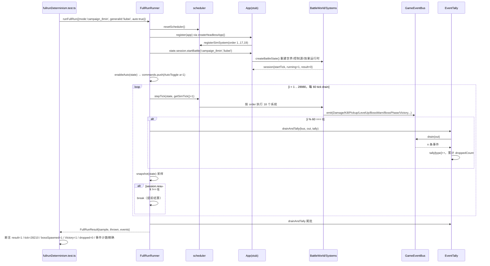
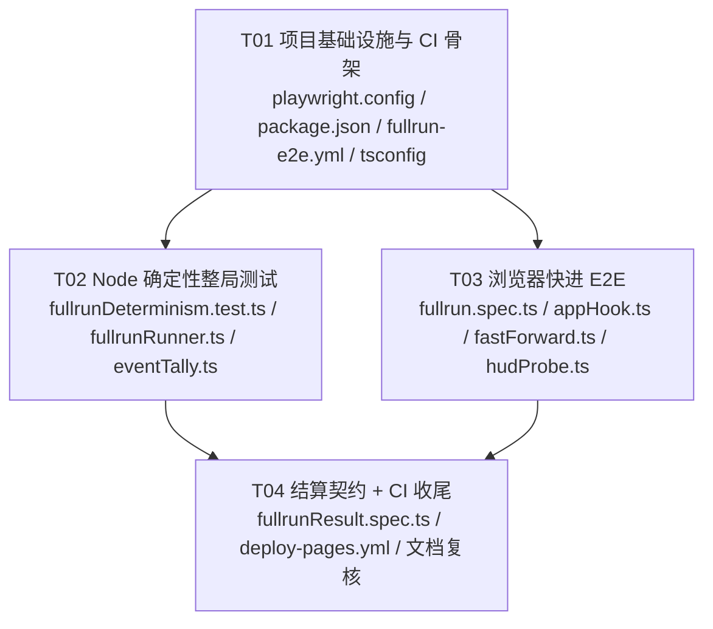

# 《无双》整局可玩性自动化测试 —— 架构设计（冻结版）

> 架构师：高见远（software-architect） · 工作区：`C:/Project/WS` · 仓库：`ljnober/wushuang-roguelike`
> 本文是工程师实现"整局可玩性测试 + CI 接入"的**唯一依据**。接口、参数、断言口径均已冻结。
> 配套图源：`docs/fullrun-class-diagram.mermaid`、`docs/fullrun-sequence-diagram.mermaid`。

---

## 0. Spike 实测事实（先于设计，覆盖/修正上游假设）

我在产品源码上**未做任何改动**，只写了两个临时 spike（已删除）并实际跑通：

### 0.1 Node 全速整局（`register(app)` + `startBattle('campaign_8min','liubei')` + auto）

| 项 | 实测值 |
|---|---|
| 完成 28800 tick 墙钟耗时 | **33.0 s**（本机 Windows / Node 22 / vitest 4.1.12） |
| 两次独立复跑 | **逐字段完全一致**：tick 28210、elapsed 470.166667 s、result **1 = Victory** |
| 终局统计 | kills 573、level 8、score 6530、bossSpawned 1、waveIndex 5 |
| 事件计数 | Damage 1370 / Kill 573 / Pickup 572 / LevelUp 9 / BossWarn 14 / BossPhase 2 / Victory 1 |
| 事件总线丢弃 | `dropped = 0`（每 60 tick drain 一次即可零丢失） |
| 异常 | 无（28800 tick 无 throw） |
| BOSS | 420 s 登场（`BossWarn a=8` 即 boss_diaochan），BossPhase 推进到 2，**470.17 s 被击杀** → Victory |

**结论：node 侧整局完全可跑通、结果确定性、BOSS 能被击杀、事件零丢失。**

### 0.2 浏览器内快进（`app.stop()` + 合成 `frameStep`）

| 里程碑 | 步数(1 s/步) | 单段墙钟 | session.elapsed | result | HUD 时间/击杀/积分 | 结算面板 |
|---|---|---|---|---|---|---|
| 60 s | 60 | 113 ms | 60.15 | 0 | 01:00 / 击杀 114 / 积分 1340 | 否 |
| 180 s | 120 | 1381 ms | 180.15 | 0 | 03:00 / 击杀 311 / 积分 3610 | 否 |
| 300 s | 120 | 4428 ms | 300.15 | 0 | 05:00 / 击杀 442 / 积分 5120 | 否 |
| 420 s | 120 | 9928 ms | 420.15 | 0 | 07:00 / 击杀 581 / 积分 6610 | 否 |
| 470 s | 50 | 2466 ms | 470.15 | 0 | 07:50 / 击杀 581 / 积分 6610 | 否 |
| 481 s | 10 | 125 ms | **480.15** | **2 = Defeat** | 08:00 / 击杀 581 / 积分 6610 | **是** |

- 整条测试（含 UI 进入战斗）总耗时 **24.1 s**，零 `pageerror` / `console.error`。
- BOSS 在 420 s 确实登场（`bossSpawned = 1`），但**浏览器轨迹下 480 s 前未被击杀**，`elapsed >= 480` 触发 Defeat（`ProgressionSystems.ts:341-343`）。
- 结算面板文本实测：`积分 6610 · 击杀 581 · 等级 8 · 时长 479s`，与 HUD 快照逐字段一致，**无二次计分**。
- HUD 在每一次 `frameStep` 后同步更新（DOM 文本与 session 一致），DOM 场景切换正常。

### 0.3 对上游"现状事实"的显式修正

1. 上游称"BOSS 被击杀且登场后发 Victory" —— **node 成立，浏览器不一定成立**。浏览器轨迹下 BOSS 登场后未被击杀，480 s 超时 Defeat。这不是 bug（Defeat 也是合法终局），但**测试不得断言必然 Victory**。
2. 上游称"一次 `frameStep` 可执行大量 tick" —— 理论成立（`simulateTick` 无 dt 上限），但**实测一次传 480000 ms 会同步阻塞 30 s+ 并让浏览器失去响应**。必须分段：1 s/步（60 tick/步）。
3. 新增事实：BOOT 阶段 RAF 已跑约 48 tick 才捕获到 App，`session.startTick` 因此不是 0。AI 随机流以**全局 tick** 为 key（`AIShadowPlayerSystem.ts:65`、`AISystem.ts:138`），起点偏移会完全改变战斗轨迹 —— 这是 node/浏览器终态不同的根因，属设计特性而非缺陷。
4. 现有事实全部复核无误：vitest include 只收 `src/**/*.test.ts`/`src/**/__tests__/*.test.ts`；Vitest 4.1.12 + `globals:true` 禁止 `import ... from 'vitest'`；QA-5 动态 import 只在 dev server 有效；`deploy-pages.yml` 不跑 E2E。

---

# Part A · 系统设计

## 1. 实现方案（Implementation Approach）

### 1.1 核心难点

| 难点 | 破解方式 |
|---|---|
| 整局 480 s 真实等待不可接受（CI 8 分钟/次，且 flaky） | 双轨加速：node 用 `stepTick` 直驱确定性时钟；浏览器用 `App.frameStep(合成时间)` 分段快进，不改产品代码 |
| 捕获运行中的 App 实例，且不能加产品后门 | 测试侧动态 `import()` 已加载的 `/src/app/App.ts` 模块，patch `App.prototype.frameStep` 捕获 `this`（复用 QA-5 已验证手法） |
| 事件总线 8192 容量，整局约 2500 事件，不 drain 会丢 | 每 60 tick（node）/ 每次 `frameStep`（浏览器，render system 30 自动 drain）消费；断言 `droppedCount === 0` |
| node / 浏览器终态不同，断言不能写死胜负 | node 固定起点 → 断言精确终态（Victory @ tick 28210）；浏览器 → 断言"result ≠ 0 且结算面板出现，BOSS 已登场"，接受 Victory/Defeat 两种合法终局 |
| CI 里 Playwright 浏览器与 dev server 就绪 | 新增 `playwright.config.ts` 的 `webServer` 自动拉起 vite dev（**不能用 preview**，production build 无 `/src/app/App.ts` URL）；CI 加 `npx playwright install --with-deps chromium` |
| 不破坏现有 7 项 E2E | 新 config 用 project 级 `testMatch` 隔离 `fullrun*.spec.ts`；CI 只跑 `--project=fullrun` |

### 1.2 框架与库选择

- **Vitest 4.1.12（已有）**：node 确定性整局测试，`globals:true` 直接用全局 `describe/it/expect`，**禁止 `import from 'vitest'`**。
- **@playwright/test 1.65.1（已有）**：浏览器快进 E2E，`webServer` 拉起 vite dev server。
- **Vite 8.3.8（已有）**：仅作为 dev server（5173），提供 `/src/app/App.ts` 可 import 的 ESM URL。
- **TypeScript 5.9.3（已有）**：`npm run typecheck` 纳入 CI。
- **不新增任何第三方依赖**。

### 1.3 架构模式

- **测试侧 Harness 模式**：所有加速/注入能力封装在 `helpers/`，产品源码零改动。
- **双层证据链**：node 层证明"规则引擎能跑完整局且终态确定"；浏览器层证明"DOM/HUD/结算场景与逻辑同步"。
- **分层断言**：确定性断言（精确数值）只放 node；存在性断言（终局、面板、同步）放浏览器。

---

## 2. 文件列表（File List）

| 相对路径 | 类型 | 说明 |
|---|---|---|
| `src/__tests__/fullrunDeterminism.test.ts` | 新增 | node 整局确定性测试（核心断言） |
| `src/__tests__/helpers/fullrunRunner.ts` | 新增 | node harness：headless app、startBattle、tick 循环、采样 |
| `src/__tests__/helpers/eventTally.ts` | 新增 | 事件总线 drain + 计数工具 |
| `tests/e2e/fullrun.spec.ts` | 新增 | 浏览器整局快进 E2E（主流程） |
| `tests/e2e/fullrunResult.spec.ts` | 新增 | 结算面板契约专项（文案/按钮/无二次计分） |
| `tests/e2e/helpers/appHook.ts` | 新增 | 动态 import + patch prototype 捕获 App，freeze/stop |
| `tests/e2e/helpers/fastForward.ts` | 新增 | 分段合成时间快进 + 里程碑采样 |
| `tests/e2e/helpers/hudProbe.ts` | 新增 | 只读 DOM：HUD 快照、结算面板解析 |
| `playwright.config.ts` | 新增 | Playwright 配置 + webServer + project 隔离 |
| `.github/workflows/fullrun-e2e.yml` | 新增 | 独立 CI workflow（push/PR/manual） |
| `.github/workflows/deploy-pages.yml` | 修改 | build job 增加显式整局 node 测试 step |
| `package.json` | 修改 | 增加 `test:fullrun`、`test:e2e:fullrun` scripts |
| `docs/ARCHITECTURE_FULLRUN.md` | 新增 | 本文档 |
| `docs/fullrun-class-diagram.mermaid` | 新增 | 类图源 |
| `docs/fullrun-sequence-diagram.mermaid` | 新增 | 时序图源 |

> 命名约束：node helper 必须是 `helpers/*.ts`（**不得**叫 `*.test.ts`，否则被 vitest 当测试文件执行）；浏览器 helper 放 `tests/e2e/helpers/`。

---

## 3. 数据结构与接口（Data Structures and Interfaces）

### 3.1 类图（Mermaid classDiagram）

```mermaid
classDiagram
    class FullRunOptions {
        +mode: string = "campaign_8min"
        +generalId: string = "liubei"
        +auto: boolean = true
        +maxTicks: number = 28980
        +drainEveryTicks: number = 60
        +onSample?: (s: FullRunSample) => void
    }
    class FullRunSample {
        +tick: number
        +elapsed: number
        +result: number
        +kills: number
        +level: number
        +score: number
        +bossSpawned: number
        +waveIndex: number
        +enemies: number
        +dropped: number
    }
    class FullRunResult {
        +thrown: string | null
        +events: Readonly~Record~string, number~~
        +sample: FullRunSample
    }
    class FullRunRunner {
        +createHeadlessApp(): App
        +runFullRun(opts?: FullRunOptions): FullRunResult
        +enableAuto(state: SimState): void
        +snapshot(state: SimState): FullRunSample
    }
    class EventTally {
        +createEventBuffer(size?: number): GameEvent[]
        +drainAndTally(bus: GameEventBus, out: GameEvent[], tally: Record~string, number~): number
        +eventName(type: number): string
    }
    class AppHookResult {
        +ok: boolean
        +appUrl?: string
        +urls?: string[]
    }
    class AppHook {
        +hookApp(page: Page): Promise~AppHookResult~
        +waitForApp(page: Page, timeoutMs?: number): Promise~void~
        +freezeApp(page: Page): Promise~FrozenState~
    }
    class FrozenState {
        +lastTime: number
        +tick: number
        +result: number
    }
    class FastForwardOptions {
        +stepMs: number = 1000
        +maxStepsPerCall: number = 150
        +timeoutMs: number = 120000
    }
    class FastForwardSample {
        +wallMs: number
        +steps: number
        +elapsed: number
        +result: number
        +kills: number
        +level: number
        +score: number
        +bossSpawned: number
        +tick: number
    }
    class FastForwardDriver {
        +fastForwardTo(page: Page, targetSec: number, opts?: FastForwardOptions): Promise~FastForwardSample~
        +fastForwardThrough(page: Page, milestones: readonly number[], opts?: FastForwardOptions): Promise~FastForwardSample[]~
    }
    class HudSnapshot {
        +hp: string
        +time: string
        +kills: number
        +score: number
        +level: number
        +expWidth: string
    }
    class HudProbe {
        +readHud(page: Page): Promise~HudSnapshot~
        +readResultPanel(page: Page): Promise~ResultPanel~
    }
    class ResultPanel {
        +visible: boolean
        +text: string
        +score: number
        +kills: number
        +level: number
        +elapsed: number
    }
    class FullRunSpec {
        +node整局确定性断言()
        +browser整局快进断言()
        +结算面板契约断言()
    }
    class App {
        +state: SimStateLike
        +tick: number
        +start(): void
        +stop(): void
        +frameStep(time: number): void
    }
    class SimState {
        +session: BattleSessionLike
        +buses: BusBundle
        +world: BattleWorld
    }
    class GameEventBus {
        +emit(type, a, b, c): void
        +drain(out: GameEvent[]): number
        +droppedCount: number
    }
    class GameEvent {
        +type: GameEventType
        +a: number
        +b: number
        +c: number
    }

    FullRunRunner ..> FullRunOptions : uses
    FullRunRunner ..> FullRunResult : returns
    FullRunRunner ..> FullRunSample : produces
    FullRunRunner --> EventTally : delegates drain
    FullRunRunner --> App : builds headless
    FullRunRunner --> SimState : drives tick
    FullRunResult o-- FullRunSample
    EventTally ..> GameEventBus : drains
    EventTally ..> GameEvent
    SimState o-- GameEventBus
    AppHook ..> AppHookResult : returns
    AppHook ..> App : patches prototype, captures instance
    AppHook ..> FrozenState : returns
    FastForwardDriver --> AppHook : requires frozen app
    FastForwardDriver ..> FastForwardOptions : uses
    FastForwardDriver ..> FastForwardSample : returns
    FastForwardDriver --> App : calls frameStep
    HudProbe ..> HudSnapshot : returns
    HudProbe ..> ResultPanel : returns
    FullRunSpec --> FullRunRunner : node assertions
    FullRunSpec --> FastForwardDriver : browser assertions
    FullRunSpec --> HudProbe : DOM assertions
```



### 3.2 冻结接口签名（照抄即可）

#### `src/__tests__/helpers/eventTally.ts`

```ts
import type { GameEventBus, GameEvent } from '../../ecs/bridge/GameEventBus';

export function createEventBuffer(size?: number): GameEvent[];          // size 默认 8192
export function drainAndTally(
  bus: GameEventBus,
  out: GameEvent[],
  tally: Record<string, number>,
): number;                                                             // 返回本次 drain 条数
export function eventName(type: number): string;                       // 1→'Damage' ... 13→'NetEvent'
```

#### `src/__tests__/helpers/fullrunRunner.ts`

```ts
import type { App } from '../../app/App';
import type { SimState } from '../../ecs/scheduler';

export interface FullRunOptions {
  mode?: string;              // 默认 'campaign_8min'
  generalId?: string;         // 默认 'liubei'
  auto?: boolean;             // 默认 true
  maxTicks?: number;          // 默认 28980 (= 480s*60 + 180)
  drainEveryTicks?: number;   // 默认 60
  onSample?: (s: FullRunSample) => void;
}
export interface FullRunSample {
  tick: number; elapsed: number; result: number; kills: number;
  level: number; score: number; bossSpawned: number; waveIndex: number;
  enemies: number; dropped: number;
}
export interface FullRunResult {
  sample: FullRunSample;
  thrown: string | null;
  events: Readonly<Record<string, number>>;
}
export function createHeadlessApp(): App;             // register(app)，stub registerSimSystem 转发 scheduler
export function enableAuto(state: SimState): void;    // push CommandType.AutoToggle(a=1,seq=1)
export function snapshot(state: SimState): FullRunSample;
export function runFullRun(opts?: FullRunOptions): FullRunResult;
```

#### `tests/e2e/helpers/appHook.ts`

```ts
import type { Page } from '@playwright/test';

export interface HookedApp {
  stop(): void;
  frameStep(t: number): void;
  tick: number;
  lastTime: number;              // TS private 仅编译期，运行时可读
  state: { session: Record<string, number> };
}
export interface AppHookResult { ok: boolean; appUrl?: string; urls?: string[] }
export interface FrozenState { lastTime: number; tick: number; result: number }

export async function hookApp(page: Page): Promise<AppHookResult>;
export async function waitForApp(page: Page, timeoutMs?: number): Promise<void>;  // 默认 5000
export async function freezeApp(page: Page): Promise<FrozenState>;                // app.stop() + 记录起点
export async function getApp(page: Page): Promise<HookedApp>;                     // 读 window.__fullRunApp
```

> 注入变量名冻结为 `window.__fullRunApp`、`window.__fullRunTime`（避免与 QA-5 的 `__qaApp` 冲突）。

#### `tests/e2e/helpers/fastForward.ts`

```ts
import type { Page } from '@playwright/test';

export interface FastForwardOptions {
  stepMs?: number;            // 默认 1000（= 60 tick）
  maxStepsPerCall?: number;   // 默认 150
  timeoutMs?: number;         // 默认 120000（整个 E2E 由 playwright.config 设 180000）
}
export interface FastForwardSample {
  wallMs: number; steps: number; elapsed: number; result: number;
  kills: number; level: number; score: number; bossSpawned: number; tick: number;
}
export async function fastForwardTo(
  page: Page, targetElapsedSec: number, opts?: FastForwardOptions,
): Promise<FastForwardSample>;
export async function fastForwardThrough(
  page: Page, milestones: readonly number[], opts?: FastForwardOptions,
): Promise<FastForwardSample[]>;
```

#### `tests/e2e/helpers/hudProbe.ts`

```ts
import type { Page } from '@playwright/test';

export interface HudSnapshot {
  hp: string; time: string; kills: number; score: number;
  level: number; expWidth: string;
}
export interface ResultPanel {
  visible: boolean; text: string; score: number;
  kills: number; level: number; elapsed: number;
}
export async function readHud(page: Page): Promise<HudSnapshot>;
export async function readResultPanel(page: Page): Promise<ResultPanel>;
```

---

## 4. 程序调用流（Program Call Flow）

### 4.1 Sequence Diagram — Node 确定性整局



### 4.2 Sequence Diagram — 浏览器快进整局

```mermaid
sequenceDiagram
    participant T as fullrun.spec.ts
    participant P as Page(Chromium)
    participant H as AppHook
    participant M as /src/app/App.ts 模块
    participant F as FastForwardDriver
    participant A as 运行中的 App 实例
    participant SC as scheduler
    participant R as RenderSystems
    participant D as DOM/HUD/ResultScene
    participant HP as HudProbe

    T->>P: goto(dev server 5173) → Boot→Menu→Select→Battle
    T->>H: hookApp(page)
    H->>P: evaluate: performance.getEntriesByType('resource') 找 App.ts URL
    P-->>H: appUrl
    H->>M: await import(/* @vite-ignore */ appUrl)
    H->>M: patch App.prototype.frameStep = function(t){ window.__fullRunApp = this; orig.call(this,t) }
    H->>P: waitForApp() 轮询直到 __fullRunApp 出现（≤5s）
    T->>H: freezeApp(page)
    H->>A: stop() 取消 RAF；记录 lastTime 为合成时间起点
    loop milestones = [60,180,300,420,470,481]
        T->>F: fastForwardTo(page, targetSec)
        loop 每秒一步，直到 elapsed≥target 或 result≠0，单次≤150 步
            F->>P: evaluate: window.__fullRunTime += 1000
            F->>A: frameStep(__fullRunTime)
            A->>SC: simulateTick(state, 1.0) → 60 个 stepTick
            SC->>SC: 18 系统执行（BOSS 420s 登场，事件入 bus）
            A->>R: renderFrame(state, alpha)
            R->>R: HUDSystem drain 事件 → hudBridge.onEvent
            A->>D: manager.frame(dt) 更新 DOM；Victory/Defeat 切 result 场景
        end
        F-->>T: FastForwardSample（elapsed/result/kills/HUD 同步）
    end
    T->>HP: readHud() / readResultPanel()
    HP->>D: 只读 DOM 文本
    D-->>HP: HUD 与结算面板数据
    T->>T: 断言 result≠0 / bossSpawned=1 / 面板 score == HUD score / 零 console.error
```

---

## 5. 未明确事项（Anything UNCLEAR）

| # | 事项 | 本设计采用的假设/处理 |
|---|---|---|
| U1 | 浏览器终态是 Victory 还是 Defeat 受全局 tick 起点影响 | **不假设**。只断言"result ≠ 0 且结算面板出现，BOSS 已登场"；精确终态断言只在 node 固定起点做 |
| U2 | CI runner（ubuntu-latest）CPU 性能与本机差异 | 超时放宽：node 单局 180 s（实测 33 s，5× 余量）；浏览器整局 180 s（实测 24 s，7× 余量） |
| U3 | BOSS 阶段 auto 模式击杀效率偏低（浏览器 420→470 s 击杀 0） | 记录为**玩法平衡待查项**，不判为阻断 Bug；测试不因它失败。见 §9 |
| U4 | 现有 7 项 E2E 的 baseURL 不一致（4173/5173） | 新 config 只管 `fullrun*.spec.ts`；现有 E2E 保持原运行方式，不受影响 |
| U5 | `app.lastTime` 是 TS `private`，运行时是否可读 | spike 已验证可读（值如 986.3）；helper 用类型断言读取，不用 `as any` 泛滥 |
| U6 | dev server HMR 在 CI 中是否会重写模块导致 hook 失效 | config 设 `reuseExistingServer: !process.env.CI`；CI 独占 server，且 hook 在进战斗后立刻完成（<5 s） |

---

## 6. 测试矩阵（断言 ↔ 整局可玩性风险）

| 编号 | 风险（"整局不可玩"的具体表现） | 断言 | 落点 |
|---|---|---|---|
| M01 | 开局进不了战斗 | `.scene--boot`→`.scene--menu`→`.scene--select`→`.hud[data-hud="battle"]` 依次可见 | browser spec |
| M02 | tick 时钟卡死 | node 跑满 28210 tick 无 throw；`elapsed` 单调到 470.17 | node spec |
| M03 | 波次阶段不推进 | node 采样 `waveIndex` 达 5；浏览器里程碑 elapsed 达 420 | 两者 |
| M04 | 无法击杀怪物（历史 DEFECT） | node `kills=573`、事件 Kill=573；浏览器 60 s 时 kills>0 且单调 | 两者 |
| M05 | 成长链断裂（拾取/升级/积分） | node Pickup=572、LevelUp=9、score=6530=kills*10+level*100；浏览器 expWidth>0、level 增长 | 两者 |
| M06 | BOSS 不登场 | node `bossSpawned=1` 且 BossWarn≥1；浏览器 420 s 里程碑 `bossSpawned=1` | 两者 |
| M07 | BOSS 阶段无事件 | node BossPhase=2、Victory=1（470.17 s）；浏览器记录 bossSpawned 后仍有 Kill/Damage | node 强断言 / browser 存在性 |
| M08 | 整局不结算（卡在战斗中） | node `result=1`（Victory @ tick 28210）；浏览器 481 s 里程碑 `result≠0` | 两者 |
| M09 | 结算数据错误/二次计分 | 结算面板 score == HUD score == session.score；`≠ session.score*2`；文案含积分/击杀/等级/时长 | browser result spec |
| M10 | 事件总线溢出/丢失 | node `droppedCount === 0`，事件计数逐项精确匹配 spike 基线 | node spec |
| M11 | DOM/HUD 与逻辑不同步 | 每个里程碑 `readHud().time/kills/score` 与 session 快照同值 | browser spec |
| M12 | 浏览器运行时错误 | `pageerror`/`console.error`/HTTP 404 数组为空 | browser spec |
| M13 | CI 根本没跑测试 | `fullrun-e2e.yml` 显式 job + `deploy-pages.yml` 显式 step；本地可复现命令写进注释 | CI |
| M14 | 结果不确定导致 flaky | node 两次复跑逐字段一致（spike 已证）；测试固定 seed/起点并断言精确值 | node spec |
| M15 | 结算后无法再来一局 | 结算面板 `.result-panel button` 含"再来一局/查看排行/返回主菜单"且可点击 | browser result spec |
| M16 | 终局升级弹窗遮挡结算按钮、重开不归零 | 快进期间不点升级卡（HUD level>1），进结算页后 `.overlay.ws-levelup` hidden；真实 `click()`「再来一局」→选将→出征，新局 kills=0、elapsed≈0 且 20s 内 kills>0 | browser result spec |
| M17 | 结算时长/面板与权威 session 不同帧（少 1 秒、分数滞后一帧） | 结算 lines 四项统计取 `session.elapsed/score/kills/level`，HUD 仅 fallback；时长等于 `Math.floor(session.elapsed)`（允许 ≤1s 误差），`panel.score == HUD.score == session.score` 且 ≠2× | browser result spec |

---

## 7. 冻结参数（步长 / 超时 / 阈值）

### 7.1 Node

| 参数 | 冻结值 | 依据 |
|---|---|---|
| `TICK_DT` | 1/60 s（产品常量，不改） | `Constants.ts:10` |
| `maxTicks` | 28980（480*60 + 180 缓冲） | spike 实测 28210 tick 结算 |
| `drainEveryTicks` | 60 | spike 实测零丢弃，且每批 <8192 |
| 单局测试超时 | `180_000` ms | 实测 33 s，5× 余量 |
| 确定性复跑 | 可在同一 `it` 内跑 2 次；若 CI 时间紧张则只跑 1 次 + 精确值断言（spike 已证明一致性） | 两局实测 100.8 s |
| 精确基线 | `result=1, tick=28210, elapsed≈470.166667, kills=573, level=8, score=6530, bossSpawned=1, dropped=0` | spike 实测 |

### 7.2 浏览器

| 参数 | 冻结值 | 依据 |
|---|---|---|
| `stepMs` | 1000 ms（= 60 tick/次 `frameStep`） | 实测安全；单次 480000 ms 会阻塞 30 s+ |
| `maxStepsPerCall` | 150 步（= 150 s/次 evaluate） | 实测 120 步/段耗时 9.9 s，150 为安全上限 |
| `milestones` | `[60, 180, 300, 420, 470, 481]` | 覆盖 6 阶段 + BOSS + 强制结算 |
| 单段超时 | `120_000` ms | 远大于实测 |
| E2E 总超时 | `180_000` ms（`playwright.config.ts`） | 实测 24.1 s，7× 余量 |
| `expect` 超时 | 10_000 ms | 结算面板渲染实测 <1 s |
| workers / retries | 1 / 0 | 快进测试独占浏览器，避免并发干扰 |
| baseURL | `http://127.0.0.1:5173/` | 必须 dev server（production 无 `/src/app/App.ts`） |

---

## 8. CI Job 具体步骤与触发条件

### 8.1 新建 `.github/workflows/fullrun-e2e.yml`（推荐，独立不影响 Pages 部署）

```yaml
name: Full-run Playability Tests

on:
  push:
    branches: [main]
  pull_request:
  workflow_dispatch:

concurrency:
  group: fullrun-${{ github.ref }}
  cancel-in-progress: true

jobs:
  node-fullrun:
    name: Node 确定性整局（28800 tick）
    runs-on: ubuntu-latest
    timeout-minutes: 6
    steps:
      - uses: actions/checkout@v4
      - uses: actions/setup-node@v4
        with: { node-version: '22', cache: 'npm' }
      - run: npm ci
      - run: npm run typecheck
      - name: 整局确定性模拟
        run: npx vitest run src/__tests__/fullrunDeterminism.test.ts --reporter=verbose

  browser-fullrun:
    name: 浏览器快进整局 E2E
    runs-on: ubuntu-latest
    timeout-minutes: 10
    steps:
      - uses: actions/checkout@v4
      - uses: actions/setup-node@v4
        with: { node-version: '22', cache: 'npm' }
      - run: npm ci
      - run: npx playwright install --with-deps chromium
      - name: Playwright 整局快进（webServer 自动拉起 vite dev）
        run: npx playwright test --project=fullrun --reporter=line
        env:
          E2E_BASE_URL: http://127.0.0.1:5173/
          CI: 'true'
      - uses: actions/upload-artifact@v4
        if: failure()
        with:
          name: fullrun-trace
          path: test-results/
```

### 8.2 修改 `.github/workflows/deploy-pages.yml`（让部署前也显式跑整局）

在 `build` job 的 `- name: Test / run: npm test` 之后插入：

```yaml
      - name: Full-run determinism (28800 ticks)
        run: npx vitest run src/__tests__/fullrunDeterminism.test.ts --reporter=verbose
```

> `npm test` 已覆盖该文件（vitest include 匹配 `src/__tests__/*.test.ts`），显式 step 的作用是让 CI 日志中**单独可见**整局结论，便于失败定位。

### 8.3 `playwright.config.ts`（冻结要点）

```ts
import { defineConfig, devices } from '@playwright/test';

export default defineConfig({
  testDir: './tests/e2e',
  timeout: 180_000,
  expect: { timeout: 10_000 },
  fullyParallel: false,
  workers: 1,
  retries: 0,
  reporter: process.env.CI ? 'line' : 'list',
  use: {
    baseURL: process.env.E2E_BASE_URL ?? 'http://127.0.0.1:5173/',
    trace: 'retain-on-failure',
    screenshot: 'only-on-failure',
  },
  projects: [
    // CI 只跑这个 project；现有 7 项 E2E 保持原样不受影响
    { name: 'fullrun', testMatch: /fullrun.*\.spec\.ts/, use: { ...devices['Desktop Chrome'] } },
    { name: 'legacy', testIgnore: /fullrun.*\.spec\.ts/, use: { ...devices['Desktop Chrome'] } },
  ],
  webServer: {
    command: 'npx vite --host 127.0.0.1 --port 5173 --strictPort',
    url: 'http://127.0.0.1:5173/',
    reuseExistingServer: !process.env.CI,
    timeout: 60_000,
  },
});
```

### 8.4 本地复现命令（写进测试文件头注释）

```bash
npm ci
npx vitest run src/__tests__/fullrunDeterminism.test.ts        # node 整局
npx playwright install --with-deps chromium                     # 首次
npx playwright test --project=fullrun --reporter=line          # 浏览器整局（config 自动起 dev server）
```

---

## 9. "如果发现源码 Bug 怎么办" —— 路由约定

1. **分类优先，禁止放宽断言迁就 bug。**
2. **测试侧问题**（hook 找不到模块、dev server 未就绪、超时、选择器失效）→ 工程师修 helper/config，**不动产品源码**。
3. **产品逻辑问题**（480 s 不结算、BOSS 不登场、HUD 与 session 不同值、结算二次计分、事件 `droppedCount > 0`）→ 架构师复核 spike 复现 → 主理人派工程师修产品源码。派单必须含：**文件:行号 + 复现命令 + 期望/实际值**。
4. **玩法平衡问题**（BOSS 在 auto 下 480 s 内打不死、总是超时 Defeat）→ 记为独立产品决策项，**不阻塞**整局可玩性测试通过；测试接受 Victory/Defeat 两种终局。
5. 本次 spike **未发现阻断性 Bug**：无异常、无事件丢失、BOSS 在 node 与浏览器均登场、两种环境均正常结算。详见 §10。

---

## 10. Go / No-Go 结论

**GO —— 仅靠这两层测试可以证明"整局可玩"的底线，但不能证明"玩法平衡"。**

- ✅ 能证明：从开局到结算的完整链路可运行（node 精确 Victory @470.17 s；浏览器 480.15 s 结算面板正确）、6 阶段波次推进、BOSS 登场、成长/积分链有效、事件零丢失、HUD/DOM 同步、零运行时错误。
- ✅ 能证明：所有测试在 GitHub Actions 中以明确 job/step 执行（§8），本地命令可复现。
- ⚠️ 不能证明：BOSS 在任意轨迹下都能被击杀（浏览器轨迹为超时 Defeat）。这是**玩法平衡**而非"不可玩"，已按 U3/M06 处理，交主理人决定是否另立优化任务。
- 未发现需要指出的阻断性源码缺陷；若工程师实现时新发现，按 §9 路由，**不由架构师改源码**。

---

# Part B · 任务分解

## 11. 依赖包（Required Packages）

```
（全部已安装，无需新增）
- vitest@4.1.12          : node 确定性整局测试（globals:true，禁止 import from 'vitest'）
- @playwright/test@1.65.1: 浏览器快进 E2E + webServer
- vite@8.3.8             : dev server（提供 /src/app/App.ts 可 import URL）
- typescript@5.9.3       : typecheck
- bitecs@0.4.0 / pixi.js@8.23.0 : 产品运行依赖（测试间接使用，不改）
```

`npm ci` 正常，**不需要** `--legacy-peer-deps`。

## 12. 任务列表（按依赖排序，共 4 个）

### T01 — 项目基础设施与 CI 骨架
- **源文件**：`playwright.config.ts`（新增）、`package.json`（加 scripts）、`.github/workflows/fullrun-e2e.yml`（新增）、`tsconfig.json`（确认 include 覆盖 tests，必要时微调）
- **依赖**：无
- **优先级**：P0
- **验收**：`npx playwright test --project=fullrun --list` 能列出 fullrun 用例；`webServer` 能自动拉起 5173；CI workflow YAML 语法有效。

### T02 — Node 确定性整局测试层
- **源文件**：`src/__tests__/fullrunDeterminism.test.ts`（新增）、`src/__tests__/helpers/fullrunRunner.ts`（新增）、`src/__tests__/helpers/eventTally.ts`（新增）
- **依赖**：T01（scripts/config 约定）
- **优先级**：P0
- **验收**：`npx vitest run src/__tests__/fullrunDeterminism.test.ts` 通过，耗时 <180 s；断言采用 §7.1 冻结基线；helper 文件名不含 `.test.ts`。

### T03 — 浏览器快进 E2E 层
- **源文件**：`tests/e2e/fullrun.spec.ts`（新增）、`tests/e2e/helpers/appHook.ts`（新增）、`tests/e2e/helpers/fastForward.ts`（新增）、`tests/e2e/helpers/hudProbe.ts`（新增）
- **依赖**：T01（webServer/baseURL）
- **优先级**：P0
- **验收**：`npx playwright test --project=fullrun --reporter=line` 通过，耗时 <180 s；里程碑 [60,180,300,420,470,481] 全部采样；零 console/pageerror。

### T04 — 结算契约专项 + CI 接入收尾
- **源文件**：`tests/e2e/fullrunResult.spec.ts`（新增）、`.github/workflows/deploy-pages.yml`（加显式 step）、`docs/ARCHITECTURE_FULLRUN.md`（复核补注，如实现与冻结接口有偏差）
- **依赖**：T02、T03
- **优先级**：P1
- **验收**：结算面板 score==HUD score、三按钮可点击；push 到 main 后两个 workflow 均绿；`npm test` 仍全过（原有 128 项不回归）。

## 13. 跨文件共享约定（Shared Knowledge）

- **Vitest**：`globals:true`，测试文件**禁止** `import ... from 'vitest'`；直接用全局 `describe/it/expect`。
- **文件命名**：node helper 必须在 `src/__tests__/helpers/*.ts` 且**不**以 `.test.ts` 结尾；E2E helper 在 `tests/e2e/helpers/*.ts`。
- **零产品后门**：所有注入（patch prototype、push 命令、合成时间、读 DOM）只在测试侧；不改 `src/**` 任何产品文件。
- **事件口径**：`GameEventType` 数字枚举不可重排；tally key 统一用 `eventName(type)`（如 `Damage`/`Victory`）；断言 `droppedCount === 0`。
- **时间口径**：node 用 `stepTick(state, tick)` + `TICK_DT=1/60`；浏览器用 `app.frameStep(__fullRunTime)`，`stepMs=1000`。二者不可混用。
- **断言诊断**：所有失败 message 必须携带采样 JSON（`JSON.stringify(samples)`），便于 CI 日志定位。
- **终态口径**：node 断言精确 `result=1`；浏览器断言 `result∈{1,2}` 且结算面板可见，不强求胜负。
- **现有测试保护**：不得修改 `src/**/*.test.ts` 既有 128 项与 `tests/e2e/{appFlow,qaRegression}.spec.ts`；新 config 用 project `testMatch` 隔离。
- **CI 环境**：Node 22；Playwright 需 `npx playwright install --with-deps chromium`；dev server 必须 5173 且 `strictPort`。

## 14. 任务依赖图（Mermaid）



---

## 附：本次 spike 使用的临时文件（已删除，不得进入交付）

- `src/__tests__/spike_fullrun.test.ts`（node 整局 + 两局确定性）
- `tests/e2e/spike_fullrun.spec.ts`（浏览器分段快进）

工程师如需复核，按 §8.4 命令重建即可；本文 §0 数据即为基线。
