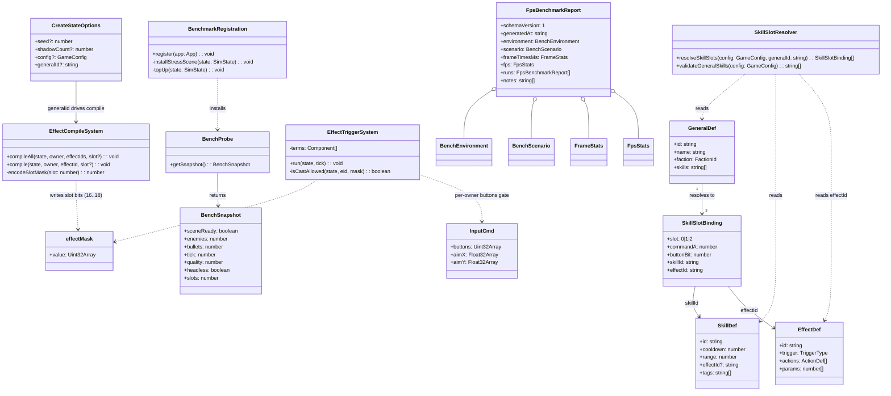
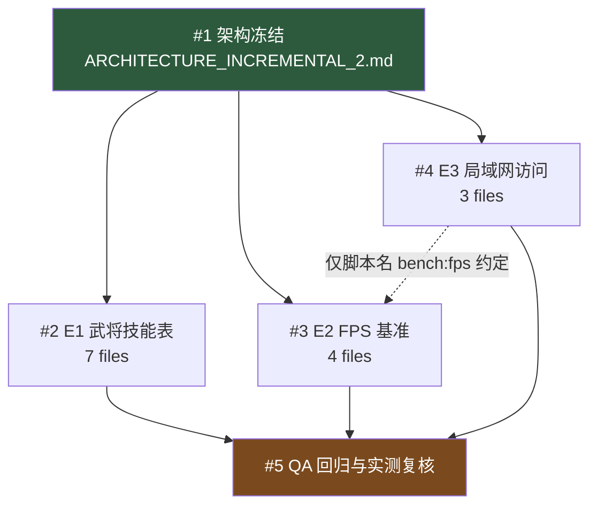

# 《无双》增量打磨 2 — 架构设计与接口冻结

> 架构师：高见远（software-architect） · 基线提交：`2944978` · 事实来源：`DESIGN.md` §8/§12、`docs/PRD.md`、`docs/ARCHITECTURE.md`（冻结契约）
> 适用工作目录：`C:/Project/WS`。本文只增补本轮三块改动，**不覆盖** `ARCHITECTURE.md` 的既有冻结签名；凡本文未改处，一律以 `ARCHITECTURE.md` 为准。
> 本轮三块改动：**E1 武将独立技能表** / **E2 FPS 压测基准** / **E3 Vite 局域网访问**。三块文件域互斥，可并行实现。

---

## 1. 三块改动的方案与关键取舍

### 1.0 基线事实核对（读源码后确认，含行号）

| 编号 | 事实 | 源码位置 |
| --- | --- | --- |
| F1 | `createBattleState()` 从 `config.effects.all()` 顺序取 **前 4 个** `onHit/onCast`（或 lifesteal）效果编译到**每个玩家**，实际落到 `eff_basic_attack / eff_sweeping_slash / eff_war_cry / eff_dragon_roar`；注释所称「全局击杀吸血」**因提前截断而从未编译**。与所选武将完全无关。 | `src/registration/systems.ts:193-207` |
| F2 | 40 位武将 `skills` 数组**只有 2 项**，但 UI 有 3 个技能按钮。 | `src/data/generals.ts:10-498`、`src/ui/TouchControls.ts:59-67` |
| F3 | `LocalHumanSource` 把 `CommandType.Skill.a = 0..3` 写成 `1<<a`（即 `InputCmd.buttons` bit0..bit3）；`presentation.ts` 中技1/技2/技3 按钮发 a=0/1/2，闪避按钮发 a=3；键盘 `1/2/3` 经 `onSkill(0/1/2)` 同样发 a=0/1/2。 | `src/ecs/systems/control/LocalHumanSource.ts:60-64`、`src/registration/presentation.ts:199-211`、`src/ui/TouchControls.ts:240-253` |
| F4 | `MovementSystem` 对**任意** cast 位只写全局 `EffectContext.flags[0] |= TriggerBit.onCast` 与 `source[0]=eid`，不区分键位；`EffectTriggerSystem` 对所有 onCast 效果做同一个全局掩码判定 → **按任意键触发全部已编译效果**，且多玩家互相串扰。 | `src/ecs/systems/MovementSystem.ts:29-31,87-90`、`src/ecs/systems/EffectSystems.ts:436-454` |
| F5 | 效果冷却固定 `0.1s`（`ActionDispatchSystem` 写入），`SkillDef.cooldown` 未被读取。 | `src/ecs/systems/EffectSystems.ts:478-485`、`src/data/combat.ts:154-191` |
| F6 | 部分技能的 `EffectDef.trigger` 是 `onHit`（`spear_thrust / moon_slash / chain_lightning / soul_drain`），若原样按 onCast 键位编译，这些技能按键**不会生效**。 | `src/data/combat.ts:71-73,82-84,101-104,108-111` |
| F7 | `EffectContext.flags[0]` 每 tick 在 `TimeSystem`（order 1）清零；`applyDamage` 在 order 11 写 onHit/onKill/onCritical，故命中类事件实际在**下一 tick** 的 order 10 被消费（既有语义，本轮不改）。 | `src/ecs/systems/LifecycleSystems.ts:308-323`、`src/ecs/systems/CombatSystems.ts:87-106` |
| F8 | `effectMask` 是 32 位掩码，架构 §6.2 规定「新增位只追加不重排」；当前只用了低 9 位（TriggerBit）。 | `src/ecs/components/effect.ts:17-28` |
| F9 | `EffectEntityPool` 容量 = `CAP - 2048 = 2048`，每玩家编译 4 组尚有余量，扩到 4 组/玩家不存在池溢出。 | `src/core/Constants.ts:14,18`、`src/ecs/pools/EntityPool.ts:93-97` |
| F10 | `vite.config.ts` 未配置 `server.host`，Vite 默认只监听 localhost/127.0.0.1；当前机器 LAN IP 为 `192.168.31.120`（WLAN），`169.254.10.20` 为链路本地地址，跨 PC 不可用。 | `vite.config.ts:13-30`、`ipconfig` 实测 |
| F11 | 现有 FPS 只在 `?debug=1` 下每 500ms 刷到调试面板，无落盘、无报告、不可复现；`DESIGN.md` §12 的 P3/P7 目标为桌面 ≥50、移动端 ≥45。 | `src/registration/presentation.ts:366-378,390-400`、`DESIGN.md:306,310` |
| F12 | 静态审查硬约束：业务层禁 `import 'bitecs'`、全工程禁 `Math.random(`、逻辑层禁 `quality`、墙钟只在白名单文件。测试必须用 `globals`（`vite.config.ts` 已 `globals:true`），不得 `import { describe } from 'vitest'`。 | `src/ecs/__tests__/hardConstraints.test.ts:575-654`、`vite.config.ts:24-29` |

### 1.1 E1 — 武将独立技能表

**核心难点**：把「键位 → 武将技能 → 效果编译 → 触发」变成一条**逐 tick 确定、且只触发本技能**的链路，同时不改冻结的命令号/位号、不破坏现有 114 项测试。

**方案（六步）**：

1. **数据补足**：`GeneralDef.skills` 由 2 项补为**恰好 3 项且互不重复**，第三项从既有 `SKILL_DEFS` 中取（完整表见 §2.1 与 §6.1）。`basic_attack` 不进武将表，保持通用普攻地位。
2. **纯解析层**：新增 `src/data/skillSlots.ts`，提供 `resolveSkillSlots(config, generalId): SkillSlotBinding[]`；只读 Registry，无副作用、无热路径字符串查找。缺失/非法 id 走 `assert()`（`1xxx` 配置错误）。
3. **编译层扩展**：`EffectCompileSystem.compileAll(state, owner, effectIds, slot?)` / `compile(state, owner, effectId, slot?)` 增加**可选槽位参数**。槽位编码进 `effectMask.value[main]` 的**高 16 位**（`SKILL_SLOT_FLAG_BASE = 1 << 16`，bits 16..18 表示 slot 0..2）；低 9 位仍是 `TriggerBit`。技能槽效果**强制按 onCast 语义触发**（忽略 `EffectDef.trigger`，解决 F6），全局效果仍按声明 trigger。`compiledEffects` 的 key 扩展为 `owner:slot:effectId`，避免不同槽引用同一效果时被去重误吞。
4. **触发层改为按玩家判定**：`EffectTriggerSystem` 对 **onCast 类效果**不再读全局 `flags[0]`，改读**宿主自己的** `InputCmd.buttons[owner]`：槽位效果要求 `(buttons & (1<<slot)) !== 0`，通用普攻要求 `(buttons & CAST_BUTTON_MASK) !== 0`。非 onCast 效果（onHit/onKill/onCritical/onDamaged/onTimer/onDeath…）**保持原全局 flags 逻辑不变**，把改动面压到最小。这样同时修掉 F4 的多玩家串扰。
5. **开局装配**：`CreateStateOptions` 增加 `generalId?: string`（默认 `'liubei'` 保持测试基线），`startBattle(mode, generalId)` 把它传入 `createBattleState`。每玩家编译 **4 组**效果：1 个通用 `eff_basic_attack` + 3 个武将槽位效果。全局 onKill/onCritical 效果本轮**仍不编译**（F1 现状，非用户诉求，避免额外行为变更）。
6. **冷却不动**：保持 `0.1s` 效果级冷却。**不接 `SkillDef.cooldown`**。理由：QA 回归 `qaCombatRegression.test.ts:164-191` 明确断言「间隔 14 tick 的第二次施法仍生效」，接 3.2s/6s 类 CD 会直接打破基线 114 绿；且用户本轮首要是「各自技能表」。见 §7 待明确 Q2。

**键位映射冻结（历史命名错位不再调整，只冻结映射）**：

| UI 动作 | `CommandType.Skill.a` | `InputCmd.buttons` 位 | `InputButton` 冻结名 | 本轮技能槽 |
| --- | --- | --- | --- | --- |
| 技1（键盘 `1`） | 0 | bit0 | `Basic`（历史命名） | `general.skills[0]` |
| 技2（键盘 `2`） | 1 | bit1 | `Skill1` | `general.skills[1]` |
| 技3（键盘 `3`） | 2 | bit2 | `Skill2` | `general.skills[2]` |
| 闪避（键盘空格） | 3 | bit3 | `Skill3`（历史命名） | 无槽位效果；仅通用普攻伴随触发，保证 QA「闪避也扣血」基线 |

**关键取舍**：
- ✅ 不改 `CommandType`/`InputButton`/`GameEventType` 任何编号（ARCHITECTURE §6.2 冻结）。
- ✅ 不新增 ECS 组件字段，用 `effectMask` 高位追加（F8），`clearComponentData()` 与 warm-up 断言自动兼容。
- ✅ 不把 `SkillDef.cooldown` 拉进本轮，避免「最小闭环」膨胀成战斗数值改版。
- ✅ 本轮**所有席位共用所选武将技能表**（真人与影子一致）；多人各自选将是后续范围，不扩大。
- ❌ 不做「槽位不同但效果相同」的去重优化；同一武将的三个 skill id 由数据保证互异，测试强制校验。

### 1.2 E2 — FPS 压测基准（可复现、不污染逻辑测试）

**核心难点**：要拿到**真实渲染帧率**，又要让逻辑测试保持纯净与确定性。

**方案**：

- **浏览器内压力场景**：新增 `src/registration/benchmark.ts`，由 `main.ts` 既有 `import.meta.glob('./registration/*.ts')` 自动侧载；仅在 URL 含 `?bench=1` 时生效，否则 `register()` 立即返回（正常游戏零影响）。它调用 `createBattleState()` / `startBattle()` 后，用 `spawnCombatEntity()` 与 `fireProjectile()` 把场景**补足到 300 敌 / 500 弹幕**，并在采样期间每秒补位，防止击杀导致数量下降。固定 `roomSeed`，输入序列为空（确定性）。
- **只读探针**：`window.__WS_BENCH__` 暴露 `getSnapshot(): {enemies, bullets, tick, quality, headless, slots, sceneReady}`，**不暴露任何写接口**（防作弊）。场景代码不读 `Date.now/performance.now`；帧时间由驱动侧 `requestAnimationFrame(timestamp)` 参数采集，规避 F12 墙钟静态审查。
- **Node 驱动**：`scripts/fps-bench.mjs` 用 Playwright 同时跑 `desktop`（Chromium，1280×720，DSF=1）与 `mobile`（设备模拟 Pixel 7 / iPhone 13，DSF=2/3）两组；每组 3 次独立运行取中位数；每次 3s 预热 + 10s 采样；输出 `docs/perf/fps-report.json`。
- **防「削减达标」**：报告强制记录 `minObservedEnemies` / `minObservedBullets`；任一低于 300/500 即 `pass=false` 且脚本以非零码退出。禁止在 benchmark 中改 `CAP`、波次表、`MAX_PROJECTILES`、刷怪率。若 `renderer.headless === true`，该次结果标 `validForTarget=false`，不得计入达标。
- **不污染 vitest**：脚本在 `scripts/*.mjs`，`vite.config.ts` 的 `test.include` 只匹配 `src/**/*.test.ts` 与 `src/**/__tests__/*.test.ts`，天然隔离；新增的 `src/registration/benchmark.ts` 不含 `quality` 字面量在逻辑层（它在 `registration/` 而非 `logicRoots`），不含墙钟调用，不含 `Math.random`，静态审查全绿。

**FPS 指标定义（冻结口径）**：

- **帧时间** = 相邻两帧 `requestAnimationFrame(timestamp)` 之差（ms）。预热阶段帧不计入样本。
- **预热**：3s 或 180 帧，取**较晚**到达者；**采样**：10s，要求有效样本 ≥ 300 帧，否则该次无效。
- `fps.mean = sampleFrames * 1000 / (lastTs - firstTs)`；`frameMs.p50/p95/p99` 由样本排序取分位；`fps.p95LowerBound = 1000 / frameMs.p95` 作为保守下界。
- 达标判定：`validForTarget && !capped && minObservedEnemies >= 300 && minObservedBullets >= 500 && fps.mean >= target`（桌面 50 / 移动 45）。`capped` 表示显示刷新率不足（由预热阶段最小帧间隔估算 `refreshCapHz < target + 10`），此时报告标注环境受限而非判定逻辑失败。
- 报告必须包含浏览器版本、UserAgent、viewport、DSF、WebGL renderer、quality、seed、样本数与原始帧时间数组，保证他人可复核。

### 1.3 E3 — Vite 局域网访问

**根因**：`vite.config.ts` 未设 `server.host`，Vite 默认绑定 localhost（仅 127.0.0.1），其他 PC 无法建立 TCP 连接；与游戏代码无关。

**方案**：`server.host = '0.0.0.0'`（`npm run dev` 直接生效），同时提供显式 `npm run dev:lan`（`vite --host 0.0.0.0`）与 `npm run preview:lan`；`preview.host` 同步设为 `'0.0.0.0'`。访问地址：`http://192.168.31.120:5173/`。防火墙需放行入站 TCP 5173（专用网络）；同网段、AP 隔离关闭。`169.254.10.20` 是链路本地地址，跨 PC 不可用，勿写入文档给用户。补 HMR `clientPort: 5173` 以规避代理/端口推断问题。安全提示：`0.0.0.0` 会把 dev server 暴露给整个网段，仅限可信 LAN。

---

## 2. 精确文件清单与互斥文件域

> 三域文件集合**完全互斥**。工程师只改自己域内文件；如需跨域改动，先 SendMessage 给 team-lead 协调。

### 2.1 E1 域 — 武将独立技能表（对应 team 任务 #2）

| 文件（相对 `C:/Project/WS/`） | 新增/修改 | 职责 |
| --- | --- | --- |
| `src/data/generals.ts` | 修改 | 40 位武将 `skills` 各补第 3 项（见 §6.1 全表），不改其他字段 |
| `src/data/skillSlots.ts` | **新增** | `resolveSkillSlots()` 纯解析；槽位常量与校验；无副作用 |
| `src/core/Constants.ts` | 修改 | 追加 `SKILL_SLOT_COUNT` / `SKILL_SLOT_FLAG_BASE` / `SKILL_SLOT_MASK`（只追加，不改既有值） |
| `src/ecs/systems/EffectSystems.ts` | 修改 | `compile*/` 增 `slot` 参数与高位编码；`EffectTriggerSystem` 按 `InputCmd.buttons[owner]` 判定 onCast；冷却仍 0.1s |
| `src/registration/systems.ts` | 修改 | 删除「前 4 个效果」硬编码；`CreateStateOptions.generalId`；按所选武将逐席位编译 4 组效果 |
| `src/data/__tests__/contentIntegrity.test.ts` | 修改 | 断言每将 3 个互异 skill id、effectId 可解析、`basic_attack` 不在武将表 |
| `src/__tests__/skillSlotRouting.test.ts` | **新增** | E1 单元回归：键位→武将效果→伤害特征、槽位互斥、换将重开 |

### 2.2 E2 域 — FPS 压测基准（对应 team 任务 #3）

| 文件 | 新增/修改 | 职责 |
| --- | --- | --- |
| `src/registration/benchmark.ts` | **新增** | `?bench=1` 侧载压力场景；补足 300/500；`window.__WS_BENCH__` 只读探针 |
| `scripts/fps-bench.mjs` | **新增** | Playwright 驱动（桌面+移动、各 3 次）、rAF 采样、写报告、达标退出码 |
| `docs/perf/fps-report.json` | 生成并提交 | 实测证据（按 §3.3 schema） |
| `docs/perf/FPS_BENCHMARK.md` | **新增** | 运行命令、环境、实测结果表、未达标时的瓶颈记录 |

### 2.3 E3 域 — 局域网访问（对应 team 任务 #4）

| 文件 | 新增/修改 | 职责 |
| --- | --- | --- |
| `vite.config.ts` | 修改 | `server.host/port/hmr`、`preview.host`；不改 `base`/`define`/`test` |
| `package.json` | 修改 | 追加 `dev:lan`、`preview:lan`、`bench:fps` 脚本与 `@playwright/test@1.65.1` devDependency |
| `docs/NETWORK_ACCESS.md` | **新增** | LAN IP、访问 URL、Windows 防火墙命令、排错清单、安全提示 |

### 2.4 架构师产出（本轮已完成，工程师不改）

| 文件 | 说明 |
| --- | --- |
| `docs/ARCHITECTURE_INCREMENTAL_2.md` | 本文（唯一事实来源） |
| `docs/incremental2-class-diagram.mermaid` | 类图（本文 §3.1 副本） |
| `docs/incremental2-sequence-diagram.mermaid` | 技能链路时序图（本文 §4.2 第一张副本） |
| `docs/incremental2-bench-sequence-diagram.mermaid` | FPS 压测时序图（本文 §4.2 第二张副本） |

### 2.5 明确不属于本轮文件域（禁止改动）

`src/main.ts`、`src/app/App.ts`、`src/ui/TouchControls.ts`、`src/ui/HUD.ts`、`src/ecs/scheduler.ts`、`src/ecs/components/*`、`src/ecs/bit/*`、`src/ecs/systems/MovementSystem.ts`、`src/ecs/systems/control/*`、`src/net/*`、`src/game/*`、`src/engine/Renderer.ts` / `PixiPools.ts` / `BattleFx.ts`、`src/ecs/__tests__/hardConstraints.test.ts`、`src/__tests__/qaCombatRegression.test.ts`、`tests/e2e/*`、`docs/ARCHITECTURE.md`、`DESIGN.md`。

> 例外：QA（team 任务 #5）可在复核阶段按实测结果补测试，但需 team-lead 批准后才可触碰上述文件。

---

## 3. 数据结构与接口契约（TS 签名级冻结）

### 3.1 类图



### 3.2 技能表与注册/编译入口（E1）

```ts
// src/core/Constants.ts —— 只追加
export const SKILL_SLOT_COUNT = 3;                 // 武将主动技能槽数（不含通用普攻）
export const SKILL_SLOT_FLAG_BASE = 1 << 16;       // effectMask 高位槽位基址（bits16..18）
export const SKILL_SLOT_MASK = 0x7 << 16;          // 槽位掩码
/** bit0 Basic | bit1 Skill1 | bit2 Skill2 | bit3 Skill3；core 层不得 import ecs，故用字面量 */
export const CAST_BUTTON_MASK = 0b1111;

// src/data/skillSlots.ts
export interface SkillSlotBinding {
  /** 0..2，对应 general.skills[slot] */
  readonly slot: 0 | 1 | 2;
  /** CommandType.Skill.a，恒等于 slot（技1/技2/技3 → 0/1/2） */
  readonly commandA: number;
  /** 1 << commandA，与 InputCmd.buttons 位一致 */
  readonly buttonBit: number;
  readonly skillId: string;
  readonly effectId: string;
}

/** 纯解析：只读 Registry，缺失/重复/effectId 悬空一律 assert(1xxx)。 */
export function resolveSkillSlots(config: GameConfig, generalId: string): SkillSlotBinding[];
/** 内容完整性校验：返回错误信息数组（空数组表示通过），供 contentIntegrity.test.ts 使用。 */
export function validateGeneralSkills(config: GameConfig): string[];

// src/ecs/systems/EffectSystems.ts —— 签名扩展（既有调用方保持兼容）
export class EffectCompileSystem {
  compileAll(state: SimState, owner: Eid, effectIds: readonly string[], slot?: number): void;
  compile(state: SimState, owner: Eid, effectId: string, slot?: number): void;
  /** 内部：effectMask.value[main] = triggerBit | (SKILL_SLOT_FLAG_BASE << slot) */
}
/** 供 QA 读取某效果实体的槽位绑定（只读，调试/测试用）。 */
export function skillSlotOfMask(mask: number): -1 | 0 | 1 | 2;

// src/registration/systems.ts —— 扩展
export interface CreateStateOptions {
  seed?: number;
  shadowCount?: number;
  config?: GameConfig;
  /** 默认 'liubei'；startBattle(mode, generalId) 会显式传入 */
  generalId?: string;
}
// startBattle(mode: string, generalId: string): void —— 签名不变
```

**编译清单（每玩家恰好 4 组，冻结）**：

| 组 | `effectId` | 槽位参数 | 触发语义 | `effectMask` 高位 |
| --- | --- | --- | --- | --- |
| 通用普攻 | `'eff_basic_attack'` | `undefined` | onCast（任意 cast 位） | 0 |
| 技1 | `resolveSkillSlots(...)[0].effectId` | `0` | 强制 onCast | `1 << 16` |
| 技2 | `[1].effectId` | `1` | 强制 onCast | `2 << 16` |
| 技3 | `[2].effectId` | `2` | 强制 onCast | `3 << 16` |

**触发判定伪码（冻结）**：

```ts
// EffectTriggerSystem.run，仅 onCast 分支；非 onCast 保持原全局 flags 逻辑
const mask = effectMask.value[eid];
const isCast = (mask & TriggerBit.onCast) !== 0;
if (isCast) {
  const owner = EffectContext.source[eid] >>> 0;   // 编译期写入的宿主
  if (owner === 0 || owner >= CAP) continue;
  const buttons = InputCmd.buttons[owner] >>> 0;
  const slot = skillSlotOfMask(mask);              // -1 = 通用普攻
  const needed = slot < 0 ? CAST_BUTTON_MASK : (1 << slot);
  if ((buttons & needed) === 0) continue;
  // 命中：ActiveEffect.state=1, elapsed=0（与现有逻辑一致）
} else {
  const flags = EffectContext.flags[0];
  if (flags === 0 || (mask & flags) === 0) continue;
  // 命中：同现有逻辑
}
// 冷却递减仍逐 tick 执行；ActionDispatchSystem 仍写 0.1s，不改
```

### 3.3 FPS 报告 JSON schema（E2）

```ts
// 文件：docs/perf/fps-report.json（由 scripts/fps-bench.mjs 生成）
interface FpsBenchmarkReport {
  schemaVersion: 1;
  generatedAt: string;              // ISO 8601 UTC
  platform: 'desktop' | 'mobile';
  pass: boolean;                    // 单次运行是否达标
  validForTarget: boolean;          // !headless && !capped
  environment: {
    browser: string;                // 'chromium' | 'webkit'
    browserVersion: string;
    userAgent: string;
    viewport: { width: number; height: number };
    deviceScaleFactor: number;
    webglRenderer: string | null;
    headless: boolean;
    quality: 'low' | 'medium' | 'high';
    refreshCapHz: number;           // 预热阶段估算，可能被显示刷新率钳制
    capped: boolean;                // refreshCapHz < target + 10
    seed: number;
  };
  scenario: {
    targetEnemies: 300;
    targetBullets: 500;
    minObservedEnemies: number;     // 采样期间每秒采样最小值
    minObservedBullets: number;
    warmupMs: 3000;
    sampleMs: 10000;
    warmupFrames: number;
    sampleFrames: number;
  };
  frameTimesMs: {
    samples: number[];              // 原始帧间隔，不裁剪
    mean: number;
    p50: number;
    p95: number;
    p99: number;
    max: number;
  };
  fps: {
    mean: number;                   // sampleFrames * 1000 / (lastTs - firstTs)
    p50: number;                    // 1000 / p50
    p95LowerBound: number;          // 1000 / p95
    target: 50 | 45;                // desktop 50 / mobile 45
  };
  determinism: {
    tickAtStart: number;
    tickAtEnd: number;
    tickDelta: number;
  };
  notes: string[];
}
// 顶层聚合文件：{ schemaVersion:1, runs: FpsBenchmarkReport[], median: { desktop: FpsStats, mobile: FpsStats }, allPass: boolean }
```

**脚本入口与探针契约**：

```ts
declare global {
  interface Window {
    __WS_BENCH__?: {
      getSnapshot(): BenchSnapshot;   // 只读；返回新对象，不暴露写入口
    };
  }
}
interface BenchSnapshot {
  sceneReady: boolean;
  enemies: number;
  bullets: number;
  tick: number;
  quality: number;
  headless: boolean;
  slots: number;
}
```

```bash
# E3 落地后：桌面 + 移动各 3 次，写报告
npm run bench:fps -- --platform=both --runs=3 --out=docs/perf/fps-report.json
# 单独调试（E3 尚未落地时可直接调脚本）
node scripts/fps-bench.mjs --platform=desktop --base-url=http://127.0.0.1:5173/
```

### 3.4 dev host 配置（E3）

```ts
// vite.config.ts —— 仅追加 server/preview 段，base/define/resolve/test 不动
export default defineConfig({
  base: './',
  server: {
    host: '0.0.0.0',       // 关键：默认 dev 也监听全部网卡
    port: 5173,
    strictPort: false,
    hmr: { clientPort: 5173 },
  },
  preview: { host: '0.0.0.0', port: 4173 },
  // ...既有 define / resolve / test 保持不变
});
```

```jsonc
// package.json scripts 追加
"dev:lan": "vite --host 0.0.0.0",
"preview:lan": "vite preview --host 0.0.0.0",
"bench:fps": "node scripts/fps-bench.mjs"
// devDependencies 追加 "@playwright/test": "1.65.1"
```

---

## 4. 依赖图与实现顺序

### 4.1 任务级依赖（与 team 任务号对齐）

| 顺序 | team 任务 | 内容 | 依赖 | 优先级 |
| --- | --- | --- | --- | --- |
| 已完成 | #1 | 架构冻结（本文） | — | P0 |
| T01 | #2 | E1 武将独立技能表（7 文件） | #1 | **P0** |
| T02 | #3 | E2 FPS 压测基准（4 文件） | #1 | **P0** |
| T03 | #4 | E3 Vite 局域网访问（3 文件） | #1 | P1 |
| T04 | #5 | QA 增量回归与实测复核 | #2, #3, #4 | P0 |

**并行性结论**：T01 / T02 / T03 的文件域互斥，**三者可完全并行**。T02 的 `bench:fps` npm 脚本由 T03 写入 `package.json`（唯一跨域耦合点，仅脚本名约定）；在 T03 未合并前，T02 直接用 `node scripts/fps-bench.mjs` 即可独立工作。T04 必须等三者全部合并后再跑。

### 4.2 程序调用流（关键路径时序图）

```mermaid
sequenceDiagram
    participant UI as TouchControls / DOM
    participant PB as CommandBus
    participant LS as LocalHumanSource
    participant IS as InputSystem
    participant MS as MovementSystem
    participant ET as EffectTriggerSystem
    participant AD as ActionDispatchSystem
    participant EC as EffectCompileSystem
    participant CFG as skillSlots / GeneralDef

    Note over CFG,EC: 开局/换将（非热路径）
    UI->>CFG: startBattle(mode, generalId)
    CFG->>CFG: resolveSkillSlots(config, generalId)
    CFG->>EC: compileAll(state, owner, ['eff_basic_attack'], undefined)
    CFG->>EC: compileAll(state, owner, [eff0,eff1,eff2], slot=0/1/2)
    EC->>EC: effectMask[main] = TriggerBit.onCast | (1<<16)<<slot

    Note over UI,AD: 每 tick（固定 60Hz）
    UI->>PB: CommandType.Skill(a=0/1/2), seq++
    PB->>LS: drain(buffer)
    LS->>LS: buttons |= 1 << a
    LS->>IS: poll(tick, frame) → InputCmd.buttons[eid]
    IS->>MS: InputCmd 写入完成
    MS->>MS: flags[0] |= onCast; source[0]=eid (兼容保留)
    MS->>ET: order 10
    loop 每个 EffectTag 实体
        ET->>ET: 读 owner=EffectContext.source[eid]
        ET->>ET: slot = skillSlotOfMask(effectMask[eid])
        ET->>IS: 读 InputCmd.buttons[owner]
        ET->>ET: slot<0? 任意cast位 : (buttons & 1<<slot)
        alt 命中
            ET->>ET: ActiveEffect.state=1, elapsed=0
        end
    end
    ET->>AD: order 11 按 op 分派
    AD->>AD: ActiveEffect.cd = 0.1 (不改)
```

```mermaid
sequenceDiagram
    participant CLI as scripts/fps-bench.mjs
    participant PW as Playwright Chromium/Mobile
    participant Reg as registration/benchmark.ts
    participant Sim as battle state
    participant R as Pixi Renderer

    CLI->>PW: launch(desktop / mobile context)
    PW->>Reg: goto ?bench=1&seed=...&q=...
    Reg->>Reg: register(app) → installStressScene
    Reg->>Sim: startBattle(campaign_8min, liubei)
    Reg->>Sim: spawn 300 enemies / 500 projectiles
    Reg->>Reg: window.__WS_BENCH__.getSnapshot()
    CLI->>PW: waitForFunction(sceneReady && enemies>=300 && bullets>=500)
    CLI->>PW: evaluate(async rAF sampler: warmup 3s → sample 10s; per-sec getSnapshot())
    loop 每帧
        PW->>R: renderFrame (真实渲染)
        PW->>PW: samples.push(ts[i]-ts[i-1])
    end
    Reg->>Sim: topUp() 每秒补足 300/500
    PW-->>CLI: {samples, minObserved*, tickDelta, env}
    CLI->>CLI: 计算 mean/p50/p95/p99，判定 pass
    CLI->>CLI: 写 docs/perf/fps-report.json，非达标 process.exit(1)
```

### 4.3 任务依赖图



---

## 5. 共享约定（跨三域强制）

1. **测试写法**：只用 `globals`（`describe / it / expect / beforeEach`），**禁止** `import { ... } from 'vitest'`。`vite.config.ts` 已 `globals:true`，`test.include` 只收 `src/**/*.test.ts` 与 `src/**/__tests__/*.test.ts`。新增单测放 `src/__tests__/` 或 `src/data/__tests__/`。
2. **确定性**：不得 `Math.random(`（全工程静态审查）；随机一律走 `Rng` / `hash32(seed, playerId, tick, salt)`。E1 的槽位编码是纯位运算，不改变同输入下的 tick 序列（空输入基线哈希应保持不变）。
3. **墙钟**：逻辑层（`src/core`、`src/data`、`src/net`、`src/ecs/systems`、`src/registration/systems.ts`）禁止 `Date.now/performance.now`。新代码中帧时间只用 rAF 回调参数；E2 的场景文件不得出现墙钟 API 调用。HUD/DOM 的既有墙钟用法保持白名单不变。
4. **画质不得影响逻辑**：`quality` 只能出现在渲染/UI/存档层；E2 报告里记录 quality 仅用于标注环境，不得写进 `SimState` 参与任何系统判断。CAP=4096、TICK_RATE=60、`MAX_PROJECTILES=512` 均为跨设备常量，压测场景不得修改。
5. **bitECS 边界**：所有 bitECS 调用只在 `src/ecs/bit/adapter.ts`；新代码只用 adapter 的 `add/has/query/queryNoCommit/spawn/recycle` 等封装。
6. **位/枚举只追加**：`effectMask` 高 16..18 位为本轮新增槽位位，低 9 位 TriggerBit 不动；`CommandType`/`InputButton`/`GameEventType` 全部冻结。
7. **热路径零分配**：每 tick 路径不得新建对象/闭包/字符串；E1 的槽位判定用位运算与预分配 `SkillSlotBinding[]`（构造期生成一次）。
8. **错误码**：配置/技能解析错误用 `1xxx` + `WushuangError` + `assert()`；压测场景数量不足属验收失败，不抛逻辑异常，由脚本退出码体现。
9. **提交卫生**：每个工程师只提交自己域内文件；生成的 `docs/perf/fps-report.json` 由 E2 提交作为验收证据；不得修改 `dist/` 或 `node_modules/`。

---

## 6. 验收标准与待明确事项

### 6.1 E1 验收标准

- `npm test` **≥114 全绿**（含新增 `skillSlotRouting.test.ts`），`npm run typecheck` 0 错，`npm run build` 成功。
- `contentIntegrity` 断言：40 将 × 3 个互异 skill id，`effectId` 全部可解析，`basic_attack` 不在任何武将表内。
- 行为断言（用 `ActiveEffect.defId` 或伤害特征区分）：
  - 刘备技1 → `eff_sweeping_slash`；关羽技1 → `eff_dragon_roar`；赵云技1 → `eff_spear_thrust`（原 onHit 配置也能按键触发）。
  - 按技2 **不会**激活技1/技3 的效果实体（槽位互斥）。
  - `startBattle('campaign_8min', 'guanyu')` 后编译表随之改变；重开不残留旧效果（`resetEffectRuntime()` 生效）。
  - 闪避（a=3）仍造成真实伤害（通用普攻兜底），`qaCombatRegression.test.ts` 不改自绿。
- 空输入下 `hardConstraints.test.ts` 的 30/60/144fps × quality 哈希一致性仍成立。

**40 将第三技能补全表（冻结数据，工程师照抄）**：

| 武将 id | 第三技能 | 武将 id | 第三技能 | 武将 id | 第三技能 | 武将 id | 第三技能 |
| --- | --- | --- | --- | --- | --- | --- | --- |
| liubei | tiger_charge | guanyu | tiger_charge | zhangfei | tiger_charge | zhaoyun | tiger_charge |
| machao | war_cry | huangzhong | tiger_charge | zhugeliang | tiger_charge | jiangwei | tiger_charge |
| weiyan | tiger_charge | pangtong | tiger_charge | caocao | whirlwind | xiahoudun | whirlwind |
| zhangliao | sweeping_slash | xuchu | whirlwind | dianwei | whirlwind | guojia | whirlwind |
| simayi | whirlwind | caren | whirlwind | xuhuang | whirlwind | zhanghe | sweeping_slash |
| sunquan | blade_dance | zhouyu | blade_dance | lvmeng | arrow_rain | luxun | blade_dance |
| ganning | arrow_rain | taishici | blade_dance | huanggai | blade_dance | sunshangxiang | blade_dance |
| lusu | blade_dance | chengpu | blade_dance | lvbu | earthquake | diaochan | earthquake |
| zhangjiao | earthquake | dongzhuo | sweeping_slash | yuanshao | earthquake | gongsunzan | earthquake |
| mateng | earthquake | huaxiong | sweeping_slash | yanliang | earthquake | chenggong | earthquake |

> 规则：阵营首选（蜀 `tiger_charge` / 魏 `whirlwind` / 吴 `blade_dance` / 群 `earthquake`），与该将已有技能重复时改用次选（蜀 `war_cry` / 魏·群 `sweeping_slash` / 吴 `arrow_rain`）。表内每一项均已与既有两项校验互异。

### 6.2 E2 验收标准

- `docs/perf/fps-report.json` 存在、schemaVersion=1、字段齐全；`scenario.minObservedEnemies >= 300`、`minObservedBullets >= 500`；`environment.headless === false`。
- 桌面 `fps.mean >= 50`、移动 `fps.mean >= 45`（各 3 次取中位数）；若未达标，报告 `notes` 写明瓶颈（GPU/DOM/Pixi 槽数）并**给出优化建议**，严禁下调实体数。
- 同一命令在相同环境重复执行，报告中的 seed / 环境 / 样本量一致；`tickDelta > 0` 且逻辑未因 bench 场景改用另一套系统链。
- 正常访问（不带 `?bench=1`）时 `src/registration/benchmark.ts` 完全无副作用：`npm test` 与 `npm run build` 不受影响，静态审查全绿。

### 6.3 E3 验收标准

- 本机 `npm run dev`（或 `dev:lan`）启动后，另一台同网段 PC 打开 `http://192.168.31.120:5173/` 能看到游戏首页且可进入战斗；HMR 不报连接错误。
- `npm run build` 与 `npm run preview -- --host 0.0.0.0` 正常；`base: './'` 未被改动。
- `docs/NETWORK_ACCESS.md` 含防火墙入站规则（TCP 5173，专用网络）、AP 隔离提示、链路本地地址不可用的说明与安全警告。

### 6.4 待明确事项（默认取值，不阻塞开工）

| 编号 | 问题 | 架构默认取值 | 需谁拍板 |
| --- | --- | --- | --- |
| Q1 | 第三技能是否接受按阵营规则补全（§6.1 表）？ | 接受；数据改动只在 `generals.ts` | team-lead |
| Q2 | 是否本轮接入 `SkillDef.cooldown`？ | **不接**；保持 0.1s，避免打破 QA 第二次施法断言；列为下一增量 | team-lead |
| Q3 | 移动端实测设备型号？ | 先用 Playwright Pixel 7 / iPhone 13 模拟；真机数据由 QA 补充 | team-lead / QA |
| Q4 | 刷新率钳制（60Hz 屏跑不到 >60）如何判定？ | 记录 `capped`，环境受限不算逻辑失败，但 `mean` 仍须 ≥ 目标 | team-lead |
| Q5 | Windows 防火墙规则是否允许自动写入？ | 不自动写入；文档给命令，由用户/QA 手动放行 | team-lead |
| Q6 | FPS 报告 JSON 是否入库？ | 入库，作为验收证据 | team-lead |
| Q7 | 多玩家各自武将是否在本轮支持？ | **不支持**；所有席位共享所选武将 | team-lead |

---

## 7. 风险提示（须同步 team-lead 与 QA）

1. **QA 基线回归风险（高）**：E1 改了效果编译与触发，虽刻意保留通用普攻兜底，但 `qaCombatRegression.test.ts` 中「闪避造成伤害」与「第二次施法」对时序敏感；若 E1 后该测试变红，先核对 `CAST_BUTTON_MASK` 与 0.1s 冷却是否仍生效，**不要**通过删测试或降断言解决。
2. **多玩家串扰修复的副作用（中）**：onCast 改为按 `InputCmd.buttons[owner]` 判定后，影子玩家的施法不再误触发真人效果；这会改变 auto 模式下的伤害分布与击杀归属，可能使既有确定性快照值变化（但跨 fps/quality 一致性仍成立）。QA 需复跑 `hardConstraints.test.ts` 与 loopback 测试。
3. **onHit 技能触发语义（中）**：强制 onCast 会让 `eff_spear_thrust` 等原本 onHit 的效果变成按键即范围伤害，强度提升；这是用户诉求的必要代价，已冻结在契约中，后续若需还原需新增 `onCastAsOnHit` 语义而非改 trigger 字面量。
4. **FPS 环境真实性（高）**：`headless=true` 或 WebGL 不可用时数字不可作为达标依据；若 CI/本机无 GPU，必须先解决渲染环境，禁止用 headless 数据冒充实测。60Hz 屏的 `mean` 上限约 60，目标 50 有余量但 p95 可能被拖拽；记录原始样本供复核。
5. **`?bench=1` 泄漏到正常流程（中）**：`import.meta.glob` 会加载所有 registration 文件，`benchmark.ts` 必须在 `register()` 第一行做 URL 判定并返回；QA 用不带参数的 e2e 冒烟验证无副作用。
6. **防火墙与 AP 隔离（低但常见）**：同网段 ARP 通但 TCP 不通多为防火墙；能 ping 通但页面打不开多为代理/AP 隔离；文档须区分两类排错路径。
