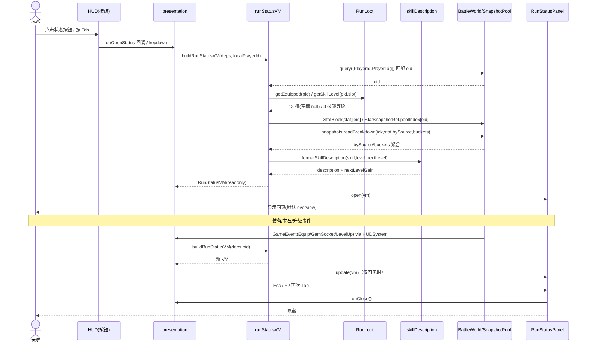
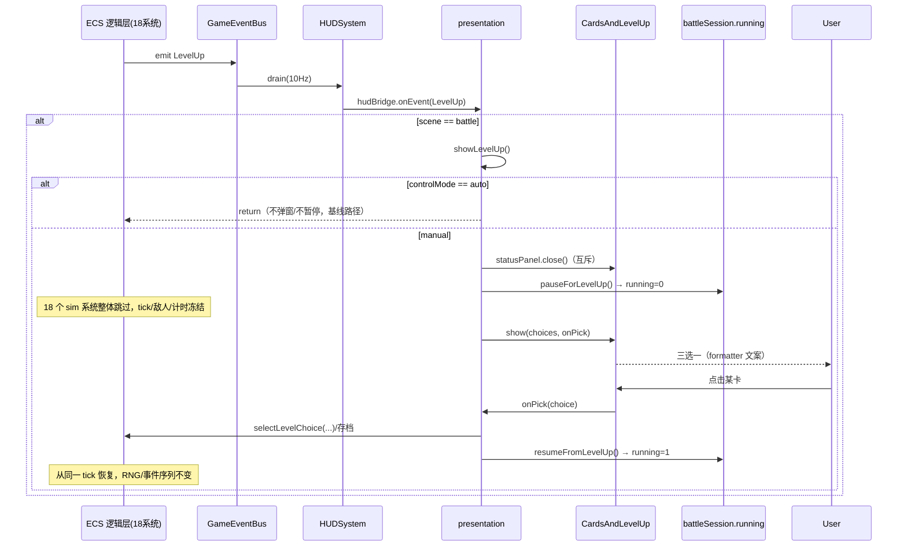
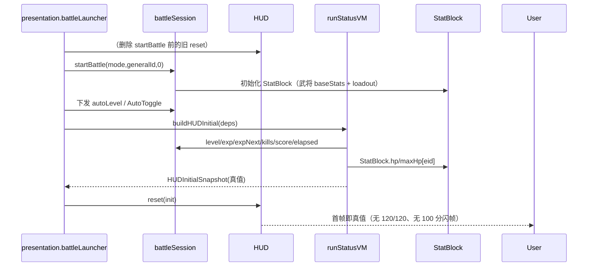
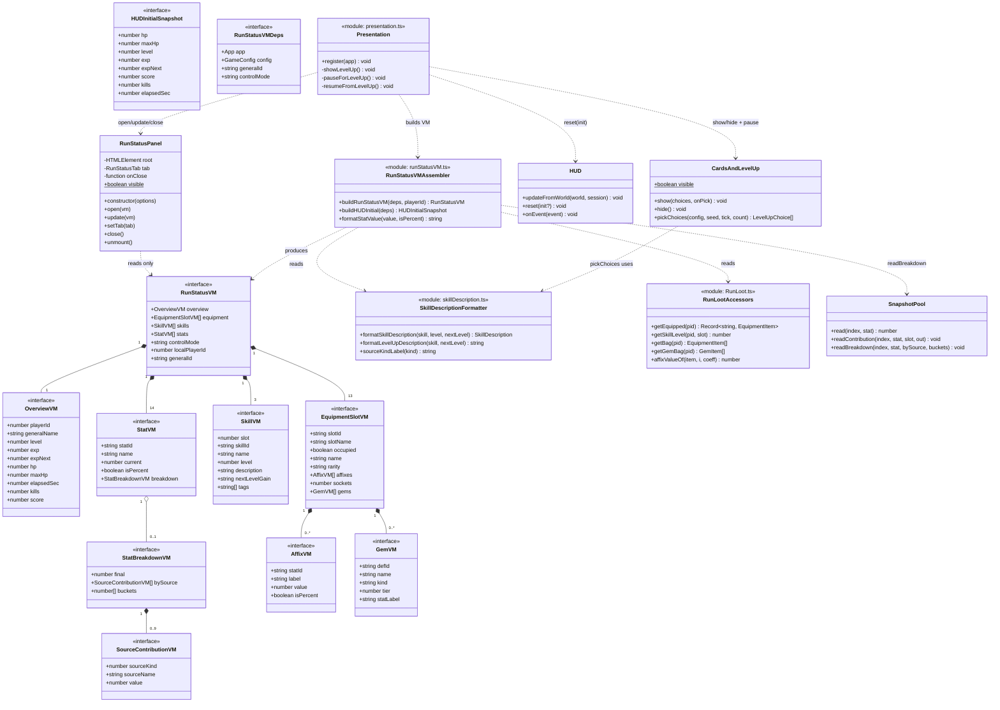
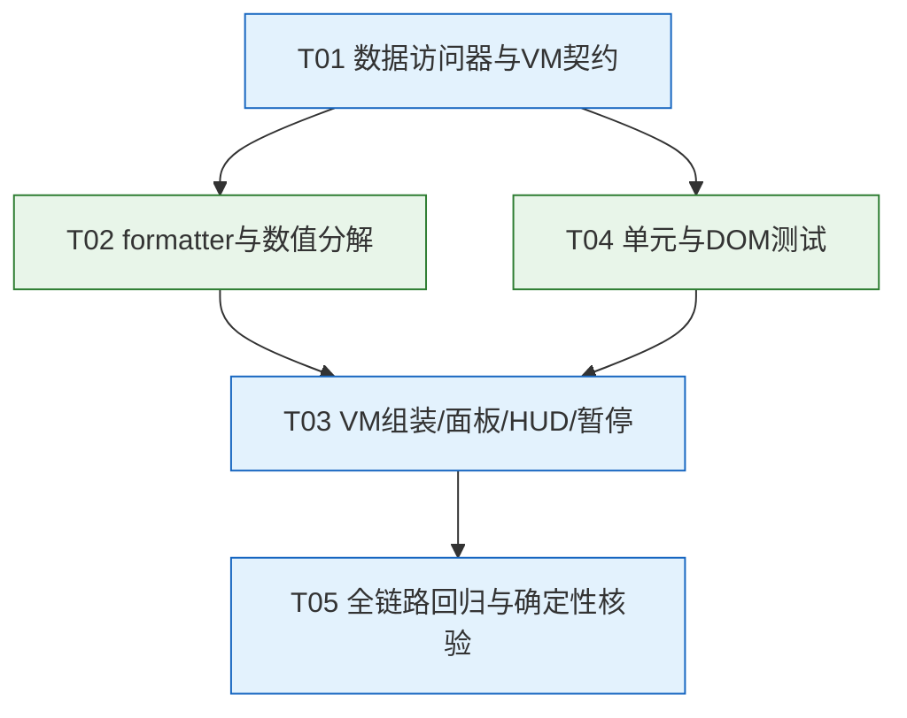

# 增量架构设计：局内角色状态面板 / 技能详情 / 数值透明 / UI 一致性

> 版本：v1.0（本轮增量）　架构师：高见远（Gao）　状态：待实现
> 输入：`docs/PRD_RUN_STATUS.md` + 主理人对 Q1~Q6 的拍板 + 源码勘察（2025-11-25）
> 本文只描述增量设计，不重复既有基线；所有接口签名均为**冻结契约**，工程师按此并行实现。

---

## 0. 拍板结论落地摘要（Q1~Q6）

| ID | 拍板 | 本设计的落地方式 |
| --- | --- | --- |
| Q1 | formatter 集中（选项 B） | 新增 `src/data/skillDescription.ts`，产出「说明 + 当前等级 + 下一级增益」。面板 / `showLevelUp()` / `CardsAndLevelUp.pickChoices()` 三处共用；`SkillDef` 仅增设可选 `description` 静态兜底字段，增益文案**一律动态计算**。 |
| Q2 | 角色面板不暂停；升级弹窗必须暂停 | 面板全程 `running` 不动（边打边看）；升级弹窗仅在 manual + battle 场景置 `running=0`，选卡后恢复。 |
| Q3 | 不改 auto 确定性基线 | **结构性证明**：node 基线 runner 走 `registration/systems.ts` 的 `register`，根本不加载 `presentation.ts`；E2E auto 模式在 `showLevelUp()` 第 348 行 `return`。详见 §3.6。 |
| Q4 | P0 四项 bySource；buckets 预留 | `atk/maxHp/crit/armor` 渲染 `bySource`；VM 预留 `buckets?: readonly number[]`，P0 不渲染。 |
| Q5 | getEquipped 补全空槽 | 生产代码**零调用**，仅 2 处测试用 `?.uid` 可选链；补全 13 槽为 null 无遍历破坏。详见 §3.5。 |
| Q6 | HUD 按钮为主，Tab 打开 / Esc 关闭为辅 | 全工程无 Tab 键监听；Esc 仅局外 UI 且 `visible` 门控。Tab/Esc 无冲突，键盘监听放 presentation 层。详见 §3.7。 |

---

## Part A：系统设计

## 1. 实现方案与选型

### 1.1 核心难点

| 难点 | 分析 | 选型 |
| --- | --- | --- |
| 面板不得直连 ECS（FC-5.3） | `hardConstraints.test.ts:593` 静态扫描 `from 'bitecs'`；PRD 底线要求新 UI 只读 VM | UI 层（`src/ui/RunStatusPanel.ts`、`src/ui/types/RunStatusVM.ts`）**零 ECS import**；ECS 访问全部收敛到 presentation 层 helper `src/registration/runStatusVM.ts` |
| 数值必须是引擎真值 | 局外 `statsOf()` 是中值口径，`compileEquippedItem()` 用 hashUid+roll 随机取整，二者不同 | 面板 current 一律读 `StatBlock[statId][eid]`（SoA f32），来源分解读 `StatSnapshotRef.poolIndex[eid]` → `SnapshotPool` |
| 技能说明单一事实来源 | `CardsAndLevelUp.pickChoices()`（死代码）与 `presentation.showLevelUp()` 双实现文案漂移 | 抽出纯函数 formatter（data 层），`×1.3^(level-1)` 口径复用现状；`+0.04` 作为下一级附加增益一并展示 |
| 升级弹窗暂停但不碰确定性 | `session.running` 是 18 个 sim 系统的总闸（`systems.ts:306-309`） | 暂停只写在 `presentation.ts`（浏览器侧，headless 基线不加载），且 auto 分支提前 return；manual 用 `running=0/1` |
| 13 槽稳定结构 | `getEquipped` 当前仅返回已装备键 | 以 `SLOT_DEFS`（13 项，`data/equipment.ts:28-42`）为骨架铺 null，再覆盖已装备项 |

### 1.2 技术选型（沿用既有栈，零新增依赖）

- **UI**：原生 DOM + BEM + 既有 CSS 令牌（`--ws-*`），无框架、无新库。
- **数据通道**：`ECS (StatBlock / SnapshotPool / PlayerLoot / config)` → `presentation.runStatusVM` → **只读 VM** → 面板渲染。单向、不可回写。
- **事件**：沿用 `GameEventBus` → `HUDSystem`(10Hz) → `hudBridge` → DOM；新增面板刷新挂在同一桥上，不新建总线。
- **架构模式**：表现层 MVP 变体——VM 组装器（Presenter 职责）+ 被动视图（`RunStatusPanel`）。ECS 与 DOM 解耦。

### 1.3 面板形态

**Tab 四页**（`overview / equipment / skills / stats`），单浮层、固定 13 槽网格、3 技能卡、14 属性列表：

```
┌───────────────────────────────────────────────────────────┐
│ 角色状态   [总览][装备][技能][数值]                 [×]  │
├───────────────────────────────────────────────────────────┤
│ 总览：武将 / 等级 / 经验 / 生命 / 核心属性速览             │
│ 装备：13 槽网格（名称/稀有度/词缀/孔/镶嵌宝石，空槽占位）   │
│ 技能：3 槽卡片（说明 + 当前等级 + 下一级增益 + 标签）      │
│ 数值：14 属性（真值），核心 4 项展开来源分解                │
└───────────────────────────────────────────────────────────┘
```

- 入口：HUD 固定按钮（主）+ `Tab`（辅，打开/切页）；关闭：`Esc` / `×` / 再次 `Tab`。
- 互斥：升级弹窗显示时面板自动 `close()`；面板打开期间升级弹窗仍可强制置顶（z-index 同为 30，弹窗 DOM 后挂载，天然在上）。
- 面板**不暂停**战斗；仅升级弹窗暂停。

---

## 2. 文件列表

### 2.1 新增文件

| 路径 | 职责（一句话） |
| --- | --- |
| `src/ui/types/RunStatusVM.ts` | 只读 VM 类型族（总览/装备槽/技能/数值/来源分解），面板唯一数据契约，零 ECS。 |
| `src/ui/RunStatusPanel.ts` | Tab 四页面板类，纯 DOM + BEM，消费 `RunStatusVM`，零 ECS / 零墙钟。 |
| `src/data/skillDescription.ts` | 技能说明 formatter 纯函数（说明 + 当前等级 + 下一级增益），三处共用。 |
| `src/registration/runStatusVM.ts` | presentation 层 VM 组装器：读 ECS/config/RunLoot/formatter，产出只读 VM 与 HUD 初始值。 |
| `src/ui/styles/runStatus.css` | 面板样式（Tab/网格/卡片/分解条），只用 `--ws-*` 令牌。 |
| `src/ui/__tests__/runStatusPanel.test.ts` | 面板 DOM 单测（jsdom）：open/update/close/Tab 切换/空槽渲染。 |
| `src/data/__tests__/skillDescription.test.ts` | formatter 单测：文案、等级、增益口径、静态兜底。 |
| `src/ecs/pools/__tests__/snapshotBreakdown.test.ts` | `readBreakdown` 聚合单测：bySource/buckets 下标与求和。 |

### 2.2 修改文件

| 路径 | 改动要点 |
| --- | --- |
| `src/game/RunLoot.ts` | `getEquipped` 补全 13 槽为 null；新增 `getBag` / `getGemBag` 只读快照；`PlayerLoot` 保留私有。 |
| `src/data/types.ts` | `SkillDef` 增设可选 `description?: string`（静态兜底，增益仍走 formatter）。 |
| `src/ecs/pools/SnapshotPool.ts` | 新增零分配 `readBreakdown(index, stat, bySource, buckets)`。 |
| `src/ui/CardsAndLevelUp.ts` | `pickChoices()` 的 description 改调 formatter；`hide()` 暴露恢复钩子由 presentation 注入。 |
| `src/ui/HUD.ts` | `updateFromWorld` 用 `session.localPlayerId` 匹配玩家；`reset(init?)` 去硬编码、接受真值初始值。 |
| `src/registration/presentation.ts` | 实例化面板、注册键盘、组装/刷新 VM、升级弹窗暂停/恢复、`showLevelUp` 用 formatter、HUD reset 传真值。 |
| `src/ui/styles/index.css` | `@import './runStatus.css';` 追加到序列末尾（`components.css` 之后）。 |
| `src/game/__tests__/runLoot.test.ts` | 增补「13 槽全覆盖 + 空槽为 null」断言。 |

> 约束检查：新增 UI 文件均不 import `bitecs` / adapter / components，不调用 `Math.random(` / `Date.now(` / `performance.now(`，逻辑层新文件不出现 `quality`。

---

## 3. 冻结接口契约（CRITICAL）

> 以下签名为并行实现地基，**不得擅自改名/改参**。所有 VM 类型 `readonly`，面板只读不回写。

### 3.1 只读 VM 类型 — `src/ui/types/RunStatusVM.ts`

```ts
/** 局内角色状态面板的唯一数据契约。全部 readonly；面板侧零 ECS、零写入。 */
export interface RunStatusVM {
  readonly overview: OverviewVM;
  readonly equipment: readonly EquipmentSlotVM[]; // 固定 13 项，顺序 = SLOT_DEFS
  readonly skills: readonly SkillVM[];             // 固定 3 项，slot 0/1/2
  readonly stats: readonly StatVM[];               // 14 项，顺序 = STAT_DEFS
  readonly controlMode: 'auto' | 'manual';
  readonly localPlayerId: number;
  readonly generalId: string;
}

export interface OverviewVM {
  readonly playerId: number;
  readonly generalName: string;
  readonly level: number;      // 1-based（session.level）
  readonly exp: number;
  readonly expNext: number;
  readonly hp: number;         // StatBlock.hp[eid]
  readonly maxHp: number;      // StatBlock.maxHp[eid]
  readonly atk: number;        // 核心属性速览
  readonly armor: number;
  readonly crit: number;
  readonly elapsedSec: number;
  readonly kills: number;
  readonly score: number;
}

/** 13 槽之一；空槽 occupied=false，其余字段为空串/空数组。 */
export interface EquipmentSlotVM {
  readonly slotId: string;              // SLOT_DEFS[i].id，如 'mainHand'
  readonly slotName: string;            // 中文名，如 '主手武器'
  readonly occupied: boolean;
  readonly name: string;                // equipmentName(def, uid)；空槽为 ''
  readonly rarity: string | null;       // RarityId；空槽为 null
  readonly affixes: readonly AffixVM[];
  readonly sockets: number;             // def.sockets；空槽为 0
  readonly gems: readonly GemVM[];      // 已镶嵌（按 item.gems 的 defId 查表）
}

export interface AffixVM {
  readonly statId: string;
  readonly label: string;               // 例 '攻击力 +5.2'，由 AFFIX_POOL + 实例 roll 渲染
  readonly value: number;               // 已 roll 的真实值（hashUid 口径，见 §3.4 注）
  readonly isPercent: boolean;
}

export interface GemVM {
  readonly defId: string;
  readonly name: string;                // `${kind 中文}${tier}级 ${stat.name}`
  readonly kind: 'red' | 'blue' | 'yellow' | 'green';
  readonly tier: number;
  readonly statLabel: string;           // 例 '攻击力 +3'
}

export interface SkillVM {
  readonly slot: 0 | 1 | 2;
  readonly skillId: string;
  readonly name: string;
  readonly level: number;               // 1-based = getSkillLevel(pid, slot) + 1
  readonly description: string;         // formatter.description
  readonly nextLevelGain: string;       // formatter.nextLevelGain；不可再升为 '—'
  readonly tags: readonly string[];
  readonly cooldown: number;
  readonly range: number;
}

export interface StatVM {
  readonly statId: string;
  readonly name: string;
  readonly current: number;             // StatBlock[statId][eid] 真值
  readonly isPercent: boolean;
  /** P0 仅核心 4 项非 null；其余为 null。buckets 预留，P0 不渲染。 */
  readonly breakdown: StatBreakdownVM | null;
}

export interface StatBreakdownVM {
  readonly final: number;               // = StatVM.current
  readonly bySource: readonly SourceContributionVM[]; // 过滤掉 0 贡献，按 sourceKind 升序
  readonly buckets?: readonly number[]; // 预留（RS-08），下标 = BUCKETS 顺序
}

export interface SourceContributionVM {
  readonly sourceKind: number;          // SOURCE_PRIORITY 下标（0=base..8=buff）
  readonly sourceName: string;          // 中文名：基础/词缀/宝石/套装/传奇/魔盒/技能/传说宝石/Buff
  readonly value: number;
}

/** HUD.reset 初始值（presentation 在 startBattle 后按真值构造）。 */
export interface HUDInitialSnapshot {
  readonly hp: number;
  readonly maxHp: number;
  readonly level: number;
  readonly exp: number;
  readonly expNext: number;
  readonly score: number;
  readonly kills: number;
  readonly elapsedSec: number;
}
```

### 3.2 面板类 — `src/ui/RunStatusPanel.ts`

```ts
import type { RunStatusVM, HUDInitialSnapshot } from './types/RunStatusVM';

export type RunStatusTab = 'overview' | 'equipment' | 'skills' | 'stats';

export interface RunStatusPanelOptions {
  readonly host: HTMLElement;
  /** 关闭时回调（presentation 用于清键盘态/焦点归还）；可选。 */
  readonly onClose?: () => void;
}

export class RunStatusPanel {
  constructor(options: RunStatusPanelOptions);
  /** 当前是否显示（= overlay 未 hidden）。 */
  get visible(): boolean;
  /** 当前激活页，默认 'overview'。 */
  get tab(): RunStatusTab;
  /** 首次/重新打开：切换页签（默认保留上次 tab，P0 可固定 overview）并渲染 vm。 */
  open(vm: RunStatusVM): void;
  /** 面板可见时按新 vm 刷新内容；P0 允许整体重建子节点，P2 再优化增量。 */
  update(vm: RunStatusVM): void;
  /** 切换页签；仅在已 open 后有效。 */
  setTab(tab: RunStatusTab): void;
  /** 关闭面板并触发 onClose（若提供）。重复调用安全。 */
  close(): void;
  /** 卸载 DOM 与事件监听；幂等。 */
  unmount(): void;
}
```

**实现约束**：
- 类内**不得**出现 `from 'bitecs'` / `from '../../ecs/...'` / `Date.now(` / `performance.now(` / `Math.random(`。
- `open/update` 入参即最新快照，面板不缓存跨帧状态、不做 ECS 查询。
- 根容器 `class="overlay ws-status"`，`hidden` 切换显隐（与 `CardsAndLevelUp` 同构），挂载到 `host`。
- 页签按钮 `data-tab`，卡片 `data-slot` / `data-skill-slot`，便于 E2E 断言。

### 3.3 VM 组装器 — `src/registration/runStatusVM.ts`

```ts
import type { App } from '../app/App';
import type { GameConfig } from '../data/types';
import type { RunStatusVM, HUDInitialSnapshot } from '../ui/types/RunStatusVM';

export interface RunStatusVMDeps {
  readonly app: App;
  readonly config: GameConfig;
  readonly generalId: string; // = save.meta.selectedGeneral（当前局武将）
  readonly controlMode: 'auto' | 'manual';
}

/**
 * 组装只读 VM。读取：app.state 的 world/session/pool；config 的
 * generals/skills/equipment/gems/stats；RunLoot 的 getEquipped/getSkillLevel；
 * formatter 的 formatSkillDescription。localPlayerId 缺省从 session 取。
 * 玩家匹配：query(world,[PlayerId,PlayerTag]) 后按 PlayerId.value[eid]===playerId 取 eid。
 */
export function buildRunStatusVM(deps: RunStatusVMDeps, playerId?: number): RunStatusVM;

/** startBattle 之后调用：从 battleSession + StatBlock 取真值，供 HUD.reset(init) 消除闪帧。 */
export function buildHUDInitial(deps: RunStatusVMDeps): HUDInitialSnapshot;

/** 格式化单条属性为展示串（isPercent 用百分比，否则整数/一位小数）。 */
export function formatStatValue(value: number, isPercent: boolean): string;
```

**组装规则（工程师必读）**：

1. **玩家 eid**：`const world = app.state.world as BattleWorld | null`；`const eids = query(world, [PlayerId, PlayerTag])`；遍历取 `PlayerId.value[eid] === pid`。取不到时 `overview` 用 session 值兜底、装备/技能/数值用空结构，**不得回退 `players[0]`**（多席位错位）。
2. **localPlayerId**：`pid = playerId ?? sessionFromState(app.state.session).localPlayerId`。`sessionFromState` 来自 `src/net/session.ts`（已 export）。
3. **13 槽**：`const equipped = getEquipped(pid)`（此时已补全）；遍历 `SLOT_DEFS`（`src/data/equipment.ts` 已 export），`const item = equipped[slot.id] ?? null`；空槽 `{ occupied:false, name:'', rarity:null, affixes:[], sockets:0, gems:[] }`。词缀真实值用与 `compileEquippedItem` 相同的 `hash32(hashUid(uid), i, 0xa771)` 口径重算（`hashUid` 目前是私有函数——见 §7 待明确 D1：建议 export `affixValueOf(item, i, rarityCoefficient)` 复用，避免 UI 重复随机口径）。
4. **技能**：`resolveSkillSlots(config, generalId)` → 3 条 binding；`level = getSkillLevel(pid, binding.slot) + 1`；`skill = config.skills.tryGet(binding.skillId)`；调用 `formatSkillDescription(skill, level, level + 1)`。
5. **数值**：遍历 `STAT_DEFS`；`const idx = STAT_DEFS.indexOf(def)`（= statIndex）；`current = (StatBlock as unknown as Record<string, Float32Array>)[def.id][eid]`。核心 4 项（`atk/maxHp/crit/armor`）构建 `breakdown`，其余 `null`。
6. **来源分解**：`const poolIdx = StatSnapshotRef.poolIndex[eid]`；分配 `bySource=new Float32Array(SOURCE_PRIORITY.length)`、`buckets=new Float32Array(config.buckets.length)` 并清零；调 `pool.snapshots.readBreakdown(poolIdx, idx, bySource, buckets)`；按 `SOURCE_PRIORITY` 转 `SourceContributionVM[]`（过滤 value===0）。`final = current`。
7. **零写入**：本文件只读 ECS，不写组件、不改 session（暂停由 presentation 单独处理）。

### 3.4 formatter — `src/data/skillDescription.ts`

```ts
import type { SkillDef } from './types';

/** formatter 输出：说明、当前等级、下一级增益三段。 */
export interface SkillDescription {
  readonly description: string;      // 说明文字（静态 description 优先，否则按 def 生成）
  readonly currentLevel: number;     // 1-based，= level 入参
  readonly nextLevelGain: string;    // 下一级增益文案；nextLevel===null 时为 '—'
}

/**
 * 统一 formatter。level 为 1-based 当前等级；nextLevel 为下一级（null 表示不可再升）。
 * 伤害系数口径固定 ×1.3^(level-1)（与 presentation.showLevelUp 现状一致），
 * 下一级增益额外含每级 damage +0.04（ProgressionSystems 口径）。
 * 本函数为纯函数：零墙钟、零随机、零 ECS。
 */
export function formatSkillDescription(
  skill: SkillDef,
  level: number,
  nextLevel: number | null,
): SkillDescription;

/** 升级卡描述统一入口：showLevelUp 与 pickChoices 共用，消除双实现漂移。 */
export function formatLevelUpDescription(skill: SkillDef, nextLevel: number): string;

/** 来源优先级下标 → 中文名（供 StatBreakdownVM 使用，放此处或 stats.ts 均可，冻结导出名）。 */
export function sourceKindLabel(kind: number): string;
```

**共用方式**：
- `presentation.showLevelUp()`：技能卡 `description = formatLevelUpDescription(skill, level)`（level 仍 = `getSkillLevel(0, code)+1`）。
- `RunStatusPanel` 技能页：`formatSkillDescription(skill, level, level+1)` 的 `description + nextLevelGain`。
- `CardsAndLevelUp.pickChoices()`：把第 50 行硬编码串替换为 `formatLevelUpDescription(def, def.level + 1)`。
- 22 条技能定义缺静态说明，formatter 依据 `name/tags/cooldown/range/damage` 生成可读文案；未来在 `SkillDef.description` 填值即自动优先展示，无需改调用方。

### 3.5 `StatBreakdown` 实现 — `src/ecs/pools/SnapshotPool.ts`

在 `SnapshotPool` 类内新增**零分配**方法（复用既有 `readContribution`，不改变冻结布局）：

```ts
/**
 * 聚合某快照槽某属性的贡献。调用方预分配并清零 out 数组（长度分别 >=
 * SOURCE_PRIORITY.length 与 bucketCount）。遍历 MAX_CONTRIB_PER_STAT 个贡献槽，
 * 读 [value, sourceKind, sourceId, bucket]，按 sourceKind 累加到 bySource[k]，
 * 按 bucket 累加到 buckets[b]。零分配（仅用既有 readContribution 的 4 长 out）。
 */
readBreakdown(
  index: number,
  stat: number,
  bySource: Float32Array,
  buckets: Float32Array,
): void;
```

**实现要点（工程师）**：
- 内部复用 `const out = new Float32Array(CONTRIB_STRIDE)` 作为**类字段**预分配（构造期一次），循环内 `this.readContribution(index, stat, s, out)`。
- `value=out[CONTRIB_VALUE]`、`kind=out[CONTRIB_SOURCE_KIND]|0`、`bucket=out[CONTRIB_BUCKET]|0`；`bySource[kind] += value`（守卫 `kind` 在 `[0,bySource.length)`）、`buckets[bucket] += value`（守卫 `bucket` 在 `[0,buckets.length)`）。
- `sourceKind` 为 f32 存储的整数枚举，读取需 `|0` 取整；空贡献槽 `value===0` 自然不影响求和。
- `final` 由调用方用 `read(index, stat)` 或 `StatVM.current` 填写，方法本身不改 `bySource[0]`（避免与 base 语义混淆）。
- `StatBreakdown` 接口（`{final,buckets,bySource}`）保持原签名不动，本次不强制构造该接口对象，VM 用 `StatBreakdownVM` 承载。

### 3.6 RunLoot 只读访问器 — `src/game/RunLoot.ts`

```ts
/** 补全 13 槽：以 SLOT_DEFS 为骨架，空槽为 null；返回新 Record，不改内部 Map。 */
export function getEquipped(playerId: number): Record<string, EquipmentItem | null>;

/** 只读背包快照（RS-09，P1 展示用；本轮先落接口）；返回 slice，调用方改不影响结算。 */
export function getBag(playerId: number): readonly EquipmentItem[];
export function getGemBag(playerId: number): readonly GemItem[];

/** 供面板按 hashUid 口径重算词缀真实值（避免 UI 重复实现随机口径）。 */
export function affixValueOf(item: EquipmentItem, affixIndex: number, rarityCoefficient: number): number;
```

**`getEquipped` 补全实现（伪码，直接落地）**：

```ts
export function getEquipped(playerId: number): Record<string, EquipmentItem | null> {
  const loot = lootByPlayer[playerId];
  const out: Record<string, EquipmentItem | null> = {};
  for (let i = 0; i < SLOT_DEFS.length; i++) out[SLOT_DEFS[i].id] = null; // 先铺 13 槽
  if (loot === undefined) return out;
  const iter = loot.equipped.entries();
  for (let i = 0; i < loot.equipped.size; i++) {
    const [slot, item] = iter.next().value as [string, EquipmentItem];
    if (slot in out) out[slot] = item; // 只覆盖已知槽，杜绝脏键
  }
  return out;
}
```
> 需新增 `import { SLOT_DEFS } from '../data/equipment'`（该文件已 import 同模块的 `findRarity/SET_DEFS` 等，无新增依赖）。

**调用点逐一确认（Q5）**：

| 调用点 | 形态 | 补全后影响 | 结论 |
| --- | --- | --- | --- |
| `src/game/__tests__/runLoot.test.ts:97` | `getEquipped(0)[defs[idx].slot]?.uid` | 非空槽照常返回；可选链对 null 安全 | 无需改；新增 null 断言即可 |
| `src/game/__tests__/runLoot.test.ts:113` | `getEquipped(0)[defs[idx].slot]?.gems` | 同上 | 无需改 |
| 生产代码（Grep 全量） | **0 处** | 无 | 无破坏 |
| `recompileAll` / `findSocketTarget`（RunLoot 内部） | 遍历 `loot.equipped`（Map），**不经** `getEquipped` | 内部 Map 未变 | 无破坏 |
| 新增 VM 组装（§3.3） | 遍历 `SLOT_DEFS` 取 `equipped[slot.id] ?? null` | 正是补全的预期消费者 | 适配完成 |

### 3.7 HUD 修复 — `src/ui/HUD.ts`

**修复点 1 — 玩家选取（`updateFromWorld`）**：

```ts
// 现有：const eid = players[0] as Eid;  ← 多席位错位
// 目标：按 session.localPlayerId 匹配
updateFromWorld(world: BattleWorld | null, session: unknown): void {
  if (world !== null) {
    const localId = readNumber(session, 'localPlayerId'); // session 为普通对象视角
    const players = query(world, this.playerTerms);       // playerTerms = [PlayerId, PlayerTag]
    for (let i = 0; i < players.length; i++) {
      const eid = players[i] as Eid;
      if (PlayerId.value[eid] !== localId) continue;
      if (has(world, eid, Health)) this.setHealth(Health.cur[eid], Health.max[eid]);
      break;
    }
    // 未匹配到任何玩家时保持上一帧血量，不用 players[0] 兜底（避免错位）。
  }
  // ... 其余 time/kills/level/score 逻辑不变
}
```
- `private readonly playerTerms = [PlayerId, PlayerTag];`（原为 `[Position, PlayerTag]`）。
- 新增 `import { PlayerId } from '../ecs/bit/components'`（HUD 是既有允许读 ECS 的特殊 UI 文件，见墙钟白名单，不违反 FC-5.3 的 bitecs 禁令）。
- 注意 `session` 在 `presentation.ts:477` 传入的是 `app.state.session`（可变普通对象，`localPlayerId` 为 number），`readNumber` 可直接取。

**修复点 2 — `reset(init?)` 去闪帧**：

```ts
reset(init?: HUDInitialSnapshot): void {
  this.kills = 0; this.level = 1; this.exp = 0; this.expNext = 10;
  this.score = 0;                                   // 原为 100（删除硬编码）
  this.lastHp = -1; this.lastMaxHp = -1; this.lastExp = -1; this.lastLevel = -1;
  this.lastTime = -1; this.lastKills = -1; this.lastScore = -1; // 保持 -1：首帧必写真值
  this.bossWarningUntil = 0;
  this.bossBanner.style.display = 'none';
  this.toastBox.replaceChildren();
  if (init !== undefined) {
    this.setHealth(init.hp, init.maxHp);
    this.setLevel(init.level, init.exp, init.expNext);
    this.setTime(init.elapsedSec);
    this.setKills(init.kills);
    this.setScore(init.score);
  }
  // 无 init 时不写死 120/120：文本保持上一值，待首帧 updateFromWorld 覆盖。
}
```

**presentation 侧调用顺序调整**（`battleLauncher`，现 `:369` 与 `:401`）：
1. 删除 `:369` 的 `hud?.reset()`（startBattle 前无真值）。
2. 在 `session.startBattle(...)` 与 `autoLevel`/`AutoToggle` 下发之后，调用 `hud?.reset(buildHUDInitial({ app, config, generalId, controlMode }))`。
3. 这样首帧即真值，消除 `120/120 → 真值`、`100 分 → 真值` 闪烁；且不改变 `startBattle` 签名。

### 3.8 暂停实现 — `src/registration/presentation.ts`

**状态机（模块级闭包变量，随 `register()` 生命周期）**：`let levelUpPaused = false;`（true 表示"本次暂停由升级弹窗引起"）。

**落地伪码（工程师按此实现，注意三处守卫）**：

```ts
const battleRunning = (): { get(): number; set(v: number): void } | null => {
  const s = app.state.session as unknown as { running?: number } | null;
  if (s === null || typeof s.running !== 'number') return null;
  return { get: () => s.running as number, set: (v) => { s.running = v; } };
};

const pauseForLevelUp = (): void => {
  // 守卫 1：auto 模式不弹窗也不暂停（showLevelUp 已在 :348 return，此处双保险）
  if (save.meta.settings.controlMode === 'auto') return;
  // 守卫 2：仅战斗场景
  if (app.sceneManager.current?.id !== 'battle') return;
  // 守卫 3：幂等
  if (levelUpPaused) return;
  const running = battleRunning();
  if (running === null || running.get() !== 1) return; // 非运行中（结算/菜单）不暂停
  running.set(0);
  levelUpPaused = true;
};

const resumeFromLevelUp = (): void => {
  if (!levelUpPaused) return;
  levelUpPaused = false;
  const running = battleRunning();
  // 仅当仍在 battle 场景时恢复为 1；结算路径由 endBattle 自行维持 running=0
  if (running !== null && app.sceneManager.current?.id === 'battle') running.set(1);
};
```

**接入点**：

| 时机 | 动作 |
| --- | --- |
| `showLevelUp()` 中 `cards.show(...)` **之前**（`auto return` 之后） | `pauseForLevelUp()`；若面板可见则 `statusPanel?.close()`（互斥） |
| `cards.show` 的 onPick 回调内（选卡、`selectLevelChoice`、存档之后） | `resumeFromLevelUp()` |
| `battleLauncher` 的 `cards?.hide()` | 先 `resumeFromLevelUp()` 再 hide（清理上一局残留暂停） |
| `deps.resetBattle` 的 `cards?.hide()` | 同上 |
| `hudBridge` 收到 `Victory/Defeat` | `resumeFromLevelUp()`（避免暂停态带入结算）；`endBattle` 会置 `running=0` |

**auto 路径确定性零影响 — 三方证明**：

1. **node 整局确定性**（`npm run test:fullrun`）：`src/__tests__/helpers/fullrunRunner.ts:24` 导入的是 `registration/systems.ts` 的 `register`（headless `createHeadlessApp` 只转发 `registerSimSystem`），**全程不加载 `presentation.ts`**。本设计所有暂停代码仅在 `presentation.ts`，因此对该测试结构性零影响——基线 tick 25435 / 423.92s / kills 597 / level 10 / score 6970 / Equip 26 / GemSocket 8 / LevelUp 12 不变。
2. **E2E fullrun**（`npm run test:e2e:fullrun`）：浏览器走 `presentation.ts`，但存档默认 auto；`showLevelUp()` 第 348 行 `if (controlMode === 'auto') return` 在 `cards.show()` 与 `pauseForLevelUp()` 之前，auto 分支不暂停、不弹窗。
3. **manual 暂停语义**：manual 模式不存在既有确定性/E2E 基线断言。暂停期间 `running=0` 使 18 个 sim 系统整体跳过（`systems.ts:306-309`），敌人与计时停推进；`resumeFromLevelUp()` 恢复为 1 后从同一 tick 继续，不改 RNG 状态、不改事件序列。

> 红线：**不得**把暂停写进 `registration/systems.ts` 或任何 ECS 系统/命令消费路径（`CommandType.Pause` 继续空实现），否则触碰基线。

### 3.9 键盘入口 — presentation 层

```ts
// register() 内，host !== null 时注册一次；面板/升级弹窗互斥在此统一裁决
window.addEventListener('keydown', (event: KeyboardEvent): void => {
  if (app.sceneManager.current?.id !== 'battle') return;
  const key = event.key;
  if (key === 'Tab') {
    event.preventDefault(); // 阻止焦点跳转
    if (cards?.visible) return;                       // 升级弹窗优先，面板不抢
    if (statusPanel?.visible) statusPanel.setTab(nextTab(statusPanel.tab));
    else if (statusPanel !== null) statusPanel.open(buildRunStatusVM(...));
  } else if (key === 'Escape') {
    if (statusPanel?.visible) { event.preventDefault(); statusPanel.close(); }
  }
});
```

**冲突核对（Q6）**：
- `TouchControls.onKeyDown`（`:275-292`）只处理 w/a/s/d、方向键、k、1/2/3、空格；**无 Tab/Esc**。
- `LocalHumanSource.poll`（`:94-98`）对 `CommandType.Pause` 空实现，不消费键。
- `Escape` 仅被局外 `EquipmentUI`（`visible` 门控，`:1012`）、`ThemePicker`（浮层可见门控，`:279`）、`ItemPreview` 占用；局内 battle 场景这些 UI 不可见，无冲突。
- 结论：Tab 打开 / Esc 关闭可用。HUD 按钮为可靠主入口。

### 3.10 HUD / 面板刷新时机

- 面板 `open()` 时 `buildRunStatusVM` 一次。
- 面板可见期间，在 `hudBridge.onEvent` 的 `Equip / GemSocket / LevelUp` 分支各触发一次 `statusPanel.update(buildRunStatusVM(...))`（低频、事件驱动，P0 足够）。
- HP/时间的连续量：面板不做每帧刷新（避免 DOM 抖动与性能问题）；如需更实时，P2 再挂 10Hz 节流（复用 `HUDSystem` 的 flush 节拍，且不得在 UI 文件引入墙钟）。

---

## 4. 程序调用流（Mermaid 时序图）

### 4.1 VM 组装与面板打开/关闭



### 4.2 升级弹窗暂停 / 恢复（与 auto 零影响）



### 4.3 HUD 真值初始化（消除闪帧）



---

## 5. 类图（Mermaid）



---

## Part B：任务分解

## 6. Required Packages

**无新增第三方依赖**（沿用仓库既有）：TypeScript、Pixi.js、bitecs（仅 adapter）、vitest（dev）、playwright（E2E）。formatter / VM / 面板均用原生 DOM 与既有工具模块。

## 7. 任务列表（按依赖排序）

> 5 个任务，覆盖 P0 全部 RS-01~06。T01→(T02 ∥ T04)；T02,T04→T03；T03→T05。T02 与 T04 可并行；T05 收尾回归。

### T01 — 数据访问器与 VM 契约（可并行起点）

- **描述**：补全 `getEquipped` 空槽、新增背包只读访问器与 `affixValueOf`；定义全套只读 VM 类型；`SkillDef` 加可选 description。
- **源文件**：`src/game/RunLoot.ts`、`src/ui/types/RunStatusVM.ts`、`src/data/types.ts`
- **依赖**：无
- **优先级**：P0
- **预计产出**：可 import 的 VM 类型族；`getEquipped` 返回 13 槽 null 补全；只读背包访问器；测试断言更新。

### T02 — formatter 与数值分解（可与 T04 并行）

- **描述**：实现技能 formatter 三函数与来源中文名；`SnapshotPool.readBreakdown` 零分配聚合；`CardsAndLevelUp.pickChoices` 收敛到 formatter。
- **源文件**：`src/data/skillDescription.ts`、`src/ecs/pools/SnapshotPool.ts`、`src/ui/CardsAndLevelUp.ts`
- **依赖**：T01（`SkillDef.description` 类型、VM 中 `sourceKindLabel` 用途）
- **优先级**：P0
- **预计产出**：单一技能文案来源；`readBreakdown` 单测通过；`pickChoices` 无硬编码文案。

### T03 — VM 组装 / 面板集成 / HUD 修复 / 暂停（核心串行）

- **描述**：`buildRunStatusVM`/`buildHUDInitial`/`formatStatValue`；`RunStatusPanel` 四页 UI；presentation 实例化、键盘、刷新、暂停三守卫、showLevelUp 用 formatter、HUD 两处修复；CSS 追加。
- **源文件**：`src/registration/runStatusVM.ts`、`src/ui/RunStatusPanel.ts`、`src/registration/presentation.ts`、`src/ui/HUD.ts`、`src/ui/styles/runStatus.css`、`src/ui/styles/index.css`
- **依赖**：T01、T02
- **优先级**：P0
- **预计产出**：局内可开关的四页面板、真值数值与来源分解、升级弹窗暂停、HUD 无闪帧且玩家正确。

### T04 — 单元与 DOM 测试（可与 T02 并行）

- **描述**：按冻结签名先写测试：面板 DOM（jsdom）、formatter 口径、`readBreakdown` 聚合、`getEquipped` 13 槽断言。
- **源文件**：`src/ui/__tests__/runStatusPanel.test.ts`、`src/data/__tests__/skillDescription.test.ts`、`src/ecs/pools/__tests__/snapshotBreakdown.test.ts`、`src/game/__tests__/runLoot.test.ts`
- **依赖**：T01（类型与访问器签名）
- **优先级**：P0
- **预计产出**：新增 3 个测试文件 + 扩充 1 个；jsdom 文件首行 `// @vitest-environment jsdom`；禁止从 vitest import describe。

### T05 — 全链路回归与确定性核验（收尾）

- **描述**：跑 typecheck / 单测 / fullrun / E2E，核对确定性基线未变、硬约束静态扫描全绿；修复集成问题。
- **源文件**：`src/registration/presentation.ts`、`src/ui/RunStatusPanel.ts`、`src/ui/HUD.ts`（仅按需修复联调问题）
- **依赖**：T02、T03、T04
- **优先级**：P0
- **预计产出**：`npm run typecheck`=0；`npm test` 全绿；`npm run test:fullrun` 命中冻结基线；E2E 通过；`npx vitest run src/ecs/__tests__/hardConstraints.test.ts` 全绿。

## 8. 任务依赖图（Mermaid）



> 并行提示：T02 与 T04 同依赖 T01 且互不改同一文件，可同时开工；T03 必须等两者完成（要用 formatter 与 readBreakdown）；T05 最后统一验证。

## 9. 共享约定

- **命名**：VM 类型 `XxxVM`；接口只读 `readonly`；formatter 纯函数 `formatXxx`；面板 BEM 前缀 `ws-status__`（块 `ws-status`）。
- **CSS**：新样式只在 `src/ui/styles/runStatus.css`，令牌一律 `var(--ws-*)`，零裸色；`@import` 追加到 `index.css` 末尾；容器 `.overlay.ws-status` 走 **z-index 30**（与 `ws-levelup` 同级，弹窗后挂载故在上）；遵循 `src/style.css:157-172` 层级契约。
- **VM 只读**：面板只调用 `open/update/close/setTab`，不得持有 world/session 引用，不得写任何组件或 session。
- **测试位置**：与源同目录 `__tests__/`；jsdom 首行 `// @vitest-environment jsdom`；vitest globals，**禁止** `import { describe } from 'vitest'`；局内数据 rig 参考 `src/game/__tests__/runLoot.test.ts`。
- **确定性红线**：暂停代码只在 `presentation.ts`；不得改 `registration/systems.ts` / ECS 系统 / `CommandType.Pause` 消费；不得改 `fullrunRunner.ts` 与基线常量。
- **硬约束**：新 UI 文件禁 `from 'bitecs'`、禁 ECS 直连、禁 `Math.random(`、禁 `Date.now(`/`performance.now(`；逻辑层新文件不出现 `quality`。
- **技能口径**：等级 1-based（内部 0-based +1）；伤害系数 `1.3^(level-1)`；每级附加 `damage +0.04`；文案单一 formatter。
- **数值口径**：current = `StatBlock[statId][eid]` 真值；词缀值 = hashUid/roll 随机取整（非局外中值）；来源下标 = `SOURCE_PRIORITY`；乘区下标 = `BUCKETS`。

---

## 10. 待明确事项

Q1~Q6 已全部拍板并在本文落地。以下为**实现期需工程确认的技术细节**（不阻塞开工，已给默认方案）：

- **D1 — `affixValueOf` / `hashUid` 复用**：`hashUid` 目前是 `RunLoot.ts` 私有函数。面板要展示词缀"真实值"必须与编译口径一致。默认方案：在 T01 中把 `hashUid` 提升为 `affixValueOf(item, i, rarityCoefficient)` 导出（内部仍用原 FNV 乘数与 `0xa771` 种子），UI 侧调用它，杜绝重复实现。若团队倾向"面板只展示词缀区间不展示 roll 值"，可退化为展示 `AFFIX_POOL[i].min~max × rarity.coefficient` 区间，但需在 PRD 验收点标注口径差异。
- **D2 — 面板可见时的数值实时性**：默认事件驱动（Equip/GemSocket/LevelUp 触发 update），HP 不做每帧刷新。若验收要求 HP 实时，T05 前再挂 10Hz 节流（复用 `HUDSystem` 节拍，墙钟调用留在 `presentation.ts` 白名单内）。
- **D3 — `showLevelUp` 的 playerId 硬编码**：现状用 `getSkillLevel(0, code)` / `getLevelChoices(0, ...)`（席位 0）。本轮保持不动（单机战役本地玩家即席位 0），多席位联机留待后续；面板侧已按 `session.localPlayerId` 正确取数，不受此影响。
- **D4 — 状态面板按钮的 HUD 挂载点**：HUD 构造内建 DOM，新增按钮需在该文件内追加（T03 范围）；按钮点击回调通过 presentation 注入（避免 HUD 依赖面板类型）。按钮 `data-action="open-status"` 供 E2E 定位。

> 以上四项均有可执行默认方案，无需用户再次拍板。

---

**交付清单**：本文（`docs/ARCH_RUN_STATUS.md`）含实现方案、冻结接口契约、文件列表、类图/时序图、任务依赖图、共享约定与待明确事项；类图与时序图已内嵌，不覆盖上一轮 `docs/class-diagram.mermaid` / `docs/sequence-diagram.mermaid`。
