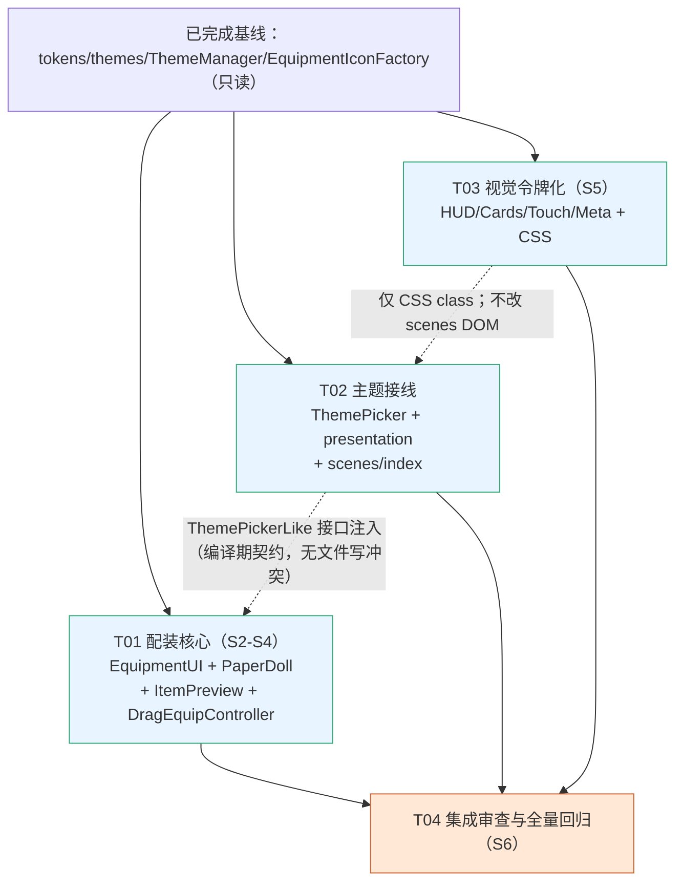
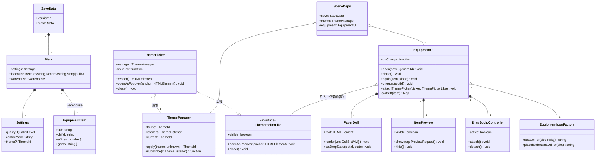

# 《无双》UI 重构架构设计与接口契约（ARCH_UI_REFACTOR）

> **文档性质**：增量架构设计，只覆盖 `docs/PRD_UI_REFACTOR.md`（已定稿）中 **S2~S6 剩余范围**。`S0`（令牌层 + 主题内核）、`S1`（CSS 拆分 + `EXTRA_CSS` 移除）、`EquipmentIconFactory`（13 槽程序化图标）**已完成且测试通过，本文不重 design、不重做**。
>
> **事实来源优先级**：`docs/PRD_UI_REFACTOR.md` 定稿版 > 本文 > 任何既有草稿。本文若与 PRD 冲突，以 PRD 为准并回写本文。
>
> **读者**：主理人（分批派工程师的依据）+ 工程师（实现契约）。**接口契约为冻结版本**：工程师按签名实现，不得自行改动；需要变更必须先通知架构师并经 team-lead 回写本文。

---

## 1. 实现方案总览

### 1.1 已完成基线（S0 / S1 / 图标工厂）——只读继承

| 已完成件 | 位置 | 状态 | 后续如何使用 |
| --- | --- | --- | --- |
| 主题 id 与可选存档字段 | `src/game/SaveData.ts`（`ThemeId`/`THEME_IDS`/`DEFAULT_THEME`/`settings.theme?`） | 冻结，只读 | 主题 UI 直接引用类型与常量，不重新定义 |
| 主题内核 | `src/ui/theme/ThemeManager.ts`（`resolveTheme`/`apply`/`subscribe`/`current`） | 冻结，只读 | **由接线任务创建唯一单例并调用 `apply`**（当前全工程无调用点，见 §1.4） |
| 令牌层 | `src/ui/styles/tokens.css`（`--ws-*`，`:root` = classic） | 冻结，只读 | 新样式一律 `var(--ws-*)`，零裸色值 |
| 主题覆盖 | `src/ui/styles/themes.css`（`[data-theme='ink'|'neon'|'sakura']`） | 可读，**仅主题任务可追加主题卡样式** | 主题卡组件样式写在此文件末尾（理由见 §5.2 写权矩阵） |
| 样式入口 | `src/ui/styles/index.css`（10 文件 @import） | 冻结，只读 | 视觉令牌化任务可改其「场景与面板通用层」裸色值；**不新增 @import** |
| 图标工厂 | `src/art/EquipmentIconFactory.ts`（`dataUrlFor`/`placeholderDataUrlFor`，13 槽 + 占位，带缓存） | 冻结，只读 | 纸娃娃/仓库/预览一律调用它取 data URL，**不得自己拼 SVG** |
| 样式拆分 | `src/registration/presentation.ts`（`EXTRA_CSS` 已删，仅留 `TOUCH_SAFE_AREA_CSS`） | 冻结，只读（接线任务除外，见 §5.2） | 保留 4 行常量原文，FC-4 断言零改动通过 |

### 1.2 S2~S6 分块策略

```
S2 配装核心（纸娃娃 + 仓库 + 详情试算）  ┐
S3 预览浮层 + 底部抽屉                    ├─ 全部写入 EquipmentUI.ts → 合并为同一任务 T01
S4 拖拽换装（桌面 + 移动长按）            ┘
主题接线（设置页主题区 + 配装快捷入口）  → 独立任务 T02（经接口注入与 T01 解耦）
S5 HUD / 魔盒 / 卡牌 / 结算视觉令牌化     → 独立任务 T03（纯 CSS + 局部 DOM class）
S6 集成审查与全量回归                     → 串行收尾任务 T04（依赖 T01/T02/T03）
```

**分块三原则**：
1. **同文件写权唯一**：凡写入 `src/ui/EquipmentUI.ts` 的模块（纸娃娃、仓库、详情、预览、拖拽）全部归入 T01，杜绝多工程师并发写同一文件。
2. **新文件独立可并行**：`PaperDoll.ts` / `ItemPreview.ts` / `DragEquipController.ts` / `ThemePicker.ts` 均为新增文件，各自职责单一；前三者由 T01 创建，后者由 T02 创建。
3. **接口先行解耦**：`ThemePickerLike`（§3.5）作为冻结接口由 T02 实现、T01 只依赖接口不依赖实现，使 T01 与 T02 可完全并行。

### 1.3 核心难点与方案

| 难点 | 方案 | 落地位置 |
| --- | --- | --- |
| 纸娃娃 13 槽锚点定位且不重叠 | 轮廓 SVG 一张（`pointer-events:none`）+ 13 个绝对定位 `<button.doll-slot>`；百分比坐标 + `translate(-50%,-50%)`；`--ws-slot-size:44px` 冻结热区 | `PaperDoll.ts` + `equipment.css` |
| 预览浮层不遮挡、不溢出 | 视口边界检测 + 四角翻转；浮层本体 `pointer-events:none`（仅按钮 `auto`）；hover 用 `setTimeout` 120ms（不读墙钟） | `ItemPreview.ts` |
| 移动端长按拖拽不误触滚动 | `pointerdown/move/up` + `setPointerCapture`；400ms `setTimeout`（**D-2 已拍板，禁 `Date.now`**）；8px 移动阈值判定为滚动并取消长按 | `DragEquipController.ts` |
| 主题 4 套全覆盖且零逻辑改动 | 接线期创建 `ThemeManager` 单例，`apply(save.meta.settings.theme)`；切主题只写 `documentElement.dataset.theme`，CSS 变量一帧重绘；写回 `settings.theme` 走既有 `SaveSystem.save()` | `presentation.ts` + `ThemePicker.ts` + `scenes/index.ts` |
| 并行任务零冲突 | 写权矩阵（§5.2）+ 接口冻结（§3）+ `ThemePickerLike` 依赖倒置 | 本文全局 |

### 1.4 现状缺口诊断（工程师务必知悉）

1. **主题内核"造好未接线"**：`grep -rn "new ThemeManager\|\.apply(" src/` 显示 `ThemeManager` 仅存在于自身与单测中，`presentation.ts` 未实例化、未 `apply`。因此当前 `data-theme` 从未被 JS 写入，存档里的 `settings.theme` 完全不生效。T02 必须补齐这条链路，且**启动时 `apply` 必须在 `app.start()` 之前、DOM 场景挂载之前**完成（否则首帧闪经典色）。
2. **配装页无换肤入口按钮**：需在 `EquipmentUI` 右上角新增 `.doll-theme-toggle`，通过 §3.5 注入的 `ThemePicker` 打开浮层。
3. **旧状态类残留**：`equipment.css` 仍是"4 列 `slot-grid` 文字按钮"样式（`§附录 A` 现状），T01 需替换为纸娃娃布局，但**保留 `.rarity-*` 由 components.css 拥有**的归属约定。

---

## 2. 文件清单

> 标记：**新增** / **修改** / **只读** / **严禁触碰**。路径相对 `C:/Project/WS/`。

### 2.1 T01 配装核心（S2~S4）

| 文件 | 职责 | 标记 |
| --- | --- | --- |
| `src/ui/EquipmentUI.ts` | 公共 API 冻结；渲染层重写；内部编排纸娃娃/仓库/详情/预览/拖拽；**保留 `statsOf`/`equip`/`unequip` 语义** | **修改** |
| `src/ui/PaperDoll.ts` | 纸娃娃视图：人形轮廓 SVG + 13 槽 `<button.doll-slot>`；纯渲染 + 槽位事件转发，不含装备写逻辑 | **新增** |
| `src/ui/ItemPreview.ts` | 只读预览浮层/底部抽屉；输入 `PreviewRequest`，输出纯 DOM；零副作用 | **新增** |
| `src/ui/DragEquipController.ts` | 指针拖拽 + 长按判定 + 落点高亮 + 取消无副作用；最终回调 `onEquip` | **新增** |
| `src/ui/styles/equipment.css` | 三栏/两栏/单栏响应式、纸娃娃锚点、槽位、仓库、详情、预览浮层、四态与禁用视觉 | **修改** |
| `src/art/EquipmentIconFactory.ts` | 13 槽图标 + 占位，只读复用 | 只读 |
| `src/data/equipment.ts` / `src/data/stats.ts` | `SLOT_DEFS`/`SET_DEFS`/`AFFIX_POOL`/`findStat`，只读 | 只读 |
| `src/ui/styles/components.css` | `.rarity-*` 等通用稀有度色归其所有，只读复用 | 只读 |

### 2.2 T02 主题接线

| 文件 | 职责 | 标记 |
| --- | --- | --- |
| `src/ui/theme/ThemePicker.ts` | 4 主题卡组件（设置页平铺 + 配装页浮层两用）；`role=radio`、`aria-checked`；迷你预览块 | **新增** |
| `src/ui/theme/ThemeManager.ts` | 内核已实现，只读复用（如需补 `dispose`、`subscribe` 已足够） | 只读 |
| `src/ui/theme/themePicker.css` | 主题卡网格与迷你预览样式；**由 `themes.css` 末尾追加或新建后由 T02 在 index.css 加 import**——见 §5.2 决策 | **新增**（可选） |
| `src/registration/presentation.ts` | 创建 ThemeManager 单例 → 启动 `apply` → 注入 `SceneDeps.theme` → 创建 ThemePicker → 接线 `equipment.attachThemePicker`；**`TOUCH_SAFE_AREA_CSS` 原文不动** | **修改** |
| `src/game/scenes/index.ts` | `SceneDeps` 加 `theme` 字段；`SettingsScene`「画质」上方加主题区；**保留全部 FC-3 选择器与文案** | **修改** |
| `src/game/SaveData.ts` | `settings.theme?` 已加，只读 | 只读 |

### 2.3 T03 视觉令牌化（S5）

| 文件 | 职责 | 标记 |
| --- | --- | --- |
| `src/ui/HUD.ts` | 仅调 class/结构包裹；`data-hud="battle"`、`.hud__value` 文本格式与前缀、经验条 width **一字不改** | **修改（受限）** |
| `src/ui/CardsAndLevelUp.ts` | `.card`/`.card-grid`/`.card__name` 等结构与文案保持，`pickChoices` 逻辑不动 | **修改（受限）** |
| `src/ui/TouchControls.ts` | DOM 结构与 pointer 行为完全保持；仅可选加装饰性 class | **修改（受限）** |
| `src/ui/MetaUI.ts` | 魔盒/宝石/排行仅视觉令牌化，无逻辑与选择器改动 | **修改（受限）** |
| `src/ui/styles/hud.css` / `cards.css` / `touch.css` / `meta.css` / `base.css` / `index.css` | 裸色值 → `var(--ws-*)`；移动端可滚容器 `touch-action:pan-y` + `overscroll-behavior:contain` | **修改** |
| `src/game/scenes/index.ts` 的结算面板样式 | 仅改 `index.css` 通用层（`.result-lines` 等），**不改 DOM 结构**以避免与 T02 冲突 | 经 CSS 间接 |

### 2.4 全局只读 / 严禁触碰

| 类别 | 文件 | 原因 |
| --- | --- | --- |
| **只读** | `src/main.ts`、`src/ui/styles/tokens.css`、`src/ui/styles/themes.css`（主题卡样式追加除外）、`src/art/Palette.ts`、`src/art/PortraitFactory.ts`、`src/core/Rng.ts` | 完成基线，复用不改 |
| **严禁触碰** | `src/ecs/**`、`src/data/**`（配置表数值）、`src/game/SaveSystem.ts`、`src/game/SaveData.ts` 的 `version` 与既有字段语义 | FC-1 / FC-2 |
| **严禁触碰** | `src/__tests__/**`、`src/ecs/__tests__/**`、`src/game/__tests__/**`、`src/data/__tests__/**`、`tests/e2e/**`（含 `helpers/hudProbe.ts`） | Q2/Q11 已拍板：既有测试零改动 |
| **严禁触碰** | `src/style.css` 中 `.hit-target, button, .hud button, .touch-control` 连续四选择器块及 `--ws-hit-min:44px`、`body/canvas/.touch-control{touch-action:none}`、两处 safe-area 规则 | FC-4，源码文本断言 |

---

## 3. 接口契约（CRITICAL — 并行实现的地基）

### 3.1 `EquipmentUI` 公共 API（签名冻结，任何任务不得改签名）

```ts
export class EquipmentUI {
  // —— 构造：签名不变，presentation.ts 已按 2 参数调用 ——
  constructor(host: HTMLElement, config: GameConfig);

  // —— 既有公共 API：全部保持，语义不变 ——
  get visible(): boolean;                       // 返回 !overlay.hidden
  open(save: SaveData, generalId: string): void; // 打开并渲染；整体替换 loadout
  close(): void;                                // 仅隐藏，不清数据
  equip(item: EquipmentItem, slotId: string): void; // 唯一性清理 + 写 loadout + onChange + render
  unequip(slotId: string): void;                // 槽位置 null + onChange + render
  onChange: ((save: SaveData) => void) | null;  // 存档写回由外部持有，UI 不 new SaveSystem
  unmount(): void;

  // —— 新增：主题快捷入口依赖注入（D-1 解耦关键）——
  attachThemePicker(picker: ThemePickerLike | null): void;
  //  语义：仅保存引用 + 在 header 创建/显示 .doll-theme-toggle 按钮；
  //  点击 → picker.openAsPopover(toggleButton)；picker 为 null 时不显示按钮。
  //  不 import ThemePicker 实现类，不 new SaveSystem，不碰 documentElement.dataset。
}
```

**保留 / 重写清单**：

| 类别 | 方法 | 要求 |
| --- | --- | --- |
| **保留（签名 + 算法均不变）** | `equip` / `unequip` / `visible` / `open` / `close` / `itemByUid` / `equippedUid` / `statsOf` / `formatStat` / `formatDelta` / `describeItem` | `statsOf` 是 NG-7 试算口径，一行不改；`equip` 唯一性语义（先清其它槽引用）不改 |
| **重写（渲染层）** | `render` / `renderDetail` | 从"两栏文字网格"改为纸娃娃 + 详情六区块；`statArea` 可改为 `detailRoot` 但私有 |
| **新增（私有）** | `renderInventory` / `applyFilter` / `applySort` / `renderSetPanel` / `renderPreviewFor` | 筛选纯 UI 态，不写存档 |
| **删除（私有）** | `foldButtons` 相关的 3 类折叠渲染逻辑由筛选器替代；`categoryFolded` 可保留作 P1 兼容或直接移除 | 不影响公共 API |

### 3.2 纸娃娃槽位数据契约

**13 槽 `data-slot` 值**：严格等于 `EQUIPMENT_SLOT_IDS`（`EquipmentIconFactory` 已导出），顺序与 `SLOT_DEFS` 一致：

```
head, shoulders, chest, bracers, gloves, belt, legs, boots,
amulet, ring1, ring2, mainHand, offHand
```

> PRD §3.3 ASCII 图中出现过 `bracelet(左腕)` 字样，为示意笔误；**以紧凑映射表为准，实现 id 为 `bracers`**。Q1 已拍板方案 A（双侧共享单槽），**不拆分槽位、不改配置表**。

**锚点坐标表**（相对人形容器百分比，`left/top` + `transform:translate(-50%,-50%)`；冻结实现依据 PRD §3.3）：

```ts
export interface DollAnchor { readonly left: number; readonly top: number; }

export const DOLL_SLOT_ANCHORS: Readonly<Record<EquipmentSlotId, DollAnchor>> = {
  head:      { left: 50, top: 2 },
  amulet:    { left: 50, top: 12 },
  shoulders: { left: 50, top: 19 },  // 双肩共用 1 槽
  chest:     { left: 50, top: 27 },
  bracers:   { left: 50, top: 38 },  // 双腕共用 1 槽
  belt:      { left: 50, top: 41 },
  gloves:    { left: 50, top: 47 },  // 双手共用 1 槽
  ring1:     { left: 30, top: 47 },
  ring2:     { left: 70, top: 47 },
  mainHand:  { left: 76, top: 52 },
  offHand:   { left: 24, top: 52 },
  legs:      { left: 50, top: 66 },  // 双腿共用 1 槽
  boots:     { left: 50, top: 84 },  // 双足共用 1 槽
};
```

**槽位视图模型**（`PaperDoll` 唯一输入，由 `EquipmentUI` 组装）：

```ts
export interface DollSlotVM {
  readonly slotId: EquipmentSlotId;      // → data-slot 属性
  readonly label: string;                // SLOT_DEFS.name，如「头盔」
  readonly anchor: DollAnchor;           // 查 DOLL_SLOT_ANCHORS
  readonly item: EquipmentItem | null;   // loadout[generalId][slotId] → warehouse 查找
  readonly iconUrl: string;              // item ? factory.dataUrlFor(slot, rarity) : factory.placeholderDataUrlFor(slot)
  readonly rarity: RarityId | null;      // item ? config.equipment.tryGet(item.defId)?.rarity : null
  readonly ariaLabel: string;            // `头盔：传奇·方天画戟` / `头盔：空`
  readonly dropState: 'idle' | 'compatible' | 'incompatible' | 'hover'; // 拖拽期注入
}

export interface PaperDoll {
  render(vm: readonly DollSlotVM[]): void;                  // 整体替换 13 槽，天然满足 US-01-6
  setDropState(slotId: EquipmentSlotId, s: DollSlotVM['dropState']): void; // 细粒度高亮，不整页重绘
  readonly root: HTMLElement;                               // .paper-doll 容器
  onSlotClick?: (slotId: EquipmentSlotId) => void;
  onSlotHover?: (slotId: EquipmentSlotId, el: HTMLElement) => void;
  destroy(): void;
}
```

**defId → 槽位映射**：只经 `config.equipment.tryGet(item.defId)?.slot`；脏 defId（查不到）→ `iconUrl` 用 `placeholderDataUrlFor(slot)`、`label` 显示「未知装备（defId）」灰色占位，不抛异常（US-04-6）。

### 3.3 预览浮层调用契约（只读、无副作用）

```ts
export interface StatDelta {
  readonly statId: string;
  readonly name: string;
  readonly delta: number;
  readonly tone: 'up' | 'down' | 'flat';  // delta>0 / <0 / ===0；0 必须显示（US-07-2）
}

export interface PreviewRequest {
  readonly item: EquipmentItem;
  readonly slotId: EquipmentSlotId;
  readonly trigger: HTMLElement;                  // 悬停/点击的源元素，用于定位与关闭后焦点归还
  readonly mode: 'hover' | 'drawer';              // 桌面悬停 / 移动或键盘底部抽屉
  readonly pointer?: { readonly x: number; readonly y: number }; // hover 模式视口坐标
  readonly deltas: readonly StatDelta[];          // 由 EquipmentUI.statsOf 前后差值提供，同源同算法
  readonly occupiedIn?: string;                   // 已装备槽名提示，如「已装备在：头盔」
}

export interface ItemPreview {
  show(req: PreviewRequest): void;   // hover 模式内部 setTimeout 120ms 后显示（零墙钟）
  hide(): void;                      // Esc / 外部点击 / pointerleave → 仅隐藏，绝写装备状态
  readonly visible: boolean;
  destroy(): void;
}
```

**硬约束**：
- `show()` **不得**调用 `equip()` / `unequip()` / `onChange` / `saveSystem`；抽屉里的「装备到此槽」按钮由 `EquipmentUI` 在抽屉外挂回调（T01 负责），`ItemPreview` 只发 `onEquipRequest` 事件（若采用回调注入：`onEquipRequest?: (item, slotId) => void`，`ItemPreview` 只调用不实现）。
- **边缘翻转**：以 `getBoundingClientRect()` 检测视口右/下边界，溢出则把 `left` 改为 `translateX(-100%)` 侧、`top` 翻到上方；`--ws-preview-width:320px`。四角均完整可见（A-8）。
- **不遮挡触发元素**：浮层 `pointer-events:none`，仅内部可点按钮 `pointer-events:auto`；定位偏移 `--ws-space-3`。
- **抽屉切换判据**：`matchMedia('(hover: none)').matches` 或 `pointerType === 'touch'` → `mode='drawer'`；否则 `hover`。键盘 `Enter`/`Space` 聚焦条目 → `mode='drawer'`（US-03-6）。
- **关闭顺序**：`Esc` 由 `EquipmentUI` 顶层监听统一调度：预览 → 抽屉 → 配装界面（US-08-4），`ItemPreview.hide()` 只负责第一层。

### 3.4 拖拽换装调用契约（零存档写入直到落点确认）

```ts
export const LONG_PRESS_MS = 400;      // D-2：setTimeout，禁 Date.now/performance.now
export const MOVE_THRESHOLD_PX = 8;    // 超过即判为滚动，取消长按

export interface DragSourceVM {
  readonly uid: string;
  readonly slotId: EquipmentSlotId;     // 该装备的目标槽（def.slot）
  readonly label: string;               // describeItem(item)
  readonly iconUrl: string;
}

export interface DragEquipController {
  attach(): void;                       // 在 root 上委托监听 pointerdown/move/up/cancel
  detach(): void;                       // 清 timer、releasePointerCapture、移 ghost、清高亮
  readonly active: boolean;
}

export interface DragEquipOptions {
  readonly root: HTMLElement;                         // .equip-columns 容器
  readonly sources: () => readonly DragSourceVM[];    // 动态取当前筛选后的仓库条目
  readonly isCompatible: (uid: string, target: EquipmentSlotId) => boolean; // def.slot === target
  readonly onDragState: (state: { dragging: boolean; uid: string | null; over: EquipmentSlotId | null }) => void;
  readonly onEquip: (uid: string, target: EquipmentSlotId) => void; // → EquipmentUI.equip(item, target)
  readonly canLongPress?: () => boolean;              // 移动端由 pointerType 决定
}
```

**事件时序（冻结）**：
1. `pointerdown`：`setPointerCapture(e.pointerId)`（与 `TouchControls` 同套路，多指安全）；记录起点；若 `pointerType !== 'mouse'`，`setTimeout(LONG_PRESS_MS)` 启动长按；**不触发 click 选中**（US-03-5）。
2. `pointermove`：位移 > `MOVE_THRESHOLD_PX` → 若长按未到时则**取消 timer 并视为滚动**（US-03-5 / R-11）；若已在拖拽则移动幽灵镜像 + 用 `document.elementFromPoint` 找 `.doll-slot[data-slot]` → `onDragState` 高亮兼容槽、压暗不兼容槽。
3. `pointerup`：
   - 落点是兼容槽 → `onEquip(uid, slot)`（内部走既有 `equip()` 唯一性清理 + `onChange` 存档写入）；
   - 其它区域 → **取消**：仅清理视觉状态，**零 `onChange`、零存档写入**（US-03-3 / A-9）。
4. `pointercancel` / `detach`：同取消路径。
5. 长按时长用 `setTimeout` 计数，**不得** `Date.now()` / `performance.now()`（FC-5.2 / R-14）。

### 3.5 主题 UI 接线契约（单例归属 + 两入口复用 + 启动落点）

**单例归属**：`ThemeManager` 的**唯一实例在 `src/registration/presentation.ts` 的 `register(app)` 中创建**，随 `SceneDeps` 注入给场景与配装页；任何组件不得自行 `new ThemeManager()`。理由：单帧内所有订阅者收到同一通知，且便于存档写回集中处理。

```ts
// —— presentation.ts（register 内，创建时机：load() 之后、创建 UI 之前、app.start() 之前）——
const saveSystem = new SaveSystem();
const save = saveSystem.load();
const theme = new ThemeManager();
theme.apply(save.meta.settings.theme);        // 启动 apply：首帧即为存档主题（US-05-3/4）

const picker = new ThemePicker({
  manager: theme,
  onSelect: (id: ThemeId) => {
    const resolved = theme.apply(id);          // 即时换色（≤1 帧，DOM 不重建）
    save.meta.settings.theme = resolved;       // 写回可选字段
    if (!saveSystem.save(save)) { /* 用 saveSystem.lastError 走 US-10-2 错误条 */ }
  },
});
// 注入场景与配装页
deps.theme = theme;
equipment.attachThemePicker(picker);
```

```ts
// —— 冻结接口：ThemePickerLike（T01 依赖它，T02 实现它）——
export interface ThemePickerLike {
  openAsPopover(anchor: HTMLElement): void;    // 配装页快捷入口：就地浮层，不跳场景（US-05-5）
  close(): void;
  readonly visible: boolean;
}
export interface ThemePicker extends ThemePickerLike {
  constructor(opts: {
    manager: ThemeManager;
    onSelect?: (id: ThemeId) => void;          // 外部持久化钩子；组件本身不碰存档
  });
  render(): HTMLElement;                       // 返回 .theme-picker 根节点（设置页平铺用）
  destroy(): void;
}
```

**设置页落点**（`SettingsScene`，`scenes/index.ts`）：在「画质」`setting-row` **之前**插入主题区——4 张 `button[data-theme-id]`（值为 `THEME_IDS`），每张含用 `var(--ws-*)` 现场渲染的迷你预览块；当前主题加 `is-active` + `aria-checked="true"` + `role="radio"`；点击 → `deps.theme.apply(id)` + `opts.onSelect(id)`（写回存档）。**必须复用同一个 `ThemePicker.render()`，不在设置页重写一遍主题卡**（US-05-1 / D-1）。

**写回契约**：`save.meta.settings.theme` 为可选字段；写回后 `saveSystem.save()` 走既有 2000ms 节流；`SaveSystem` 内部版本/容量/损坏逻辑一行不改（FC-2）。旧档无 `theme` → `resolveTheme(undefined)` → `'classic'`；非法值 → `'classic'`（US-05-4 / A-6）。

**主题生效范围自检**：场景/HUD/配装/魔盒/卡牌/触屏控件/`#app` 背景全由 `var(--ws-*)` 驱动；**Pixi 战场实体配色不随主题变**（NG 延伸 / Q5 方案 A）。

### 3.6 模块级事件与数据流（零 ECS 直连）

```
读路径（全部只读）：
  SaveData.meta.loadouts[generalId][slotId] ─┐
  SaveData.meta.warehouse.items ─────────────┼─► EquipmentUI ─► DollSlotVM[] ─► PaperDoll ─► DOM
  config.equipment / gems / generals ────────┤            └─► PreviewRequest ─► ItemPreview
  EquipmentIconFactory.dataUrlFor ───────────┘            └─► DragSourceVM[] ─► DragController
                                                                    │
写路径（唯一出口）：                                                ▼ onEquip(uid, slot)
  DragEquipController / ItemPreview.onEquipRequest / 详情按钮 ──► EquipmentUI.equip()
      ──► 改 save.meta.loadouts ──► onChange(save) ──► presentation.ts: saveSystem.save(save)
      ──► render()（整体重绘纸娃娃 + 仓库 + 详情）

主题路径：
  ThemePicker ──► theme.apply(id) ──► document.documentElement.dataset.theme ──► CSS 变量重绘（≤1 帧）
              └─► onSelect(id) ──► save.meta.settings.theme = id ──► onChange → saveSystem.save()
```

**红线**：`src/ui/**` 与新增 UI 文件不得 `import { has, query, ... } from '../ecs/bit/adapter'` 或 `from 'bitecs'`；HUD 是既有特例（已白名单化读 ECS 组件用于血量，FC-1 保持现状，T03 不新增此类读取）。

---

## 4. 依赖图（Mermaid）

### 4.1 模块级依赖与并行性



**并行结论**：T01 / T02 / T03 三者**可同时派 3 个工程师**（主理人上限即 3）；T04 必须等三者全绿后串行。T02→T01 的虚线只是"T01 按已冻结的 `ThemePickerLike` 签名调用"，T01 工程师**无需等待** T02 交付即可编码（TS 编译时接口可见即可）。

### 4.2 类图（数据模型 + 服务类）

见 `docs/ui-refactor-class-diagram.mermaid`（同步内嵌于 §7 附录）。核心关系：`EquipmentUI` 组合 `PaperDoll`/`ItemPreview`/`DragEquipController`/`EquipmentIconFactory`，依赖 `SaveData`（读）、`GameConfig`（读）；`ThemePicker` 依赖 `ThemeManager`，二者由 `presentation.ts` 装配。

### 4.3 关键时序

见 `docs/ui-refactor-sequence-diagram.mermaid`。覆盖四条主链路：①启动主题 apply；②主题切换写回；③悬停预览与抽屉；④拖拽换装（含移动长按与取消无副作用）。

---

## 5. 任务列表（有序，含依赖与验收锚点）

> 粒度原则：可并行的模块拆独立任务；有文件写冲突的合并。任务编号对应主理人已建的团队任务 #2/#3/#4/#5。

### T01 — 配装界面核心重构（S2~S4）

- **团队任务映射**：#2
- **优先级**：P0
- **依赖**：已完成基线（无其它任务依赖）
- **源文件**：`src/ui/EquipmentUI.ts`（改）、`src/ui/PaperDoll.ts`（新）、`src/ui/ItemPreview.ts`（新）、`src/ui/DragEquipController.ts`（新）、`src/ui/styles/equipment.css`（改）
- **实现范围**：纸娃娃 13 槽 + 空状态 + 响应式（S2）；仓库筛选/排序/计数 + 详情六区块 + 套装进度（S3）；桌面预览浮层 + 移动抽屉 + 拖拽换装 + 长按（S4）；四态与禁用视觉
- **接口约束**：§3.1 公共 API 冻结；§3.2/§3.3/§3.4 数据契约；§3.5 只依赖 `ThemePickerLike`
- **验收锚点**：US-01-1..6、US-02-1..5、US-03-1..6、US-04-1..6、US-06-1..4、US-07-1..4、US-08-1..6、US-10-1..4、A-7、A-8、A-9、A-11、A-14
- **完成判据**：`npm test -- --run` 162 项全绿；静态自查 grep 零命中；1280×720 与 390×844 目视槽位无重叠

### T02 — 主题 UI 接线与快捷换肤

- **团队任务映射**：#3
- **优先级**：P0
- **依赖**：已完成基线；与 T01 并行（靠 `ThemePickerLike` 解耦）
- **源文件**：`src/ui/theme/ThemePicker.ts`（新）、可选 `src/ui/theme/themePicker.css`（见写权决策 §5.2）、`src/registration/presentation.ts`（改）、`src/game/scenes/index.ts`（改）
- **实现范围**：启动 apply + 单例归属 + 4 主题卡（含迷你预览）+ 设置页主题区 + 配装页快捷入口浮层 + 存档写回 + 错误条
- **接口约束**：§3.5 全量；`TOUCH_SAFE_AREA_CSS` 原文不动；FC-3 设置页选择器与文案保持
- **验收锚点**：US-05-1..6、US-10-2、US-10-4、A-3、A-5、A-6、A-13
- **完成判据**：切主题 ≤1 帧、刷新保持、旧档回退 classic；`grep -n "EXTRA_CSS" src/registration/presentation.ts` 无结果；`mobileTouch.test.ts` 零改动通过

### T03 — HUD / 魔盒 / 卡牌 / 结算视觉令牌化（S5）

- **团队任务映射**：#4
- **优先级**：P1
- **依赖**：已完成基线；与 T01/T02 并行
- **源文件**：`src/ui/HUD.ts`、`src/ui/CardsAndLevelUp.ts`、`src/ui/TouchControls.ts`、`src/ui/MetaUI.ts`（均受限修改）；`src/ui/styles/{hud,cards,touch,meta,base,index}.css`（改）
- **实现范围**：裸色值→令牌变量；可滚容器 `touch-action:pan-y`；四态/焦点环/reduced-motion；结算与场景通用层令牌化
- **接口约束**：FC-3 选择器与文案格式**逐字保持**；不新增 ECS 读取；不改 `pickChoices` 数值逻辑
- **验收锚点**：US-08-1、US-08-5、US-09-2、US-09-3、US-09-4、A-10、A-12
- **完成判据**：4 主题下无残留裸色；e2e `hudProbe` 数值解析不破；`git diff` 零 `src/ecs/**`、`src/data/**`

### T04 — 集成审查与全量回归（S6）

- **团队任务映射**：#5
- **优先级**：P0
- **依赖**：T01 ∧ T02 ∧ T03 全部完成
- **源文件**：仅产出审查报告（不改实现代码，除非修复跨任务集成缺陷）
- **实现范围**：`npm test -- --run`、`npm run build` + `vite preview`、4 个 e2e spec、FC-1~FC-5 对照表、A-1~A-14 勾选、静态 grep 自查
- **验收锚点**：A-1..A-14 全通过
- **完成判据**：零新增失败、零跳过；FC-3 选择器对照表逐项"一致"

### 5.2 写权矩阵（防冲突关键）

| 文件 | T01 | T02 | T03 | 说明 |
| --- | --- | --- | --- | --- |
| `EquipmentUI.ts` | ✏️ | ❌（仅通过接口调用） | ❌ | 唯一写者 T01 |
| `PaperDoll/ItemPreview/DragEquipController.ts` | ✏️ | ❌ | ❌ | 新建即归属 |
| `ThemePicker.ts` / `themePicker.css` | ❌ | ✏️ | ❌ | 新建即归属 |
| `presentation.ts` | ❌ | ✏️ | ❌ | T02 唯一写者（保留 TOUCH_SAFE_AREA_CSS 原文） |
| `scenes/index.ts` | ❌ | ✏️ | ❌ | T02 唯一写者；T03 只改 CSS 不改此文件 |
| `equipment.css` | ✏️ | ❌ | ❌ | 配装样式专属 |
| `hud/cards/touch/meta/base.css` | ❌ | ❌ | ✏️ | 令牌化专属 |
| `themes.css` | ❌ | ✏️（仅末尾追加主题卡样式） | ❌ | **决策**：主题卡样式追加到 `themes.css` 末尾，**不新建 CSS、不改 `index.css`**，避免与 T03 改 `index.css` 冲突；主题卡与主题变量同源，归属合理 |
| 全部既有测试 / `tests/e2e/**` | ❌ | ❌ | ❌ | 冻结 |

---

## 6. 共享知识（跨文件约定）

### 6.1 CSS 与 DOM 命名

- **类名前缀**：配装私有组件用语义类 `.doll-*` / `.item-preview` / `.inventory-*` / `.equip-detail` / `.theme-picker`；通用状态沿用冻结类名 `.is-selected` / `.is-active` / `.is-disabled` / `.is-loading` / `.is-empty` / `.is-error`（PRD §4.4），**不得新造同义类**。
- **`data-*` 约定**：槽位 `data-slot="<slotId>"`（13 值见 §3.2）；仓库条目 `data-uid="<item.uid>"`；主题卡 `data-theme-id="<ThemeId>"`；拖拽源 `data-drag-uid`。**全部小写连字符**，值用枚举常量不用硬编码。
- **令牌变量**：一律 `--ws-*`，命名 `--ws-<类别>-<语义>-<变体>`；新样式只用 `var(--ws-*)`，裸色值/裸尺寸仅允许在 `tokens.css`/`themes.css`。常用：`--ws-hit-min:44px`（冻结）`--ws-doll-size` `--ws-slot-size` `--ws-preview-width` `--ws-drawer-max-height` `--ws-space-*` `--ws-radius-*` `--ws-dur-*` `--ws-z-*`。
- **焦点与命中**：所有可聚焦元素 `:focus-visible` 轮廓 ≥2px 用 `var(--ws-focus-ring)`；槽位热区 ≥44px（视觉图标可小，透明 padding 扩展）；浮层关闭按钮 ≥44px。

### 6.2 确定性与静态审查红线（FC-5）

- 新增 UI 文件 **零 `Math.random(`**、**零 `Date.now(`/`performance.now(`**、**零 `from 'bitecs'`（单双引号皆然）**。
- 图标/轮廓/预览配色全部走 `EquipmentIconFactory` 或 `hash32` 派生 / 查表；同一 `(slotId, defId, themeId)` 连续渲染 3 次 data URL 逐字节相同（A-14）。
- 长按 400ms 用 `setTimeout`（D-2），浮层延迟 120ms 用 `setTimeout`；**不改** `hardConstraints.test.ts` 白名单。
- UI 读数据只经 `SaveData` / `GameConfig(Registry)` / `EquipmentIconFactory`；写数据只经 `onChange(save)` 回调。
- 提交前自查命令（PRD §9.3，期望零命中）：

```bash
grep -rnE "Math\.random\(|Date\.now\(|performance\.now\(|from ['\"]bitecs['\"]" \
  src/ui src/art src/game --exclude=HUD.ts --exclude=SaveSystem.ts --exclude=index.ts
```

### 6.3 FC-3 选择器保护清单（改前对照，逐字保留）

| 归属 | 必须保留 |
| --- | --- |
| 场景 | `.scene--boot/.scene--menu/.scene--select/.scene--result/.scene--settings`；`.boot-title`(文本"无双") `.boot-enter` `.menu-title`(文本"无双")；`.menu-panel button.primary`(文本"开始征战")；`.select-panel button.primary` |
| 选将 | `.general-grid .general-card`(≥40) `.general-name` `.general-portrait`(src 必须 `data:image/svg+xml` data URL)；`.hint`(含"已选：") |
| HUD | `.hud[data-hud="battle"]`；`.hud .hud__value`（前缀"击杀"/"积分"/"Lv."且数字可解析；HP `123 / 456`；时间 `01:23`）；`.hud__bar-fill--exp`(style.width 百分比) |
| 触控 | `.touch-controls` `.joystick.touch-control` `.skill-button.touch-control`(4) `.skill-button[data-skill]`(0..2) `.touch-control__auto` `.joystick__knob`；`.touch-control` `min-*`≥44、`touch-action:none`；根初始 `display:none` |
| 卡牌 | `.card` `.card-grid` `.card__name` `.card__desc` `.card__level` `.card__tags`；`.overlay.ws-levelup` |
| 结算 | `.result-panel` `.result-lines`(含"积分/击杀/等级/时长"，时长格式"时长 123 s") `.result-panel button` |
| 设置 | `.settings-panel .setting-row` `.setting-label` `.chip` `.is-active` `.settings-panel button.primary`("返回主菜单") |

### 6.4 FC-4 `style.css` / `presentation.ts` 文本断言保护

- `style.css` 保留 `--ws-hit-min:44px`；保留连续四选择器块 `.hit-target, button, .hud button, .touch-control { … min-width:var(--ws-hit-min); … min-height:var(--ws-hit-min); }`（顺序与分组不可变）；`.hud{…env(safe-area-inset-top)`、`.overlay{…env(safe-area-inset-`；`body/canvas/.touch-control{touch-action:none}`。
- `presentation.ts` 保留 `TOUCH_SAFE_AREA_CSS` 两条规则原文（`.touch-controls .joystick{...env(safe-area-inset-left...}` 与 `.touch-controls .skill-cluster{...env(safe-area-inset-right...}`），`EXTRA_CSS` 字样不得出现。

---

## 7. 风险与待明确事项（结合 PRD §9，附建议方案）

| 风险 | 触发信号 | 规避方式（本文明确建议） |
| --- | --- | --- |
| **R-1** CSS 拆分打破文本断言 | `mobileTouch.test.ts` 红 | 已完成基线处理；T02 接线时**只追加** `ThemePicker` 接线代码，不碰 `TOUCH_SAFE_AREA_CSS` 原文；改完先跑该单测 |
| **R-2** e2e 选择器被"优化"掉 | e2e locator 超时 | §6.3 清单贴进每个 PR 描述；T03 只加 class 不删 class；T02 设置页主题区插在「画质」前不改动既有行 |
| **R-3** 全局 `touch-action:none` 让仓库滚不动 | 真机列表卡死 | `equipment.css` 为 `.inventory-list`/`.equip-detail` 显式 `touch-action:pan-y` + `overscroll-behavior:contain` |
| **R-4** 主题遗漏硬编码色 | 切主题后某元素原色 | T03 用 `grep -rnE '#[0-9a-fA-F]{3,8}' src/ui/styles --exclude=tokens.css --exclude=themes.css` 应零命中；`index.css` 通用层裸色一并令牌化 |
| **R-5** 旧档读取报错 | 旧档主题空白 | `theme?` 可选 + `resolveTheme()` 归一化（内核已实现）；T02 不得在 `SaveSystem.load()` 加版本逻辑 |
| **R-6/R-8** 锚点重叠/浮层遮挡 | 小屏截图溢出 | 百分比锚点 + `translate(-50%,-50%)`；320/390/420px 三档断点；浮层 `pointer-events:none` + 四角翻转（§3.3） |
| **R-7/R-11** 拖拽 PointerEvent 兼容与误触 | 移动端无响应/误换装 | `setPointerCapture` 多指；8px 阈值判滚动；400ms `setTimeout`；未达阈值绝不调 `onEquip` |
| **R-12** 浅色主题对比度不足 | ink/sakura 文字发飘 | 内核已在 `themes.css` 为浅底重定义阴影/边框/面板/暗角；主题卡迷你预览也用 `var(--ws-*)`，禁止写死深色底 |
| **R-13/R-14/R-15** 静态审查红 | `hardConstraints.test.ts` 第 6 组失败 | §6.2 自查命令；拖拽长按是 `Date.now` 高发点，务必用 `setTimeout` |
| **R-16** `presentation.ts` 残留样式 | 代码审查发现大段 CSS | 只保留 `TOUCH_SAFE_AREA_CSS` 4 行；T02 新增代码全为装配逻辑 |

**待明确事项（本文已给建议，不悬而不决）**：

1. **主题卡 CSS 落点**：建议追加到 `themes.css` 末尾、不新建 CSS 文件、不改 `index.css`——避免与 T03 写 `index.css` 冲突；主题卡与主题变量同源，归属合理。
2. **`ThemePicker` 与 `EquipmentUI` 的接线时机**：建议 T02 在 `presentation.ts` 内 `equipment.attachThemePicker(picker)`，T01 只实现 `attachThemePicker` 的空壳与按钮，二者并行不互等。若 T02 先交付，T01 可按 §3.5 接口直接联调。
3. **仓库 200 件性能**：建议用 `content-visibility:auto`（Q9 方案 A）而非虚拟滚动库；图标由 `EquipmentIconFactory` 缓存（已实现），不在组件内重复生成 SVG。
4. **存档失败错误条（US-10-2）**：建议 T02 在 `onSelect` 写回失败时读 `saveSystem.lastError`，用 `components.css` 的 `.error-bar`（已定义风格）在设置页主题区上方显示，不新增存档逻辑。

---

## 附录：类图与时序图（内嵌）

### 类图



### 时序图

```mermaid
sequenceDiagram
    participant U as 玩家
    participant P as presentation.ts
    participant T as ThemeManager
    participant TP as ThemePicker
    participant E as EquipmentUI
    participant D as PaperDoll/Drag/Preview
    participant S as SaveSystem

    Note over P,S: ① 启动（app.start 之前）
    P->>S: load()
    S-->>P: save
    P->>T: new ThemeManager() + apply(save.settings.theme)
    T->>T: documentElement.dataset.theme = resolved
    P->>TP: new ThemePicker({manager, onSelect})
    P->>E: attachThemePicker(picker)

    Note over U,S: ② 主题切换（设置页或配装快捷入口）
    U->>TP: 点击主题卡[data-theme-id]
    TP->>T: apply(id)
    T->>T: 写 data-theme（≤1 帧重绘，DOM 不重建）
    TP->>P: onSelect(id)
    P->>S: save.settings.theme = resolved; save(save)

    Note over U,D: ③ 悬停预览 / 移动抽屉（只读）
    U->>E: hover 仓库条目 / 点击条目
    E->>D: ItemPreview.show({item, deltas, mode})
    D-->>U: 浮层（边缘翻转）或底部抽屉
    U->>D: Esc / 点击外部
    D->>D: hide()（零存档写入）

    Note over U,S: ④ 拖拽换装（含移动长按）
    U->>D: pointerdown（setPointerCapture）
    opt 触屏
        D->>D: setTimeout(400ms) 启动长按
    end
    U->>D: pointermove（>8px 判滚动并取消长按 / 移动幽灵）
    D->>D: elementFromPoint 找 .doll-slot → 兼容高亮
    U->>D: pointerup
    alt 落点为兼容槽
        D->>E: onEquip(uid, slot)
        E->>E: equip() 唯一性清理 + loadouts 写入
        E->>P: onChange(save)
        P->>S: save(save)
        E->>D: render() 整体重绘
    else 落点非槽位
        D->>D: 取消（clearTimeout + 清高亮，零存档写入）
    end
```

> 同步副本：`docs/ui-refactor-class-diagram.mermaid`、`docs/ui-refactor-sequence-diagram.mermaid`。

---

*本文为 S2~S6 的冻结契约。工程师实现时如遇未覆盖的细节，按 PRD 定稿推断并在交付说明中标注，由架构师回写本文。*
